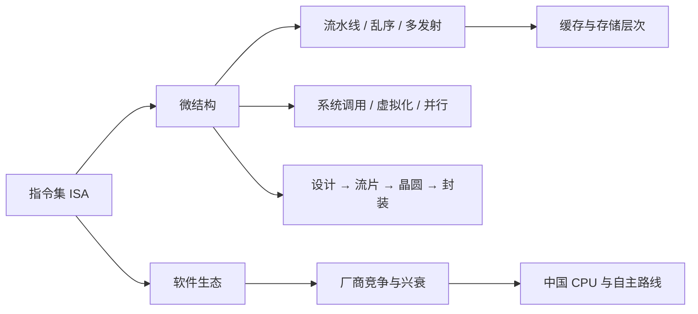

# 《CPU 通识课》点化学习系统

## 这本书在讲什么

靳国杰、张戈写的这本书，想回答一个看似朴素的问题：一台机器里那块小小的芯片，到底是什么，为什么它成了信息社会的底座。

全书的论证有三条主线。第一条是技术线：从指令集到微结构，从流水线到缓存，从设计到流片，把 CPU 从概念一路拆到晶体管。第二条是产业线：Intel 靠兼容赢、ARM 靠授权赢、日本靠制造输、中国正在补课，说明芯片的胜负从来不只是技术。第三条是判断线：作者反复用同一把尺子量事情——不是看单项指标多漂亮，而是看产品能不能被用户用起来、生态能不能正循环。

读完之后该拿到的东西，不是记住几十个型号，而是三样：能看懂一颗 CPU 的关键参数在说什么；能判断一条芯片新闻背后的产业逻辑；能说清「自主」这两个字在 CPU 领域到底难在哪。

## 全书心智模型

看图说明：左边一条是「怎么算」，右边一条是「凭什么活」。两条在指令集处交汇——ISA 既是电路的起点，也是生态的边界。全书八篇就是沿着这两条线往上走，最后在中国 CPU 这一篇合流。

## 学习路径（推荐顺序）

| 步骤 | 章节 | 主题 | 前置 | 检查点 |
|---|---|---|---|---|
| 01 | 第 1—3 章 | 概览篇：CPU 是什么 | 无 | 该篇各章自测题正确率 ≥ 80% |
| 02 | 第 4—10 章 | 术语篇：CPU 的语汇 | 步骤 01 | 该篇各章自测题正确率 ≥ 80% |
| 03 | 第 11—18 章 | 原理篇：CPU 怎么算 | 步骤 02 | 该篇各章自测题正确率 ≥ 80% |
| 04 | 第 19—23 章 | 系统篇：CPU 怎么和世界打交道 | 步骤 03 | 该篇各章自测题正确率 ≥ 80% |
| 05 | 第 24—28 章 | 生产制造篇：CPU 怎么被造出来 | 步骤 04 | 该篇各章自测题正确率 ≥ 80% |
| 06 | 第 29—31 章 | 家族篇：谁做过 CPU | 步骤 05 | 该篇各章自测题正确率 ≥ 80% |
| 07 | 第 32—34 章 | 生态篇：为什么生态比芯片难 | 步骤 06 | 该篇各章自测题正确率 ≥ 80% |
| 08 | 第 35—38 章 | 中国 CPU 篇：我们走到了哪 | 步骤 07 | 该篇各章自测题正确率 ≥ 80% |

每一步的读法：先读该篇第一章的「一句话核心」，再顺读；每章末尾的自测题当场做，错了就回头读对应小节，不要攒着。原理篇（步骤 03）如果卡住，允许先跳到系统篇建立整体印象，再回来补——但流水线与缓存两章不能跳，它们是后面所有性能讨论的地基。

## 章节索引

- 第 1 章 CPU 是什么，为什么它是信息社会的基石（难度 ★☆☆，约 0.5 小时）→ `chapters/c01-cpu-shenme.md`
- 第 2 章 怎么衡量一颗 CPU 的好坏（难度 ★★☆，约 0.7 小时）→ `chapters/c02-cpu-xingneng.md`
- 第 3 章 普通人也能学懂 CPU（难度 ★☆☆，约 0.4 小时）→ `chapters/c03-renren-ke-xue.md`
- 第 4 章 指令集——计算机的语言（难度 ★★☆，约 0.8 小时）→ `chapters/c04-zhilingji.md`
- 第 5 章 精简指令集与汇编语言（难度 ★★☆，约 0.8 小时）→ `chapters/c05-risc-huibian.md`
- 第 6 章 做 CPU 就是做微结构（难度 ★★☆，约 0.6 小时）→ `chapters/c06-weijiegou.md`
- 第 7 章 功耗从哪里来（难度 ★★☆，约 0.5 小时）→ `chapters/c07-gonghao.md`
- 第 8 章 摩尔定律与它的黄昏（难度 ★★☆，约 0.6 小时）→ `chapters/c08-moer.md`
- 第 9 章 通用还是专用（难度 ★★☆，约 0.6 小时）→ `chapters/c09-tongyong-zhuanyong.md`
- 第 10 章 后门与漏洞——芯片里的幽灵（难度 ★★★，约 0.8 小时）→ `chapters/c10-houmen-loudong.md`
- 第 11 章 理论基石——布尔代数与数字电路（难度 ★★☆，约 0.7 小时）→ `chapters/c11-lilun-jishi.md`
- 第 12 章 EDA——在电脑里先把 CPU 造一遍（难度 ★★☆，约 0.6 小时）→ `chapters/c12-eda.md`
- 第 13 章 二进制——从开关到数字（难度 ★★☆，约 0.8 小时）→ `chapters/c13-erjinzhi.md`
- 第 14 章 CPU 的天职——数值运算（难度 ★★☆，约 0.6 小时）→ `chapters/c14-shuzhi-yunsuan.md`
- 第 15 章 流水线的奥秘（难度 ★★★，约 0.7 小时）→ `chapters/c15-liushuixian.md`
- 第 16 章 乱序执行与多发射——把流水线喂饱（难度 ★★★，约 0.9 小时）→ `chapters/c16-luanxu-duofa.md`
- 第 17 章 内存、缓存与虚拟内存（难度 ★★☆，约 0.7 小时）→ `chapters/c17-neicun-huancun.md`
- 第 18 章 CPU 的"外交"——特权级、中断与 I/O（难度 ★★☆，约 0.6 小时）→ `chapters/c18-waijiao.md`
- 第 19 章 系统调用——应用与操作系统之间的桥（难度 ★★☆，约 0.5 小时）→ `chapters/c19-xitong-diaoyong.md`
- 第 20 章 专用指令——向量与加密（难度 ★★☆，约 0.5 小时）→ `chapters/c20-zhuanyong-zhiling.md`
- 第 21 章 虚拟化与可信计算——一台机器当几台用，也只信该信的（难度 ★★★，约 0.7 小时）→ `chapters/c21-xunihua-kexin.md`
- 第 22 章 并行——多核、多路、多线程与 Amdahl 定律（难度 ★★★，约 0.8 小时）→ `chapters/c22-bingxing.md`
- 第 23 章 从 CPU 到计算机——总线、主板与 BIOS（难度 ★★☆，约 0.7 小时）→ `chapters/c23-zongxian-zhuban.md`
- 第 24 章 化设计为实物——设计公司与流片厂（难度 ★★☆，约 0.5 小时）→ `chapters/c24-sheji-shiti.md`
- 第 25 章 从沙子到晶圆（难度 ★★☆，约 0.7 小时）→ `chapters/c25-guiyuanpian.md`
- 第 26 章 模拟与数字元器件——世界只有几种积木（难度 ★★☆，约 0.7 小时）→ `chapters/c26-monishuzi-qijian.md`
- 第 27 章 版图、制造设备与成本（难度 ★★☆，约 0.6 小时）→ `chapters/c27-banTu-chengben.md`
- 第 28 章 不流片也能做 CPU——FPGA 与模拟器（难度 ★★☆，约 0.5 小时）→ `chapters/c28-fpga-moniqi.md`
- 第 29 章 从上古到战国——CPU 家族简史（难度 ★★☆，约 0.6 小时）→ `chapters/c29-cpu-jianshi.md`
- 第 30 章 巨头寻踪——Intel、AMD、ARM、苹果、IBM（难度 ★★☆，约 0.7 小时）→ `chapters/c30-jutou-xunzong.md`
- 第 31 章 小而坚强与世界边缘——MIPS、RISC-V 与各国 CPU 之路（难度 ★★☆，约 0.6 小时）→ `chapters/c31-mips-riscv-shijie.md`
- 第 32 章 生态之重——CPU 的价值不在 CPU（难度 ★★☆，约 0.6 小时）→ `chapters/c32-shengtai-zhizhong.md`
- 第 33 章 开发者的号角与解决方案为王（难度 ★★☆，约 0.7 小时）→ `chapters/c33-kaifazhe-fangan.md`
- 第 34 章 生态的优点与方向——开放、兼容、优化（难度 ★★☆，约 0.7 小时）→ `chapters/c34-shengtai-fangxiang.md`
- 第 35 章 中国 CPU 旧事——为什么必须自己做（难度 ★★☆，约 0.6 小时）→ `chapters/c35-zhongguo-cpu-jiushi.md`
- 第 36 章 龙的声音——龙芯的两个十年与三条原则（难度 ★★☆，约 0.7 小时）→ `chapters/c36-long-shengyin.md`
- 第 37 章 龙之生态——试错、LoongArch 与内生安全（难度 ★★★，约 0.7 小时）→ `chapters/c37-long-shengtai.md`
- 第 38 章 未来已来——泛生态六支柱与多条路线（难度 ★★☆，约 0.5 小时）→ `chapters/c38-weilai-yilai.md`

## 前置知识（零基础缺口补讲）

| 缺口 | 对应补讲位置 | 学完标志 |
|---|---|---|
| 不知道指令、程序、编译是什么 | 第 4、5、13 章 | 能说清一条指令从源码到执行的路径 |
| 没学过数字电路，看不懂门与触发器 | 第 11、13、26 章 | 能画出 CMOS 反相器并解释它为何是「非门」 |
| 不理解拍与主频的关系 | 第 2、15 章 | 能算出一条 5 级流水执行 100 条指令的拍数 |
| 分不清缓存和内存 | 第 17 章 | 能用局部性解释多级缓存为什么有效 |
| 没接触过操作系统，听到系统调用发懵 | 第 18、19 章 | 能区分库函数与系统调用 |
| 以为生态就是软件多 | 第 32—34 章 | 能说出生态三原则与六支柱 |

## 术语 / 模式 / 速查表 入口

- 术语：`glossary.md`，193 条，按章节顺序排列，正文首现处均有白话定义。
- 模式库：`patterns.md`，7 个框架 + 7 条决策规则 + 8 个反模式。
- 速查表：`cheatsheet.md`，公式、关键数字、易混对照、流程步骤、缩写表。
- 测验：`quiz.md`，每章题 + 10 道综合题 + 一个最终检验任务。
- 抽认卡：`flashcards.md`，223 张，按章分组。
- 跨章概念页：`concepts/`，8 篇（指令集、微结构、流水线、缓存、系统调用、性能度量、软件生态、自主指令集）。

## 这份知识库怎么用

三种用法，按需要选：

一是从头学。按上面的八步走，每步做完自测题再进下一步，全程约 20 小时。

二是查着用。打开 `index.html`，用左侧搜索框直接搜概念名，或进术语表按章节筛。写方案、做汇报时最适合这种用法。

三是复习用。只看 `cheatsheet.md` 与 `flashcards.md`，前者给数字和公式，后者给记忆钩子。考前两小时翻一遍，性价比最高。
