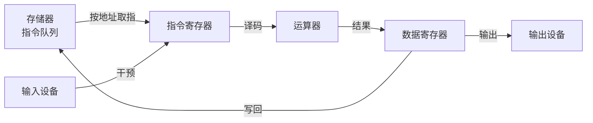

# 第 1 章：CPU 是什么，为什么它是信息社会的基石

- **难度**：★☆☆ | **学时**：0.5 小时 | **前置**：无

## 学习目标
- 能说出 CPU 由哪两个部件合并而成，以及它在五大部件里的位置
- 能按冯·诺依曼模型，把"取指—执行—写回"这条循环讲一遍
- 能举出通用 CPU 与专用 CPU 各两个例子

## 一句话核心
CPU 是运算器加控制器。程序是指令序列，存在存储器里，CPU 一条条取出来执行，所以换程序就能换功能，不用改电路。

## 零基础讲解
一台计算机按经典模型分五部分：运算器、控制器、存储器、输入设备、输出设备。前两个在实际芯片里通常一起设计，合起来就是中央处理器（CPU）。它的活是两件：控制器负责指挥别的部件什么时候动，运算器负责真正算数。

1945 年冯·诺依曼在 EDVAC 报告里把"程序存进存储器"这件事定了下来，这就是后来的冯·诺依曼体系结构。它带来一个关键后果：机器不再需要工人现场拨开关、插线板，程序进去以后自己指挥自己跑。

### 一条指令怎么走完
存储器里放着一串二进制编码，每一格是一条指令。时钟每响一次，控制器里的地址计数器加一，把对应地址的单元读进指令寄存器；译码后交给运算器执行；结果写进数据寄存器，必要时再写回存储器。然后取下一条。直到程序最后一条执行完，结果从输出设备交出去。

### 为什么要分成通用和专用
通用 CPU 不限定用途，跑通用操作系统和应用软件，台式机、服务器、笔记本、手机里都是它。专用 CPU 只服务一个场景，为了这个场景可以砍掉多余功能：汽车里监测整车状态的芯片、智能门锁里管刷卡和蓝牙的低功耗芯片，都算专用。

按制造工艺分四代：电子管、晶体管、集成电路（Intel 4004，1971 年，2250 个晶体管）、超大规模集成电路。按使用场合分五类：科学计算、信息化设备、移动计算、嵌入式、微控制器。越往后性能越低，用量越大。

### 为什么它是国之重器
高端 CPU 的设计技术集中在少数国家的少数企业手里。整机厂大量采购国外 CPU，会同时背三笔账：利润被拿走、知识产权不受控、安全上不透明（不提供设计资料和源码，后门与漏洞查不清）。这不是单纯的商业问题。

## 图示

看图说明：中间那条回路就是"取指—执行—写回"。输入设备插在取指路径上，所以早期机器可以用开关直接改指令；这也是现在键盘、鼠标能干预程序的位置来源。

## 类比与实例
- 类比：CPU 像一个拿着工序单的车间主任。工序单是程序，机床是运算器，主任按单子逐条喊"下一步"，成品从传送带出去。失效边界：真实 CPU 会同时开几条线、还会猜着往下做，不是严格一句一句来。
- 实例：书里那台"汉字生成器"CHN-1。存储器每格 1 位，0 显示"关"、1 显示"开"；时钟一来地址加一；运算器把这一位变成 8×8 点阵；显示器按 64 位点亮。整台机器只有五个部件，但冯·诺依曼模型的骨架已经齐了。

## 常见误解
- 别以为 CPU 就是"算得最快的那个部件"——它一半的职责是指挥和调度，算只是其中一步。
- 别以为程序放在硬盘上就能直接跑。程序必须先装进存储器，CPU 只认存储器里的指令。
- 别以为"专用"等于"低端"。专用是为了一个场景把性能和成本压到极致，很多场景里比通用 CPU 更合适。

## 自测题
1. CPU 由哪两部分合并而成？｜运算器和控制器｜存储器和运算器｜控制器和输入设备｜答案：A｜解析：教材把运算器与控制器合称 CPU，存储器与输入输出设备是另外的部件。
2. 冯·诺依曼体系结构最关键的思想是？｜程序和数据都放在存储器里｜用继电器代替电子管｜用多核提高主频｜答案：A｜解析："存储程序"让机器自动逐条执行，不再依赖人工操作。
3. 下列哪个最可能是专用 CPU？｜服务器里的通用处理器｜智能门锁里管刷卡和蓝牙的低功耗芯片｜台式机 CPU｜答案：B｜解析：专用 CPU 面向单一场景设计，可以砍掉与该场景无关的功能。

## 抽认卡
- CPU 由哪两部分组成？｜运算器 + 控制器
- 冯·诺依曼体系结构的核心思想？｜程序和数据都存在存储器中，由控制器逐条取指执行
- 通用 CPU 和专用 CPU 的区别？｜通用不限场景、跑通用系统；专用面向单一场景，可为该场景牺牲通用功能
- 计算机五大部件？｜运算器、控制器、存储器、输入设备、输出设备
- CPU 为什么是"国之重器"？｜高端设计技术集中、进口依赖带来利润、知识产权与信息安全三重风险

## 术语
- CPU：中央处理器，运算器与控制器的合称，负责指挥整机并执行运算
- 冯·诺依曼体系结构：程序和数据都存于存储器、由控制器逐条取指执行的计算机模型
- 指令：CPU 能识别并执行的一项基本操作，以二进制编码存在存储器中
- 主频：时钟模块每秒发出节拍的次数，决定 CPU 的工作节奏
- 专用 CPU：面向单一应用场景设计的处理器，可牺牲通用性换取性能、成本或功耗优势

## 复习锚点
- CPU = 运算器 + 控制器；程序 = 指令序列，存在存储器里
- 取指、译码、执行、写回，循环到程序结束
- 通用与专用不是高低之分，是场景之分
