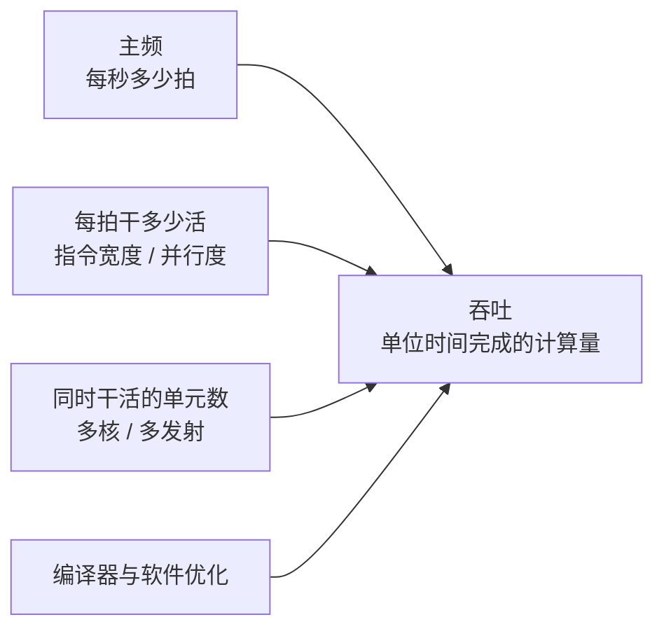

# 第 2 章：怎么衡量一颗 CPU 的好坏

- **难度**：★★☆ | **学时**：0.7 小时 | **前置**：第 1 章

## 学习目标
- 能说清"性能 = 单位时间完成的计算量"，并据此解释为什么主频不是唯一因素
- 能举出 MIPS/MFLOPS 失效的原因
- 能说明 SPEC CPU 测的是什么，以及它被"跑分"利用的两种方式

## 一句话核心
性能是"多快把问题算完"，不是"时钟敲得多快"。主频、每周期干的活、并行度，三者乘起来才是吞吐。

## 零基础讲解
### 主频为什么会卡住
数据在电路里从一个模块传到下一个模块要时间，运算器加工也要时间。这些时间加起来，决定了执行一条指令的最短周期，也就决定了主频的上限。频率再往上提，上一条没算完下一条就来了，电路进入不可控状态。想突破，只能靠更先进的工艺缩短时延，或者改结构。

### CHN-2：主频降到四分之一，性能不变
书里给了个反例。把显示器扩成同时显示 4 个汉字，指令从 1 位扩到 4 位，运算器放 4 个点阵生成器，数据寄存器从 64 位扩到 256 位。这台 CHN-2 的主频可以只有 CHN-1 的四分之一，单位时间显示的汉字数却一样多。代价是各部件都要加宽、加多，晶体管成倍增长。这就是"用并行度换频率"。

### MIPS 和 MFLOPS 为什么不管用
这两个指标数的是"每秒执行多少条指令"。问题是不同机器的一条指令含金量不同：CHN-2 一条顶 CHN-1 四条。数字好看不代表活干得多。现在它们只在计算模式单一的超算领域还有限使用。

### SPEC CPU 的思路
面向问题：挑几十个真实应用（压缩、下棋、有限元、分子动力学、气象、地震波），用 C/Fortran 写好、定好输入，在被测机器上编译运行，比对结果、掐运行时间。它屏蔽了主频、指令这些实现细节，直接测"问题解决得多快"。

它也有软肋。一是编译器：Intel 用自家 icc 编译，效率比 gcc 高不少，但用户实际多用 gcc，跑分高不等于日常快。二是测试集只覆盖计算型负载，厂商可以堆浮点单元、堆核来刷分，而手机日常的拍照、聊天并不吃这套。

### UnixBench 为什么不建议用
1995 年的老工具，2012 年后基本停更。数学项用 Dhrystone/Whetstone，程序模式太简单、数据量太小；图形项用 x11perf，测的是早已被显卡加速取代的 X11 显示路径。拿它比现代 CPU，结论会偏得离谱。

## 图示

看图说明：P 不是由 F 单独决定的。三条箭头任何一条变强，吞吐都能涨；反过来，只看主频就是把另外两条忽略了。

## 类比与实例
- 类比：送快递。主频是车速，每拍干多少活是每趟能装几件，多核是多开几辆车。只看车速判断谁送得快，显然不靠谱。失效边界：现实里还有堵车（访存延迟）、装卸（编译与调度开销），这些在公式里体现不出来。
- 实例：同一颗 CPU，用 icc 编译的 SPEC 分数明显高于 gcc。分数差出来的那一截，是编译器的功劳，不是硅片的。采购时看到这类数字，先问一句"用什么编译器跑的"。

## 常见误解
- 别以为主频高就一定快。架构不同，一条指令干的活差好几倍。
- 别以为跑分高就等于日常流畅。测试集偏计算型，日常偏交互和访存。
- 别以为核多就一定强。核多了还有一致性、带宽、调度的问题，单线程任务用不上。

## 自测题
1. 为什么主频不能无限提高？｜因为数据通路和运算都有延迟，周期短于一条指令的最短执行时间就会失控｜因为厂商不愿意｜因为散热片不够大｜答案：A｜解析：主频上限由电路时延决定，工艺进步才能把它推高。
2. MIPS 指标的根本缺陷是？｜不同机器一条指令代表的工作量不同｜数值太大不好记｜只适用于手机｜答案：A｜解析：指令语义强度不同，数指令条数没有可比性。
3. SPEC CPU 测试的本质是？｜测硬件和软件联合运行真实程序的时间｜测晶体管数量｜测主频｜答案：A｜解析：它用真实应用掐时间，所以结果同时受编译器、操作系统影响。
4. UnixBench 不适合当标准的主要原因是？｜测试项老旧，与当前硬件结构脱节｜收费太贵｜只支持 Windows｜答案：A｜解析：Dhrystone/Whetstone 和 x11perf 都代表不了现代 CPU 的实际负载。

## 抽认卡
- 性能的本质定义？｜单位时间内完成的计算量
- 主频的上限由什么决定？｜数据通路时延加运算时延，即一条指令的最短执行时间
- CHN-2 为什么主频低还能同性能？｜把并行度提高到 4 倍，用宽度换频率
- MIPS 的缺陷？｜不同机器指令语义强度不同，条数不可比
- SPEC CPU 的两大局限？｜编译器影响大；测试集偏计算型，可被堆硬件刷分
- 为什么不推荐 UnixBench？｜1995 年的老测试项，2012 年后停更，与现代表述脱节

## 术语
- 主频：时钟每秒发出的节拍数，CPU 的节奏基准
- 吞吐：单位时间内完成的有效计算量，性能的实质
- MIPS：每秒执行百万条指令数，早期性能指标
- SPEC CPU：面向真实应用的性能测试套件，以运行时间衡量
- 编译器优化：把高级语言转成更高效机器码的手段，会显著影响跑分

## 复习锚点
- 性能 = 主频 × 每拍工作量 × 并行度，再减去各种开销
- 跑分要看用什么编译器、测的什么负载
- 老测试工具不等于通用标准
