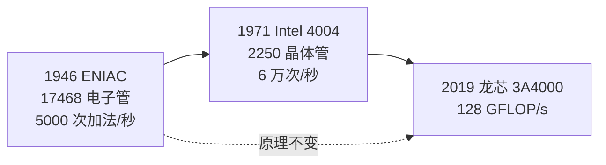

# 第 3 章：普通人也能学懂 CPU

- **难度**：★☆☆ | **学时**：0.4 小时 | **前置**：第 1、2 章

## 学习目标
- 能用三代机器的数字说明 CPU 这七十年变的是什么、没变的是什么
- 能说出推动 CPU 发展的三股力量
- 能解释"制作计算机 = 做 CPU + 做操作系统"这句话

## 一句话核心
CPU 的外形从占满机柜变成几毫米的模块，原理却一脉相承。学它不是为了造它，是为了拿到理解整个计算机系统最底层的那把钥匙。

## 零基础讲解
### 三代机器，同一套原理
ENIAC（1946）有 17468 个电子管，每秒 5000 次加法，抵得上五万人同时手算。Intel 4004（1971）把整个 CPU 放进 3mm×4mm 的硅片，2250 个晶体管，10 微米工艺，每秒 6 万次运算，PC 时代从这儿开始。龙芯 3A4000（2019）封装 37.5mm×37.5mm，峰值 128GFLOP/s，能支撑台式机上的排版、上网、3D 游戏。

体积和速度变了，架构没变：依然是取指、执行、写回那一套。这也是为什么拿一台 70 年前的机器讲原理，今天仍然听得懂。

### 三股力量在推
需求牵引：科学计算要更快，软件越写越重，逼着 CPU 提性能。
工艺进步：单位面积能放的晶体管越来越多，给了架构发挥的空间。
科学探索：工程师自己想做出更聪明的机器，这股劲不完全由市场驱动。

### 它在计算机科学里的位置
ACM 2013 年划了 18 个知识领域，其中"体系结构与组织""操作系统"两门跟 CPU 绑得最紧：前者讲以 CPU 为中心的硬件组成，后者讲跑在 CPU 上的软件平台。经典体系结构教材第一章必讲 CPU，CPU 原理能占整个计算机原理的七成。

于是有那个等式：制作计算机 = 做 CPU + 做操作系统。产业界把 CPU 叫"电脑之心"、操作系统叫"电脑之魂"，说法虽俗，位置说得准。剩下十六门课，多数是在这台机器上开发应用。

### 不做 CPU 的人为什么也要学
三层理由，一层比一层软。硬的一层：不懂底层，排障只能靠猜，性能优化只能调参数。中间一层：流水线、缓存、多核这些工程方法，搬到别的行业也能用。最软的一层：CPU 是观察信息产业的一个窗口，技术趋势、产业格局都能从这里看出来。

### 开源 CPU 的现实
OpenRISC、RISC-V 面向嵌入式与物联网；OpenSPARC、OpenPOWER 是原厂做不下去才开出来的服务器级设计。OpenCores 上两百多个核，不少十年没更新；GitHub 搜 CPU FPGA 有六百多个项目，star 最高的也就五千多，跟随便一个软件组件比都算冷清。硬件开源远没有软件开源成熟，这点要有预期。

国内有可用的教学资源：龙芯 2016 年把 GS132、GS232 两款核向高校开源，配套实验平台。2020 年国科大"一生一芯"计划里，五位本科生做出一款 64 位芯片并流片成功，跑通了 Linux 和自己写的教学操作系统。

## 图示

看图说明：横轴是时间，纵轴是集成度与算力，两条曲线都在涨；虚线表示架构主线没断。看懂这张图，就明白"变小变快"和"原理没变"可以同时成立。

## 类比与实例
- 类比：CPU 的发展像汽车。从蒸汽车到电动车，动力方式换了几轮，但方向盘、油门、刹车的逻辑一直在。失效边界：汽车换能源是断裂式演进，CPU 更多是同一套结构上的持续加固。
- 实例："一生一芯"。五个本科生，一年时间，从设计到流片，芯片能跑 Linux。这说明入门门槛没有想象中高；但同一批人要做服务器级 CPU，还差得远。两件事要分开看。

## 常见误解
- 别以为学 CPU 就是为了造 CPU。绝大多数学习者是为了获得解释力和方法迁移。
- 别以为开源 CPU 能直接拿来造高端产品。开源的多是入门级核，性能和验证深度都不够。
- 别以为本科生能流片，就意味着高端 CPU 不难。能跑通和能商用之间，隔着工艺、验证、生态三道墙。

## 自测题
1. Intel 4004 的意义是？｜第一款商用微处理器，把 CPU 做进一块芯片｜第一台电子计算机｜第一个开源 CPU｜答案：A｜解析：1971 年发布，2250 个晶体管，开启 PC 时代。
2. "制作计算机 = 做 CPU + 做操作系统"强调的是？｜两者是构成一台可用计算机的核心，其余多是应用｜只要会写应用就行｜操作系统不重要｜答案：A｜解析：CPU 是心、操作系统是魂，缺一不可。
3. 当前开源 CPU 的整体状况是？｜以入门级、嵌入式为主，活跃度有限｜已经能替代高端商用 CPU｜完全空白｜答案：A｜解析：受开发成本与知识产权限制，开源硬件远不如开源软件成熟。

## 抽认卡
- ENIAC 的规模与速度？｜17468 个电子管，每秒 5000 次加法
- Intel 4004 的关键数字？｜1971 年，2250 个晶体管，10 微米工艺，每秒 6 万次
- 推动 CPU 发展的三股力量？｜应用需求、生产工艺、科学探索
- 为什么说 CPU 原理占计算机原理的大部分？｜体系结构以 CPU 为中心，存储与 IO 都围绕它组织
- 开源 CPU 的代表项目？｜OpenRISC、RISC-V、OpenSPARC、OpenPOWER
- "一生一芯"证明了什么？｜本科生团队可以完成 64 位芯片设计与流片，入门门槛并非高不可攀

## 术语
- 集成电路：把大量晶体管与连线做在同一块半导体衬底上的电路
- 制程（工艺节点）：制造中晶体管的最小特征尺寸，如 10μm、7nm
- 流片：把设计送去晶圆厂试产，第一次做出实物芯片
- 开源 CPU：设计源码公开、可复用的处理器核
- 体系结构：规定指令集、寄存器、存储与 IO 组织方式的计算机抽象层

## 复习锚点
- 七十年：体积缩小几个数量级，原理仍是取指执行
- 三动力：需求、工艺、探索
- 学 CPU 的价值在解释力和方法迁移，不在人人去造芯
