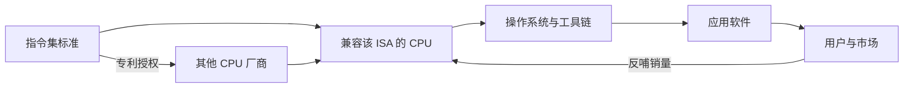

# 第 4 章：指令集——计算机的语言

- **难度**：★★☆ | **学时**：0.8 小时 | **前置**：第 1 章

## 学习目标
- 能定义指令集，并说明它为什么同时是"标准规范"和"生态入口"
- 能解释"增量演进、向下兼容"具体约束了什么
- 能用 IA64 与 AMD64 的竞争说明兼容性的市场后果

## 一句话核心
指令集是软件和硬件之间的编码约定。它写出来只要几个月，但要让全世界为它写软件，要很多年。

## 零基础讲解
### 指令集是什么
CPU 由晶体管组成，只认 0 和 1。软件要在它上面跑，就得按双方约定的格式编码，这套约定叫指令集，也叫指令系统架构（ISA）。每个 CPU 能理解的指令，构成一个有限集合；CHN-1 只有两条（0 表示关、1 表示开），现代桌面 CPU 有上千条。

把指令集理解成接口最准确：软件这边看到的是"能调哪些操作"，硬件这边看到的是"要支持哪些编码"。两边对上，程序才能跑。

### 兼容性是一条铁律
跑相同指令集的机器叫兼容机。兼容意味着同一份软件不用改就能运行。反过来，指令编码一变——比如 CHN-2 把每条指令从 1 位扩成 4 位——老软件就跑不了，两台机器不兼容。

产业界摸索出的办法是"增量演进、向下兼容"：只允许加新指令，不允许删老指令，也不允许改老指令的功能。这样新 CPU 能继承全部旧软件。1964 年 IBM System/360 是这套规则的起点，同一系列不同型号跑同一批软件，客户的软件资产不作废。直到今天 IBM 还在造兼容 System/360 的大机。

反例很有名。2001 年 Intel 和惠普搞 IA64，另起炉灶，不兼容 32 位 x86；AMD 同期推 AMD64，向下兼容 x86。市场选了 AMD64，Intel 最终放弃 IA64，把 AMD64 收编为 x86-64。强势如 Intel，也没拗过这条铁律。

### 指令集怎么控制生态
一个新指令集要活下来，得走完这条链：定标准 → 造 CPU → 做操作系统和工具链 → 吸引应用开发者 → 软件越积越多 → 卖 CPU 赚钱。规模起来后，别的厂商也会来做兼容 CPU，分蛋糕。于是有了专利与授权：想生产兼容某指令集的 CPU，得先拿到授权，费用可以高到上亿元。授权门槛就是生态的准入门槛。

这也解释了为什么全世界主流指令集不超过十个。设计本身几个月能写完，难的是打破"没用户就没软件、没软件就没用户"的死循环。再加上高端 CPU 的指令集要跟电源管理、安全、虚拟化、调试接口一起统筹，往往得把 CPU 和操作系统的原型都做出来验证。

## 图示

看图说明：左边是技术，右边是市场，中间靠软件填满。授权那条虚线说明：谁握住指令集，谁就能决定谁能进来造 CPU。

## 类比与实例
- 类比：指令集像铁路轨距。改轨距技术上不难，难的是让全国的车厢都换轮子。失效边界：轨距是物理的，指令集是编码的，后者可以靠翻译层（二进制翻译）临时过渡，虽然效率有损。
- 实例：LoongArch 分四块——基础、二进制翻译扩展（LBT）、虚拟化扩展（LVZ）、向量扩展（LSX/LASX）。LBT 的存在本身就说明"生态迁移"是现实问题，得给旧软件留一条翻译通道。

## 常见误解
- 别以为指令集是"越先进越好"。生态不认，再先进也卖不动。
- 别以为兼容就是抄。兼容是遵守同一套编码约定，微结构可以完全不同。
- 别以为有了授权就万事大吉。软件、编译器、开发者习惯都要跟着搬，这是慢功夫。

## 自测题
1. 指令集的本质是？｜软件与硬件之间的二进制编码规范｜一种电路布局｜一种编程语言｜答案：A｜解析：它规定 CPU 能识别哪些编码，是软硬件的接口。
2. "增量演进、向下兼容"的含义是？｜只增加新指令，不删除、不改变已有指令｜每隔几年推翻重来｜只兼容自家软件｜答案：A｜解析：这样旧软件在新 CPU 上仍可运行，软件资产得以继承。
3. IA64 失败的直接原因是？｜不兼容 32 位 x86，而 AMD64 向下兼容｜性能太差｜价格太高｜答案：A｜解析：市场不愿放弃既有软件，兼容性成为决定性因素。
4. 新指令集难在哪里？｜难在建立软件生态，而非写出规范｜难在申请专利｜难在取名字｜答案：A｜解析：没有软件就没有用户，没有用户就没人写软件，双向悖论最难破。

## 抽认卡
- 指令集的另一个名称？｜指令系统架构（ISA）
- 兼容机的定义？｜能识别相同指令编码、运行相同软件的计算机
- 向下兼容的具体约束？｜只增不删、不改老指令功能
- System/360 的历史地位？｜1964 年 IBM 推出，"兼容机"概念的始祖
- 指令集如何控制生态？｜通过专利与授权设定准入门槛，决定谁能造兼容 CPU
- LoongArch 的四个组成部分？｜基础、二进制翻译扩展 LBT、虚拟化扩展 LVZ、向量扩展 LSX/LASX

## 术语
- 指令集（ISA）：CPU 能识别的指令编码规范，软硬件接口
- 兼容机：遵循同一指令集、可运行相同软件的计算机
- 向下兼容：新机器能运行旧机器上的软件
- 二进制翻译：把一种指令集的机器码转换成另一种指令集可执行形式的技术
- 指令集授权：指令集权利人许可他人生产兼容 CPU 的商业模式

## 复习锚点
- 指令集 = 编码约定 = 生态入口
- 兼容靠"只增不改"，破坏它的产品会被市场淘汰
- 写规范几个月，养生态很多年
