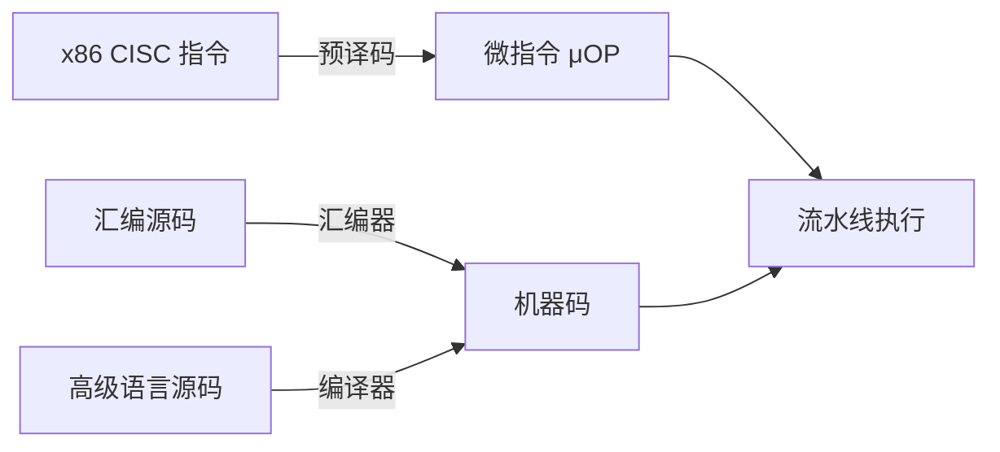

# 第 5 章：精简指令集与汇编语言

- **难度**：★★☆ | **学时**：0.8 小时 | **前置**：第 4 章

## 学习目标
- 能说清 CISC 为什么越来越臃肿，RISC 又为什么回来
- 能解释"CISC = 预译码 + RISC"是什么意思
- 能说明汇编语言和高级语言各自省掉了什么麻烦

## 一句话核心
指令不是越多越好。常用指令占两成却承担八成执行，剩下的复杂指令增加设计负担，还挡住流水线。

## 零基础讲解
### 指令数量的膨胀与代价
早期机器指令很少：ENIAC 50 条，Intel 4004 只有 45 条。到 8086 是 72 条，80386 超过 100 条，Pentium 220 条，2000 年前后的 CPU 已经上千条。

膨胀有两个推力：晶体管便宜了，塞得下更多功能；PC 普及后，程序员希望一条指令干更多事（比如一次读写一串内存单元），图省事。代价也很实在：译码电路变复杂、容易设计出错；指令之间功能重复，违背正交性；最麻烦的是指令长度和执行时间不一致，流水线不好排，编译器也不好调度。

### RISC 的判断依据
统计发现指令使用率极不均匀：最常用的两成指令，占八成执行次数。用得最多的恰恰是最原始的加减、判断、访存。既然如此，何必为那些一年用不上一次的指令付设计成本？

RISC 的思路是只留常用指令，每条只干一件事，长度统一、编码规整。这样流水线容易做，编译器也容易排。一般认为 1975 年开始研制的 IBM 801 是最早的 RISC 处理器。九十年代以后新出的指令集基本都走 RISC，剩下的主流 CISC 只有 x86。

### 为什么 x86 没死
因为生态。换指令集等于让所有软件重写，没人敢。

CISC 厂商找到的办法是两级译码：x86 指令进来，先"预译码"成内部微指令（μOP），微指令按 RISC 思路设计，后面全用流水线跑。对外仍是 x86，对内是 RISC。于是有了那个等式：CISC = 预译码 + RISC。Intel 80486 就上了五级流水线：取指、译码 1、译码 2、执行、回写。

### 指令集里到底放什么
以 LoongArch 为例：基础部分管数据运算，LBT 管跨指令集的二进制翻译效率，LVZ 管虚拟化，LSX/LASX 管向量（科学计算、信号处理、媒体解码）。每一项都对着具体需求，不是为了凑数。指令多了，学习成本、编译器复杂度都要跟着涨。

### 汇编：第一次抽象
机器指令是一串 0/1，人记不住。汇编用助记符代替操作码，用标号和寄存器名代替地址与编号。比如把"开/关"写成 ON/OFF。

汇编代码不能直接跑，要经汇编器（Assembler）转成机器码。汇编把"功能表示"从"硬件机制"里分了出来，程序员第一次不用手算二进制。

但汇编仍是面向机器的语言：得自己管寄存器、管内存，一条指令干的事太少，复杂程序写出来很长。

### 高级语言：第二次抽象
高级语言把数据类型抬到整数、浮点、数组、结构体，把控制结构抬到循环和分支。代码经编译器（Compiler）转成机器码。同样的问题，高级语言代码量平均只有汇编的七分之一，bug 也少。它还是平台无关的：换指令集只要换编译器重编一遍，不用重写。

TIOBE 前二十基本都是高级语言，汇编排在十几位，份额百分之一二。

### 汇编为什么没消失
两种场景离不开它。一是高级语言够不着的地方：读写 CPU 内部寄存器、访问外设端口，BIOS、内核、驱动、嵌入式控制程序里都有汇编。二是极致的性能优化：编译器不一定生成最优指令序列，关键函数手工汇编能榨出最后一点性能。

## 图示

看图说明：上面两条是"人怎么写"，下面这条是"机器怎么跑"。CISC 在中间加了一层翻译，把复杂指令拆成规整的微操作，流水线才跑得顺。

## 类比与实例
- 类比：CISC 像一整套组合工具箱，什么形状都有，但找起来费劲、箱子重；RISC 像一把瑞士军刀加几个常用件，轻，快，缺的场合再补。失效边界：军刀补不了重活，CISC 的复杂指令在少数场景确实一条顶多条。
- 实例：数组复制。C 语言一个 for 循环四行；龙芯汇编要自己维护三个指针（源、目的、计数），每轮做 load、store、两次地址加、一次比较跳转。代码长，但每条指令干什么一清二楚。

## 常见误解
- 别以为 RISC 一定比 CISC 快。x86 内部早就 RISC 化了，外部表现取决于微结构，不取决于标签。
- 别以为汇编等于过时。内核、驱动、启动代码里它一直在。
- 别以为指令越多功能越强。堆指令带来的复杂度，往往超过它节省的那点代码。

## 自测题
1. RISC 提出的统计依据是？｜两成常用指令承担八成执行次数｜指令越少越好｜寄存器越多越好｜答案：A｜解析：二八原则说明复杂指令的实际使用率很低。
2. "CISC = 预译码 + RISC"描述的是？｜CISC 指令在内部被译成 RISC 风格微指令再流水执行｜CISC 被 RISC 取代｜两种指令集合并｜答案：A｜解析：对外保持兼容，对内用 RISC 结构跑，兼顾生态与性能。
3. 高级语言相对汇编的主要优势不包括？｜可以直接操作 CPU 内部寄存器｜代码量约为汇编的七分之一｜换平台只需重新编译｜答案：A｜解析：直接操作寄存器恰恰是汇编的专长，高级语言做不到。
4. 汇编语言仍被使用的原因？｜内核驱动等需访问硬件，以及关键代码的性能优化｜因为编译器不存在｜因为汇编更简单｜答案：A｜解析：两类场景高级语言覆盖不了。

## 抽认卡
- CISC 与 RISC 的核心差别？｜CISC 指令多而复杂、长度不一；RISC 指令少而规整、长度统一
- RISC 的代表作起点？｜IBM 801，1975 年开始研制
- 指令膨胀的三大弊端？｜译码电路复杂、功能重复、妨碍流水线与编译调度
- μOP 是什么？｜CISC 指令预译码后生成的内部微指令，对软件不可见
- 汇编器的作用？｜把汇编源码转成二进制机器码
- 高级语言"平台无关"的含义？｜换指令集只需用新编译器重编，不必重写源码

## 术语
- CISC：复杂指令集计算机，指令多、长度可变
- RISC：精简指令集计算机，指令少、长度统一、便于流水
- 正交性：指令之间功能不重复、可组合覆盖全部需求的性质
- 微指令（μOP）：CISC 内部译码产生的 RISC 风格操作
- 汇编器：把汇编语言转成机器码的程序
- 编译器：把高级语言源码转成机器码的程序

## 复习锚点
- 指令膨胀有代价，RISC 用二八原则把它砍回去
- x86 靠"预译码 + RISC 内核"活下来
- 汇编管硬件细节，高级语言管问题逻辑
