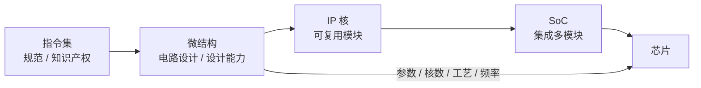

# 第 6 章：做 CPU 就是做微结构

- **难度**：★★☆ | **学时**：0.6 小时 | **前置**：第 4、5 章

## 学习目标
- 能区分指令集和微结构：一个是规范，一个是电路实现
- 能说明同一个微结构怎样衍生成不同型号的 CPU
- 能解释 IP 核的软硬两种形态，以及"SoC 攒芯片"的局限

## 一句话核心
指令集是地基，微结构是图纸和施工，IP 核是可以复用的预制构件。买房和买房图纸，不是一回事。

## 零基础讲解
### 微结构：真正的"做 CPU"
微结构（micro-architecture）是一个 CPU 的电路设计，是把指令集功能落到硬件上的实现方案。指令集属于知识产权问题——你可以授权别人的规范；微结构属于设计能力问题——能不能用电路把它高效实现出来，得自己练。

一个微结构能衍生出很多型号。做法有四种：改参数（缓存大小）、裁模块（去不去浮点单元）、多核组合（1/4/8/16/64 核）、换工艺（28nm/14nm/7nm），最后再按测试结果分档定频定价。所以同门兄弟可能长得差很远：龙芯 3A4000 用 GS464V，3A5000 和 3C5000 用 LA464；Intel 的 P6 架构从 Pentium Pro 一路用到 Pentium Ⅲ。

### IP 核：一次设计，多次使用
IP 核是设计好的电路模块，可以在不同芯片里重复使用。它像软件里的函数：定义一次，到处调用。粒度可大可小，小到乘法器、浮点单元，大到一个完整的 CPU。

软 IP 是用硬件描述语言（Verilog、VHDL）写的电路功能描述，相当于电路的源码；硬 IP 是做完布局布线、确定晶体管的版图，相当于成品。卖软 IP 交的是设计，卖硬 IP 交的是能直接流片的版图。

### SoC：把一台计算机塞进一块芯片
SoC（System on Chip）在一块芯片上集成 CPU、内存控制器、通信接口、电源管理等模块，接近一台完整计算机。龙芯 2K1000 集成了两个核和二十多种外设控制器，最小主板做到名片大小；高通的骁龙 865 把 8 个 CPU、5G、GPU、AI、Wi-Fi、蓝牙、USB、摄像头、音频、充电管理全塞进去，7nm 工艺，面积不到一角硬币。

### 买 IP 攒芯片，算不算会做 CPU
不算。IP 授权是成熟生意，CPU 核、DDR 控制器、GPU、PCIe、SATA、USB 控制器，甚至温度传感器都能买到。有钱、懂集成，几个月就能"做"出一颗手机芯片。

但这只说明你会集成，不代表掌握核心设计。用别人的核、别人的图纸，做出来的是"CPU 搬运工"。真正的自主，是自己设计微结构、自己定义指令集，还能反过来给别人授权。龙芯走的是后者，不采用第三方 IP 核。

## 图示

看图说明：同一条微结构可以向两个方向走——往下封装成 IP 复用，往右按参数衍生成不同型号。买 IP 的路径从中间插入，跳过了左边两格。

## 类比与实例
- 类比：造芯片像盖房子。指令集是地基规范，微结构是设计图纸加快工，IP 核是预制楼梯和门窗。买 IP 攒芯片，等于用别人的图纸、在别人的地基上盖房，房子能住，产权不是你的。失效边界：房子不能拆了重盖，芯片设计可以迭代流片，改一版再试。
- 实例：ARM 卖公版核，手机厂买授权，几个月出芯片。同一时期，一家没有自家微结构的公司，很难在能效上做出差异化——因为大家的图纸是一样的，只能在集成和工艺上找空间。

## 常见误解
- 别以为有指令集授权就等于会做 CPU。授权给的是规范，不是实现。
- 别以为 SoC 集成等于自研。集成能力有价值，但它不解决核心设计能力。
- 别以为微结构只有一个版本。同一套微结构能按缓存、核数、工艺、频率切出很多 SKU。

## 自测题
1. 微结构与指令集的关系是？｜微结构是某指令集的电路实现方案｜两者是同一个东西｜微结构是软件规范｜答案：A｜解析：指令集是规范，微结构是硬件实现。
2. 下列哪项不是同一微结构衍生型号的手段？｜重新设计一套指令集｜调整缓存大小与核数｜换制造工艺｜答案：A｜解析：换指令集就是另一个产品线了，不属于同微结构衍生。
3. 软 IP 与硬 IP 的区别是？｜软 IP 是功能描述，硬 IP 是确定的版图｜软 IP 更贵｜硬 IP 不能流片｜答案：A｜解析：软 IP 相当源码，硬 IP 相当可交付的版图。
4. "买 IP 攒芯片"不能称为掌握 CPU 技术，原因是？｜核心设计来自他人，只完成集成与制造｜因为成本太低｜因为芯片不能运行｜答案：A｜解析：自主性体现在微结构与指令集的设计能力上。

## 抽认卡
- 微结构的定义？｜一个 CPU 的电路设计，即指令集的硬件实现方案
- 同一微结构衍生型号的四种方式？｜改参数、裁模块、多核组合、换工艺并分档定频
- IP 核像什么软件概念？｜函数：一次定义，多次调用
- 软 IP 与硬 IP？｜软 IP 是 HDL 功能描述；硬 IP 是含布局布线的晶体管版图
- SoC 是什么？｜片上系统，一块芯片集成 CPU 与多种外设，接近完整计算机
- "CPU 搬运工"指什么？｜买现成 IP 组合成芯片、不掌握核心设计的厂商

## 术语
- 微结构：一条指令集在电路上的具体实现方案
- IP 核：可复用的电路设计模块
- 软 IP：以 HDL 描述交付、尚未布局布线的 IP
- 硬 IP：已完成布局布线、可直接流片的 IP
- SoC：片上系统，一块芯片集成 CPU 与多种功能模块
- 处理器核：CPU 中负责运算与控制的完整单元

## 复习锚点
- 指令集是规范，微结构是设计，IP 是复用件
- 同微结构可切出多档产品
- 集成 ≠ 自研
