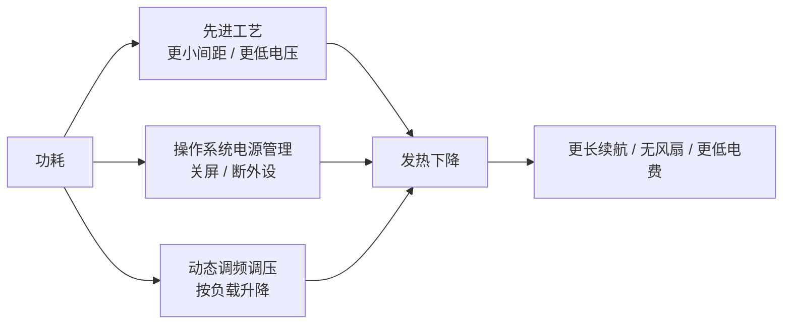

# 第 7 章：功耗从哪里来

- **难度**：★★☆ | **学时**：0.5 小时 | **前置**：第 1 章

## 学习目标
- 能按场景说出四类 CPU 的典型功耗区间
- 能列出降低功耗的三条路径，并说明哪条最依赖设计
- 能解释"低功耗"为什么不只是省电费

## 一句话核心
功耗是电流通过晶体管时变成的热。降功耗有三条路：换工艺、让操作系统管电源、按负载调频率电压。工艺买得到，设计买不到。

## 零基础讲解
### 功耗的场合差异
功耗就是单位时间消耗的电能，单位瓦特。算得越猛通常越费电，所以不同场景对功耗的容忍度完全不同。

嵌入式与微控制器常在没电源的地方工作，靠电池撑，功耗在毫瓦级。书里提过一个极端要求："一节干电池用十年"。手机平板一般不超过 10W，笔记本不超过 20W，台式机 50W 上下，服务器轻松破 100W。龙芯 1C 只有 0.5W，3A4000 峰值 50W。

### 为什么在意发热
电流过晶体管就发热，芯片表面能到 100℃，足以烧坏。几十瓦的台式机必须配风扇，风扇是机械件，有噪声也容易坏。功耗压到 15W 以内，就能做出无风扇的静音机器。

数据中心是另一回事。几万台服务器集中在一起，电费能占运营成本的三分之一，还得花大价钱制冷。阿里千岛湖用湖水冷却，Google 用海水和生活废水。2010 年全球数据中心用电约占全球发电量的 1.1% 到 1.5%。

### 三条降功耗的路
第一，先进工艺。晶体管间距更小、电压更低、密度更高，发热自然少。最先进的 5nm 往往先用在对功耗敏感的移动设备上。

第二，操作系统电源管理。待机时关屏、切断硬盘等外设供电，把能省的电省下来。

第三，按负载调频调压。负载低时降频降压，需要时再冲上去，这就是"睿频"一类的机制。更进一步的还能动态调电压，龙芯 3A4000 就有这个能力。

三条里，第一条靠钱和供应链，第二条靠软件生态，第三条靠微结构与固件的设计功底。所以"降功耗"最后拼的还是人。

## 图示

看图说明：三条箭头都指向发热，但成本与门槛不同。工艺是一次性投入，电源管理和调频调压是持续优化，能做到什么程度取决于设计能力。

## 类比与实例
- 类比：功耗像汽车的油耗。换发动机（工艺）是最根本的，但贵；养成良好驾驶习惯（电源管理）不要钱但收益有限；智能启停（调频调压）介于两者之间。失效边界：汽车油耗还受路况影响，CPU 的负载波动比路况剧烈得多。
- 实例：龙芯 3A4000 相比 3A3000 性能翻倍，同时靠功耗控制把待机时间也翻了一倍。性能与续航不是必然对立，关键看有没有在电源管理上下功夫。

## 常见误解
- 别以为功耗低就是性能差。低功耗设计的目标是"同性能下更省"，不是砍性能。
- 别以为换个先进工艺就万事大吉。工艺红利会被更高频率、更多核心吃掉，架构不改照样费电。
- 别以为散热是整机厂的事。芯片封装、功耗密度从一开始就决定了整机能不能不用风扇。

## 自测题
1. 下列哪类 CPU 的功耗通常在毫瓦级？｜嵌入式与微控制器｜服务器｜台式机｜答案：A｜解析：靠电池工作，必须把功耗压到极低。
2. 降低功耗的三条路径不包括？｜减少指令集条数｜采用先进工艺｜操作系统电源管理｜答案：A｜解析：指令集条数与功耗没有直接对应关系。
3. 低功耗 CPU 的一个直接好处是？｜可以做出无风扇的静音计算机｜可以不用操作系统｜可以不用内存｜答案：A｜解析：功耗低、发热小，机械风扇可以省掉。
4. 数据中心电费约占运营成本多少？｜约三分之一｜约十分之一｜几乎为零｜答案：A｜解析：海量服务器加制冷，电费是主要成本项之一。

## 抽认卡
- 功耗的定义与单位？｜单位时间消耗的电能，单位瓦特
- 四类 CPU 的典型功耗？｜嵌入式毫瓦级、手机不超 10W、台式约 50W、服务器可超 100W
- 降功耗的三条路径？｜先进工艺、操作系统电源管理、动态调频调压
- 为什么风扇是问题？｜机械件有噪声且易损坏，低功耗才能省掉它
- 睿频是什么？｜按负载动态升降频率的功耗管理机制

## 术语
- 功耗：单位时间消耗的电能，单位瓦特
- 睿频：根据负载动态调整频率（及电压）的机制
- 功耗密度：单位面积上的发热量，决定散热设计难度
- 无风扇设计：靠被动散热把整机做到静音的方案
- 电源管理：操作系统按状态关闭或降低部件供电的机制

## 复习锚点
- 功耗按场景分档：毫瓦、10W、50W、100W+
- 三条路：工艺、系统管理、调频调压
- 低功耗换来的是续航、静音和电费
