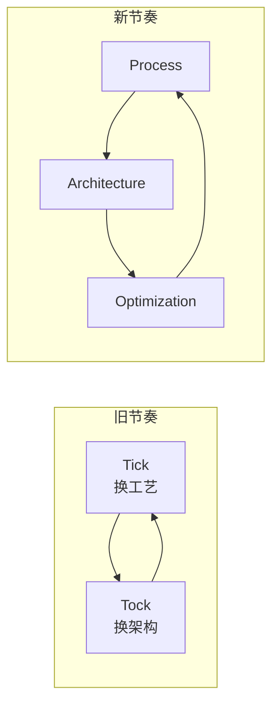

# 第 8 章：摩尔定律与它的黄昏

- **难度**：★★☆ | **学时**：0.6 小时 | **前置**：第 2、7 章

## 学习目标
- 能说出摩尔定律的原始表述与 1975 年的修正
- 能解释 Tick-Tock 为什么把工艺和架构分开做，以及后来为什么变成三步
- 能列出 CPU 性能提升变慢的三个原因

## 一句话核心
摩尔定律不是物理定律，是一条被人努力维持了半个多世纪的经验曲线。曲线还在，但斜率在变小。

## 零基础讲解
### 一条从草稿纸开始的曲线
1965 年，摩尔在草稿纸上点出历年集成电路的最大晶体管数，连成一条斜线：每年翻一倍。1975 年改成每两年翻一倍，等于承认放缓。此后几十年，产业基本按这条线走。

它跟物理定律不一样。物理定律背后有因果，摩尔定律背后只有一个观察和一群人的努力。每次撞上工程瓶颈，总有新材料、新结构把它续上。但晶体管尺寸逼近原子尺度，4nm 时只剩几个原子的宽度，电子进出控不住，1 和 0 就不稳了。有文献预计这个瓶颈在 2030 年前到来。

就算失效，也不算意外。产业够先进、供给够用，速度自然会慢下来，转向别的价值维度——就像汽车跑到 240km/h 之后，人们开始比舒适、比自动化，而不是比极速。

### Tick-Tock：把两件难事分开做
Intel 2006 年提出"嘀嗒"策略：Tick 年换制造工艺，吃摩尔定律的红利；Tock 年换微结构，做性能、节能和专用功能。两年一个循环。

为什么分开？因为工艺和架构是两颗最难的钉子。新工艺动辄几十亿美元，验证周期长；新架构要走完设计到验证的长流程。两件事一起做，问题缠在一起，很可能两头都砸。分开做，每次只解决一个子问题，难度降维，上市节奏也稳。

2017 年改成"制程—架构—优化"三步，周期拉到三年。多出来的"优化"是制程架构都不变时的小修小补、提频、修 bug。外界把这叫"挤牙膏"。

### 为什么变慢了
三个原因叠在一起。

需求端：2010 年前，多媒体、游戏、互联网、大数据轮番拉着 CPU 往前跑，两三年就得换机。2010 年后 PC 应用定型，三四百元的桌面 CPU 就够用，人们觉得"够好了"。手机和云还在要性能，但不再是全民焦点。

竞争端：Intel 在桌面、服务器、笔记本的份额长期在 80% 以上，第二名 AMD 只在少数时段构成威胁。用现有性能的芯片也能持续拿单，换代的紧迫感就弱了。

学术端：九十年代流水线、RISC 定下来之后，体系结构领域很多年没有本质突破。现在的提升多是工程细节、先进工艺、SoC 组合式创新。没有新理论，性能曲线自然平。

用户的关注点也跟着变：2000 年前买电脑要算"单位价格买到多少算力"，现在多数人只看品牌、价格、外观。

## 图示

看图说明：上面是两年一循环的两步走，下面是三年一循环的三步走。多出来的优化步，本质是承认"工艺和架构都难有大跃进了"。

## 类比与实例
- 类比：摩尔定律像一场长跑的世界纪录。纪录还在被破，但每次都只快零点几秒，而且需要更好的鞋、更好的跑道、更科学的训练。失效不是某天突然跑不动，而是越来越难快。失效边界：体育有生理极限，芯片的极限来自原子尺度，性质不同但"边际收益递减"的逻辑一样。
- 实例："挤牙膏"那几年，每代 CPU 的单核性能提升只有个位数百分比。用户换机周期从两三年拉长到五六年，二手市场反而火了。这就是性能过剩带来的产业结构变化。

## 常见误解
- 别以为摩尔定律是自然规律。它是经验观察加产业共识，靠人维持。
- 别以为工艺进步必然带来性能提升。频率墙、功耗墙、内存墙都在旁边卡着。
- 别以为性能停滞等于技术停滞。算力在往专用化、并行化、封装层面走，只是不再表现为单核频率。

## 自测题
1. 摩尔定律 1975 年的修正表述是？｜晶体管数量每两年翻一倍｜每年翻四倍｜每十年翻一倍｜答案：A｜解析：原为每年翻倍，1975 年改为两年。
2. Tick-Tock 把工艺与架构分开做的主要目的是？｜分解难度、控制风险、稳定节奏｜节省广告费｜减少核数｜答案：A｜解析：两件最难的钉子分开钉，避免问题交织。
3. 2017 年后 Tick-Tock 变成？｜制程—架构—优化三步走｜彻底取消｜改成四年一轮｜答案：A｜解析：增加优化步，周期从两年拉到三年。
4. CPU 性能提升放缓的原因不包括？｜指令集数量减少｜应用需求饱和｜Intel 市场份额过高｜答案：A｜解析：指令集数量与性能增速没有这种因果关系。

## 抽认卡
- 摩尔定律原始表述？｜集成电路晶体管数量每年翻一倍（1965）
- 1975 年的修正？｜改为每两年翻一倍
- Tick 与 Tock 各做什么？｜Tick 换制造工艺，Tock 换微结构
- 为什么工艺与架构要分开迭代？｜分解难度、控制风险、缩短上市周期
- 性能放缓的三个原因？｜需求饱和、市场垄断、体系结构缺乏新理论
- 摩尔定律的性质？｜人为总结的经验规律，不是物理定律

## 术语
- 摩尔定律：集成电路晶体管数量约每两年翻倍的产业经验规律
- Tick-Tock：工艺与架构交替升级的两年周期策略
- 制程：制造工艺节点，如 14nm、10nm、7nm
- 挤牙膏：形容性能提升幅度很小的代际更新
- 性能过剩：算力超出多数用户实际需求的状态

## 复习锚点
- 一条靠人维持的经验曲线，斜率在变小
- Tick-Tock 的本质是分而治之，后来变三步
- 变慢是三件事叠加：没需求、没对手、没新理论
