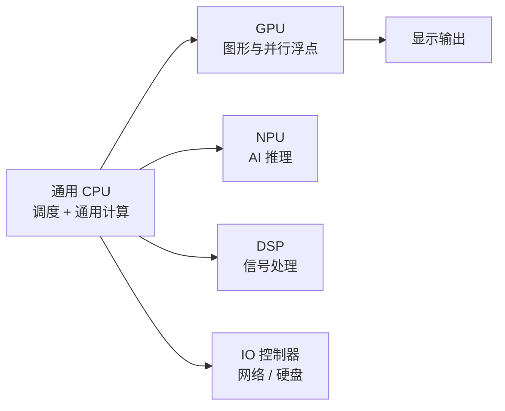

# 第 9 章：通用还是专用

- **难度**：★★☆ | **学时**：0.6 小时 | **前置**：第 1、5 章

## 学习目标
- 能说清异构计算的两个基本思想
- 能举例说明专用处理器为什么快
- 能解释 big.little 的思路与适用场景

## 一句话核心
通用 CPU 什么都能干，但什么都不最快。把常见的大块计算交给专用电路，剩下的调度交回 CPU，整机就快了。

## 零基础讲解
### 两个基本思想
异构计算是不同类型计算单元合作完成一件事。第一个思想是"专人干专事"：数字信号处理、3D 渲染、AI 推理这些活，专门设计电路去做，效率远高于通用处理器，也更省电、更省面积。

第二个思想是"把软件干的活交给硬件"。通用 CPU 上，一个功能是一串指令，指令越多越慢。专用处理器把整组操作固化成一排电路，一次就出结果，执行时间短得多。

### GPU 就是最典型的例子
在屏幕上画一条线，CPU 一次只能画一个点，要画多少个点就得多少条指令。GPU 换了个思路：CPU 只告诉它两个端点坐标，中间的点由 GPU 自己插值、批量生成，再送显示器。结构可以很简单，速度却能快上百倍。

最早的 GPU 只做 2D 硬件加速（直线、矩形、圆），后来加 3D，再加视频硬解码。连"显示鼠标指针"这种小事也交给 GPU 了。看高清视频时 CPU 占用不到 5%，就是因为画面相关的工作被 GPU 接走了。

### 桌面上的协处理器
一台现代计算机是"一个通用 CPU 加一堆专用处理器"：GPU 管图形，NPU 管网络，音频处理器管声音，硬盘控制器管读写。它们都受 CPU 调度，所以叫协处理器。科学计算和信号处理机器上还有 DSP，手机里则有 AI 用的 NPU。

### 通用芯片也能分工
ARM 的 big.little 在同一个芯片里放两类核：big 性能高功耗高，little 性能低功耗低。跑游戏、渲染复杂网页时上 big，打电话、发消息、听歌时用 little。这样一台手机既能扛重活，又能省电。

## 图示

看图说明：CPU 在中间当调度者，四周是各类专用单元。箭头是任务分配，不是数据流；真正跑起来时数据在内存和各单元之间来回搬。

## 类比与实例
- 类比：通用 CPU 像一家综合医院，什么科都有但每个科都不顶尖；专用处理器像专科医院，看一类病又快又专。社区里两家并存，常见病去专科，复杂病回综合。失效边界：医院之间转诊要时间，芯片里数据搬运也有带宽和延迟成本，搬多了反而慢。
- 实例：播放高清视频。解码器把压缩流解成画面，这个活在专用硬件上做；CPU 只负责调度播放器、处理弹幕和声音同步。所以你看到 CPU 占用极低，风扇也不怎么转。

## 常见误解
- 别以为专用处理器能取代 CPU。它只在特定计算上快，调度、分支、通用逻辑还得靠 CPU。
- 别以为异构就是堆芯片。任务分配、数据搬运、编程模型都要配套，堆了不会用等于白堆。
- 别以为 big.little 只是省电。调度策略写不好，任务在大小核之间来回搬，反而更费电。

## 自测题
1. 异构计算的两个基本思想是？｜专人干专事，以及把软件功能硬件化｜提高主频，增加核数｜降价，缩面积｜答案：A｜解析：专用化与硬件化是异构的核心。
2. GPU 画线比 CPU 快，主要因为？｜一次生成整条线的点，而不是逐点执行指令｜主频更高｜内存更大｜答案：A｜解析：把循环插值固化进硬件，指令数大幅减少。
3. big.little 的适用场景是？｜应用多样且对功耗敏感的设备，如手机｜超算中心｜工业控制｜答案：A｜解析：大小核按负载切换，兼顾性能与续航。

## 抽认卡
- 异构计算的定义？｜不同类型计算单元分工合作完成计算任务
- 异构的两个基本思想？｜专人干专事；把软件功能交给硬件实现
- GPU 为什么擅长图形？｜批量并行生成像素点，一条指令处理大量数据
- 协处理器是什么？｜受 CPU 调度、承担特定功能的专用处理器
- big.little 的两种核？｜高性能大核与低功耗小核，按负载调度

## 术语
- 异构计算：多种架构的计算单元协同完成任务的模式
- 协处理器：辅助 CPU 完成特定功能的专用处理器
- GPU：图形处理器，擅长批量并行的像素与浮点运算
- NPU：神经网络处理器，专门加速 AI 推理
- big.little：同芯片内集成高性能核与低功耗核的调度架构

## 复习锚点
- 通用管调度，专用管重活
- 专用快在"循环变电路"
- 异构的瓶颈常在数据搬运和调度
