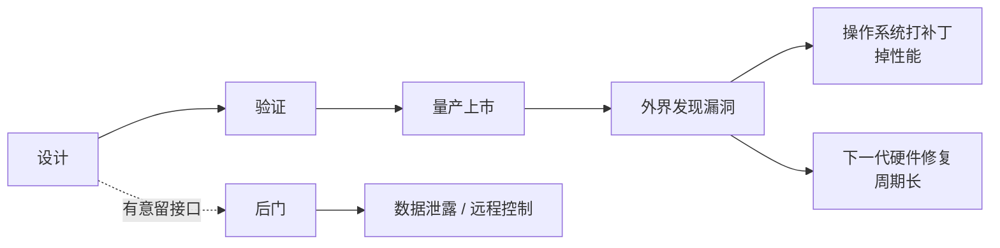

# 第 10 章：后门与漏洞——芯片里的幽灵

- **难度**：★★★ | **学时**：0.8 小时 | **前置**：第 4、5 章

## 学习目标
- 能区分后门与漏洞：一个是态度问题，一个是能力问题
- 能说出 Meltdown/Spectre 利用了哪些常见优化机制
- 能解释打补丁为什么必然掉性能，以及为什么自主设计是必要的

## 一句话核心
后门是有人故意留的门，漏洞是没人发现的门缝。前者靠制度和自律，后者只能靠设计与验证，而且永远清不干净。

## 零基础讲解
### 两个词，两件事
后门是绕过正常安全机制的通道，通常是设计者有意安排、又没写进产品文档。比如留着调试接口不上报，出厂也不禁用，日后就能悄悄收集运行信息；或者留一条能被远程触发、执行异常操作的路径。

漏洞是设计缺陷，设计者自己没意识到，测试也没抓到，上市后被外界发现。它不是故意的，但一样能被利用。

书里那句话说得直白：漏洞是能力问题，后门是态度问题。

### 为什么漏洞清不完
软件工程有条基本原理：穷尽测试不可能。CPU 的输入组合和执行路径几乎是无限的，有限用例覆盖不了；用例本身也是人写的，也会漏。所以测试只能证明"暂时没发现"，永远证明不了"没有"。

现代 CPU 为了性能堆了流水线、缓存、乱序执行、转移猜测。机制越复杂，出错的机会越多，而且这些机制互相交织，问题往往藏在组合条件里。

### 两个标志性漏洞
Meltdown 和 Spectre 在 2018 年公开，影响 Intel、ARM 的大量处理器。它们利用的恰恰是近三十年普遍使用的优化原理——乱序执行、推测执行、缓存侧信道。攻击者不需要特权，靠执行正常指令就能把不该看的数据摸出来。

Intel 公布的受影响型号有 2300 种，能追到 1994 年的 Pentium；ARM 从 Cortex-A8 到 A77 都在列。这说明问题不在某一家，而在整套性能优化范式。

再往前，威盛 C3 被研究者从专利文件里拼出一条未公开指令，能突破权限拿到最高控制权，公司没有正面回应是不是有意为之。Intel ME 则是另一个性质的问题：它是独立于 CPU 的管理模块，自带微型 CPU 和系统，能远程开机、监控、维修。2017 年曝出的 ME 漏洞让所有人意识到——这个"管家"权力太大，一旦被攻破，整机没有安全可言。

### 补丁与代价
已经卖出去的 CPU 不可能召回改硬件，只能在操作系统里绕。两种做法：改工作模式，避开触发条件；关掉部分优化特性，绕开执行路径。后者必然掉性能，Meltdown 的某个补丁据说掉了 40%。

补丁是头痛医头。根治要靠硬件改版，但那要等下一代产品。

### 查漏洞与防后门
国际权威漏洞库是 CVE，编号格式 `CVE-年份-流水号`，1999 年建立，第一条是 BSD 协议栈的拒绝服务漏洞。Meltdown 对应 CVE-2017-5754，Spectre 对应 CVE-2017-5753 和 CVE-2017-5715。各国还有 NVD、CNNVD、CNVD，厂商也有自己的安全中心。

防后门靠制度、自律、流程；防漏洞只能靠设计、验证、开源审视。CPU 源码不开放时，只能等原厂改版，周期很长。

最关键的一句在书里：最危险的不是发现 CPU 有后门，而是你根本没法判断它有没有。黑盒子拿在手里，外部测试证明不了清白。

## 图示

看图说明：实线是漏洞的正常生命周期，虚线是后门。补丁只是把风险往后推，硬件修复才是根治，而后门根本不在这条链上——它在设计那一刻就存在了。

## 类比与实例
- 类比：CPU 像一栋大楼。漏洞是设计时没算到的承重隐患，住进去才发现；后门是施工方偷偷配的钥匙。前者要靠加固和改图，后者要靠换施工方和制度约束。失效边界：楼可以封楼检查，CPU 封不了，你只能靠它自己说实话。
- 实例：Meltdown 补丁上线后，一些数据库和虚拟化场景的性能明显下滑，运维不得不重新评估容量。安全与性能从来不是免费的，这笔账最后由用户付。

## 常见误解
- 别以为漏洞是"小概率事件"。它普遍存在，只是有没有被发现。
- 别以为关掉乱序执行就安全了。性能会塌，而且新漏洞还会从别的机制里冒出来。
- 别以为开源就等于安全。开源让更多人能查，但也让攻击者看得更清楚；它提高的是发现速度，不是绝对安全。

## 自测题
1. 后门与漏洞的本质区别是？｜后门是有意安排，漏洞是疏忽造成｜后门更严重｜漏洞更难修｜答案：A｜解析：一个是态度问题，一个是能力问题。
2. Meltdown/Spectre 利用的是？｜乱序执行、推测执行、缓存等性能优化机制｜电源管理漏洞｜网络协议缺陷｜答案：A｜解析：它们利用现代 CPU 的共性优化原理实现越权读取。
3. 操作系统补丁的主要代价是？｜性能下降｜失去网络功能｜无法开机｜答案：A｜解析：绕开漏洞往往要关闭优化特性。
4. 为什么说"无法判断有没有后门"最危险？｜黑盒外部测试无法证明其清白｜因为后门一定存在｜因为漏洞无法修复｜答案：A｜解析：不可验证意味着风险不可控。

## 抽认卡
- 后门的定义？｜绕过正常安全机制的隐秘通道，通常为有意设置
- 漏洞的定义？｜设计缺陷，可被攻击者利用实现非正常功能
- 为什么测试找不全漏洞？｜输入与执行路径近乎无限，穷尽测试不可能
- Meltdown 的 CVE 编号？｜CVE-2017-5754
- Spectre 的两个 CVE？｜CVE-2017-5753、CVE-2017-5715
- Intel ME 是什么？｜独立于 CPU 的管理引擎，含微型 CPU 与系统，可远程管理机器

## 术语
- 后门：设计者有意保留、未公开的绕过安全机制的通道
- 漏洞：设计中可被利用的缺陷
- 侧信道：通过缓存、时序等间接信息推断数据的攻击方式
- CVE：国际通用的漏洞编号与披露体系
- 补丁：在软件层绕开硬件漏洞的修复手段

## 复习锚点
- 后门看态度，漏洞看能力
- 优化越复杂，漏洞越多；补丁必掉性能
- 不可验证的黑盒，是最大的风险
