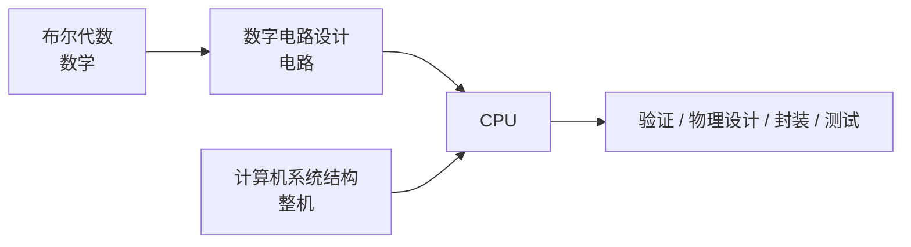

# 第 11 章：理论基石——布尔代数与数字电路

- **难度**：★★☆ | **学时**：0.7 小时 | **前置**：第 4、5 章

## 学习目标
- 能说出支撑 CPU 的三门基础理论
- 能列出 CPU 研制团队里至少六个岗位，并说出各自产出什么
- 能解释为什么电路设计比软件编程更难

## 一句话核心
CPU 是数学、电子、计算机科学三股绳拧出来的。设计它的难，不在单个模块，在模块之间那张网。

## 零基础讲解
### 三门底子
布尔代数：1847 年布尔在《逻辑的数学分析》里把逻辑写成代数，二进制从此有了运算规则。数字电路设计：用 0/1 电平搭电路，CPU 的引脚、内部模块都跑在这套逻辑上。计算机系统结构：讲整机由哪些模块组成、模块之间怎么连，CPU 是其中最复杂的一块。

缺一门都做不成：只有数学是纸上谈兵，只有电路是没有灵魂的开关，只有系统结构是画不出来的框图。

### 一支 CPU 团队有哪些人
数字电路设计：用 Verilog 写逻辑，龙芯 3A4000 的源码有几十万行。
物理设计：决定每个器件在芯片上的位置、连线，做时序分析，输出交给流片厂的版图。
全定制设计：手工摆每个晶体管，用在寄存器堆这类最要性能的模块上。
可测性设计（DFT）：加测试接口，能控制、能观察内部状态。
性能评估与优化：追学术新方法，也复盘自家产品的瓶颈。
安全分析：盯漏洞与后门，在设计中规避。
电路验证：在流片前用 FPGA 跑设计，证明功能对。
模拟电路：温度传感器、部分外设接口这类少量模块。
封装设计：外壳尺寸、材料。
测试：硅后测试，筛成品。

这套岗位组合起来，就是一颗 ASIC 的完整设计流程。

### 为什么电路比软件难
第一，工具差一代。软件语言一路演进到 Python、Java，硬件描述语言主流还是八十年代的 Verilog，描述能力大致在汇编和 C 之间。

第二，结构不同。软件是树形分层，模块高内聚低耦合，能拆开单独测；电路为了性能高度耦合，是网状结构，模块并行工作，拆不开。软件那套"分而治之"在电路上不好使。

第三，有状态。软件推崇无状态函数，输入定输出就定；电路模块大量带存储，输出还取决于内部记忆，测试要考虑输入顺序、时间维度。有状态模块的验证工作量，比无状态大得多。

## 图示

看图说明：左边两门理论合成设计能力，右边是工程实现链条。理论给你"能不能算"，工程链决定"能不能造出来、造得对不对"。

## 类比与实例
- 类比：电路设计像中医看病，靠的是长期经验和整体判断；软件像现代流水线，分工明确、每道工序可独立检验。失效边界：中医也有规范，电路也有工具链，这个比喻只强调"整体耦合"这一面。
- 实例：龙芯 GS232 的微结构图是一张密密麻麻的网，几乎每个模块都跟好几个模块相连。看软件架构图，通常是整齐的树；看电路架构图，很难找到干净的层级。

## 常见误解
- 别以为写 Verilog 就是写代码。它描述的是同时存在的电路，不是顺序执行的语句。
- 别以为验证是"跑一遍看看"。验证的工作量往往超过设计本身。
- 别以为全定制一定更好。它性能高，但人力和周期成本也高，只在关键模块用。

## 自测题
1. 下列哪项不属于 CPU 的三门基础理论？｜概率论｜布尔代数｜数字电路设计｜答案：A｜解析：书中列的是布尔代数、数字电路、计算机系统结构。
2. 物理设计的输出是什么？｜可交给流片厂的版图｜一份需求文档｜一段汇编代码｜答案：A｜解析：物理设计确定器件位置与连线，最终形成版图。
3. 电路设计比软件难的原因不包括？｜电路模块都是无状态的｜硬件描述语言更新慢、描述能力弱｜电路是高度耦合的网状结构｜答案：A｜解析：电路模块大量是有状态的，恰恰更难。

## 抽认卡
- CPU 的三门基础理论？｜布尔代数、数字电路设计、计算机系统结构
- 数字电路设计用什么语言？｜硬件描述语言，如 Verilog、VHDL
- DFT 的作用？｜增加可控可观测的测试接口，便于验证与排错
- 电路验证常用什么平台？｜FPGA，用设计源码模拟真实芯片
- 电路为什么难分而治之？｜模块高度耦合、网状连接、并行工作
- "有状态"模块难在哪？｜输出还取决于内部存储，测试要覆盖输入顺序与时间维度

## 术语
- 布尔代数：研究二进制逻辑表示与运算的数学理论
- 硬件描述语言：描述数字电路功能与结构的文本语言
- 物理设计：确定器件位置、连线并输出工艺版图的设计阶段
- 全定制设计：手工排布每个晶体管的高性能实现方式
- 可测性设计（DFT）：为测试与调试增加专用电路接口的设计方法

## 复习锚点
- 数学给规则，电路给载体，体系结构给组织方式
- 设计流程十来个岗位，验证与物理设计是大头
- 电路难在"网"和"状态"
