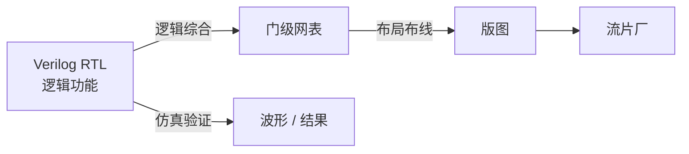

# 第 12 章：EDA——在电脑里先把 CPU 造一遍

- **难度**：★★☆ | **学时**：0.6 小时 | **前置**：第 11 章

## 学习目标
- 能说出 EDA 的两大功能
- 能走通 RTL → 逻辑综合 → 门级网表 → 版图这条链
- 能区分前端设计与后端设计

## 一句话核心
EDA 是芯片的设计软件。你用 Verilog 写"要什么功能"，它帮你算"怎么摆晶体管"。

## 零基础讲解
### 两大功能
设计：把 Verilog 描述的电路，自动转成晶体管布局和连线，顺带做时序分析、功耗分析、封装设计。
验证：在流片前自动检查设计代码，甚至加载代码像真 CPU 一样跑起来，看状态变化对不对——这叫仿真。

### 产业链位置
全球 EDA 市场九成半在美国三巨头手里：Synopsys、Cadence、Mentor。这是芯片产业最上游的软件，源代码规模不低于 CPU 和操作系统，属于需要多年积累的高门槛产品。高端工具贵到一年几千万美元，小公司根本用不起。

国产有十余家，华大九天、芯禾、广立微等，工艺上以 16nm、28nm 为主，还撑不起 7nm；加起来占全球份额约 1%。点工具好用，全流程还差。

### 开源也能练手
学原理不必上高端工具。任何文本编辑器都能写 Verilog，一个模块一个文件，整个 CPU 拆成一堆文件，合起来叫一个项目。验证用 iverilog，先编译再仿真；状态变化用 gtkwave 看波形，0/1 随时间起伏像波浪。

这套环境能完成大部分 CPU 原理教材的实验，也是龙芯新人入门用的工具链，甚至可以在龙芯机器上跑——"用龙芯电脑设计龙芯 CPU"。

### Verilog 里有什么
module 定义模块，wire 是连线，reg 是存储，assign 描述组合逻辑，always 描述时序逻辑，initial 是初始动作，再加上运算符、if-else、循环、函数。还有时钟信号、EDA 提供的单元库（加法器、乘法器、存储器），以及设计约束——时序、面积、功耗三条硬杠。

### 从抽象到实现
Verilog 写出来的是 RTL 模型（寄存器传输级），描述数据在寄存器之间怎么流动、怎么加工。这不是真正的门电路。

逻辑综合把 RTL 转成门级模型：门单元加连线，像一张网，所以叫网表（netlist）。这一步类似软件里的编译。

以网表为界，前面叫前端（逻辑设计），后面叫后端（物理设计：布局布线，定下晶体管实际位置，产出交付流片厂的版图）。

## 图示

看图说明：仿真那条支路是"先在电脑里试错"，流片是"真花钱"。前端改一行代码几乎不要钱，流片改一版要几百万美元，所以验证必须做足。

## 类比与实例
- 类比：EDA 像建筑行业的 BIM 加自动出图。设计师只画功能与结构，软件算钢筋怎么排、管线怎么走，还能先做碰撞检查。失效边界：BIM 错了改图就行，芯片错了要重新流片，代价高几个数量级。
- 实例：用 iverilog 仿真一个加法器，给输入 A=3、B=5，波形窗口里能看到进位与和的变化逐拍出现。这种"看得见的 0/1"是初学者理解时序最直接的方式。

## 常见误解
- 别以为 EDA 只是画图工具。它的验证能力才是保命的部分。
- 别以为开源 EDA 只能玩。教学、嵌入式、控制类 CPU 完全够用。
- 别以为有了 EDA 就不需要懂电路。工具替你布线，不替你决定架构。

## 自测题
1. EDA 的两大功能是？｜设计与验证｜编译与运行｜绘图与打印｜答案：A｜解析：自动布局布线和仿真验证是核心。
2. RTL 经逻辑综合后得到什么？｜门级网表｜汇编代码｜版图｜答案：A｜解析：网表是门单元及其连线的描述。
3. 前端与后端的分界点是？｜网表｜操作系统｜封装｜答案：A｜解析：网表之前是逻辑设计，之后是物理设计。
4. 常用于教学的波形查看工具是？｜gtkwave｜Photoshop｜WPS｜答案：A｜解析：gtkwave 用来观察仿真中 0/1 随时间的变化。

## 抽认卡
- EDA 全称？｜电子设计自动化
- RTL 是什么？｜寄存器传输级模型，描述数据在寄存器间的流动与加工
- 逻辑综合做什么？｜把 RTL 自动转换成门级网表
- 版图是什么？｜确定器件位置与连线的最终设计文件，交付流片
- 开源仿真器与波形工具？｜iverilog 与 gtkwave
- EDA 三巨头？｜Synopsys、Cadence、Mentor

## 术语
- EDA：电子设计自动化，芯片设计与验证软件
- RTL：寄存器传输级，Verilog 描述的抽象电路模型
- 逻辑综合：把 RTL 转成门级网表的过程
- 网表：门单元及其连接关系的描述
- 版图：含器件位置与连线的物理设计成果
- 仿真：用软件模拟电路运行以验证功能

## 复习锚点
- EDA 管设计也管验证
- RTL → 网表 → 版图，前端到后端
- 流片很贵，所以先在电脑里跑够
