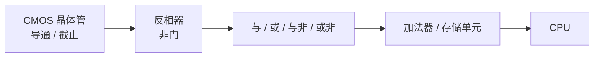

# 第 13 章：二进制——从开关到数字

- **难度**：★★☆ | **学时**：0.8 小时 | **前置**：无（本章可独立读）

## 学习目标
- 能用 CMOS 晶体管解释 0/1 的物理来源
- 能用"字符表 + 权重"说明任意进制，并会做十进制转二进制
- 能解释补码为什么让 CPU 只需要加法器
- 能说出 IEEE 754 浮点数存了哪两部分

## 一句话核心
0/1 不是抽象符号，是晶体管导通与截止。补码让减法变成加法，浮点数让小数点的位置可以浮动。

## 零基础讲解
### 0 和 1 从哪来
CPU 里最小的物理单元是 CMOS 晶体管，材料是硅、二氧化硅、金属、多晶硅。它的特性很简单：电压控制下导通或截止。导通就是能过电子，截止就是绝缘。像水龙头，电压是旋钮。

引脚电压低代表 0，高代表 1。两个晶体管组成一个反相器（非门）：输入低就输出高，反之亦然。有了非门，按布尔代数就能拼出与、或、与非、或非，再往上拼出计算单元和存储单元。整个 CPU 是从这颗小开关一层层叠起来的。

硅在地壳里占 26.3%，所以这行叫"硅工业"。

### 数制：字符表和权重
N 进制用 0 到 N-1 做字符，从低位到高位排列，第 n 位的权重是 N 的 n 次方。二进制只有 0 和 1，权重是 1、2、4、8……十进制 183 用 8 位寄存器表示就是 10110111（128+32+16+4+2+1）。

### 补码：让减法消失
原码是把最高位当符号位，0 正 1 负。麻烦在于加减要分别判断符号位和数值位，电路复杂。

补码换了个思路：正数的补码等于原码；负数的补码是原码按位取反再加一。这样符号位和数值位可以统一处理，加法就是按位加；减法 A-B 变成 A+(-B)，把 B 取反加一再加就行。

结果就是现在的 CPU 只有加法器，没有减法器。补码的发明远早于计算机——1645 年帕斯卡的机械计算器用的就是十进制补码。

### 浮点数：小数点会移动
定点表示范围太小：32 位整数最大约 21 亿（2 的 31 次方），科学计算不够用。

浮点数借科学计数法：125.62 写成 1.2562×10 的 2 次方，只需存底数"1"后面的部分和指数。IEEE 754 规定单精度 32 位，最大约 3.4×10 的 38 次方；双精度 64 位，最大约 1.8×10 的 308 次方。龙芯也遵循这个标准，有独立浮点寄存器和浮点运算器。

要记住一个边界：计算机只能存有限小数，数学里的无限小数、无理数它存不下。

## 图示

看图说明：越往下越抽象。看这张图要抓的是"逐层叠加"：没有一个叫"CPU"的魔法零件，只有开关和开关的组合。

## 类比与实例
- 类比：补码像钟表。把 8 点往回拨 3 小时，等于往前拨 9 小时，表盘上结果一样。模运算里，减一个数等于加它的补数。失效边界：钟表是 12 进制循环，计算机是 2 的 n 次方循环，溢出时会绕回，这既是技巧也是坑。
- 实例：8 位下算 -5 的补码：5 是 00000101，取反 11111010，加一 11111011。用它和 7（00000111）相加得 00000010，即 2，正好是 7-5。

## 常见误解
- 别以为 0/1 是"电子的有无"。它是电压高低两个区间，中间还有不允许的过渡带。
- 别以为浮点数精度很高。0.1 在二进制里就是无限循环小数，存进去必然有误差，所以金额计算不能用浮点。
- 别以为位宽越多越好。64 位已够用，128 位暂时没有实际需求，加了只是成本。

## 自测题
1. CPU 中 0 和 1 的物理载体是？｜CMOS 晶体管的截止与导通｜磁盘的磁极｜光的明暗｜答案：A｜解析：引脚电压高低对应 0/1。
2. 负数补码的计算方法是？｜原码按位取反后加一｜原码加一｜原码最高位置一｜答案：A｜解析：这是补码的标准定义。
3. 补码带来的直接好处是？｜减法可转成加法，只需加法器｜存储容量翻倍｜主频提高｜答案：A｜解析：符号位与数值位统一处理。
4. IEEE 754 单精度浮点数的位宽是？｜32 位｜16 位｜64 位｜答案：A｜解析：单精度 32 位，双精度 64 位。

## 抽认卡
- 反相器由几个晶体管组成？｜两个
- N 进制的两条基本规则？｜字符表 0 到 N-1；第 n 位权重为 N 的 n 次方
- 负数的补码怎么求？｜原码按位取反再加一
- 为什么 CPU 没有减法器？｜补码把减法化成了加法
- IEEE 754 存浮点数的哪两部分？｜底数（有效数字）与指数
- 计算机能表示所有实数吗？｜不能，只能表示有限小数

## 术语
- CMOS：互补金属氧化物半导体，CPU 的基础器件
- 反相器：输出与输入相反的基本门电路
- 补码：让符号位与数值位统一运算的编码方式
- 定点数：小数点位置固定的表示方式
- 浮点数：按科学计数法存储底数与指数的表示方式
- IEEE 754：国际通用的浮点数表示标准

## 复习锚点
- 0/1 = 电压高低 = 晶体管开合
- 补码把减法变成加法
- 浮点 = 底数 + 指数，精度有边界
