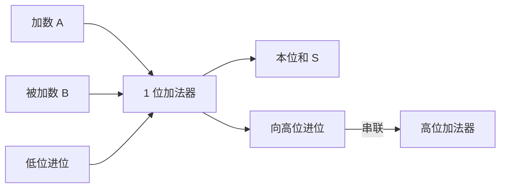

# 第 14 章：CPU 的天职——数值运算

- **难度**：★★☆ | **学时**：0.6 小时 | **前置**：第 13 章

## 学习目标
- 能说明 1 位加法器怎样串成 32 位加法器
- 能列出 ALU 的四类常见功能
- 能区分数数据寄存器、指令寄存器、地址寄存器、标志位寄存器
- 能解释"CPU 是多少位"指的是什么

## 一句话核心
CPU 的算力起点是一个能做"1+1"的电路。把它串起来、并起来、加快起来，就有了现代 CPU。

## 零基础讲解
### 从 1 位加法器到 32 位
1 位加法器有三个输入：加数 A、被加数 B、低位来的进位 Cin；两个输出：本位的和 S、向高位的进位 Cout。八种输入组合可以手工列全，十来颗晶体管就能实现。

多位加法就是串联：32 位加法器由 32 个 1 位加法器从低到高连起来，低位进位喂给高位，跟小学列竖式一模一样。

乘法器最常见的是"移位加"：乘数每一位决定要不要把被乘数移位后加上去，也是竖式思路。1960 年代科学家把高速算法挖到极致，现在很少再出新算法，龙芯沿用的也是那批经典方法。

### ALU：一个模块干多种活
算术逻辑单元（ALU）把多种运算装进一个模块：算术（加、减、乘、除、余数）、移位（左、右）、逻辑（与、或、非、异或、取反）、比较（相等、大于、小于）、地址（当前指令地址加偏移求跳转目标）。科学计算用的高级 ALU 还能做指数、对数、三角、开方。

典型结构：两个源操作数 A、B，一个结果 S，一个控制端 ALUop 选择做哪种运算。

一条指令只能用一个 ALU 的话，速度上不去。所以高性能 CPU 放多个 ALU 并行工作——龙芯 2 号有 5 个运算模块：2 个整数 ALU、1 个地址 ALU、2 个浮点 ALU，同时开工，速度提升数倍。

### 寄存器：CPU 的草稿纸
寄存器是 CPU 内部的存储单元，和存储器（内存）相对：内存大、在片外，存程序的输入和最终结果；寄存器小、在片内，存计算过程的中间数据，讲究"瞬时"。

按用途分：数据寄存器（整数、浮点分开）、指令寄存器（暂存待执行的指令）、地址寄存器（存要访问的内存地址，其中存下一条指令地址的叫程序计数器 PC）、标志位寄存器（存运算结果的特征，比如是否为零、是否溢出）。

位宽是一个寄存器包含多少二进制位，"CPU 是多少位"说的就是它。位宽大，能表示的范围大、算力强，但成本也高。历史从 8 位、16 位走到 32 位、64 位；64 位已够用，桌面和服务器暂时没有 128 位的需求。龙芯 1 号是 32 位，2 号、3 号是 64 位。

一组寄存器做成一个模块就是寄存器堆，三个端口：地址端口选编号，读写控制端口定方向，数据端口进出数据。

## 图示

看图说明：进位那根线是关键。它从低位一路传到高位，位宽越大，进位链越长，这也是加法器速度优化的着力点。

## 类比与实例
- 类比：寄存器像做题时的草稿纸，内存像课本和作业本。草稿纸就在手边，写得快，但只有几页；作业本厚，翻起来慢。失效边界：草稿纸写完可以擦，寄存器会被下一条指令直接覆盖，程序员得自己安排谁先用谁后用。
- 实例：算 183+97。8 位加法器从最低位开始，逐位加并传递进位，最后得到 280，但 8 位最大只能表示 255，于是溢出。标志位寄存器会把溢出位置一，程序据此判断结果是否可信。

## 常见误解
- 别以为乘法是独立硬件从头算。很多实现是移位加，靠加法器反复用。
- 别以为寄存器越多越好。数量多了编码变长、访问变慢，编译器分配也更难。
- 别以为 64 位一定比 32 位快一倍。位宽影响的是寻址范围与单次处理能力，实际性能还看微结构。

## 自测题
1. 32 位加法器由什么构成？｜32 个 1 位加法器串联，低位进位接高位｜32 个乘法器｜一个 32 位寄存器｜答案：A｜解析：与竖式加法同理，逐位进位。
2. ALU 的控制端 ALUop 作用是什么？｜选择执行哪种运算｜设置主频｜选择寄存器编号｜答案：A｜解析：它决定多路选择器输出哪一路运算结果。
3. "CPU 是多少位"通常指？｜寄存器的位宽｜主板尺寸｜风扇转速｜答案：A｜解析：位宽决定单次处理的数据宽度与寻址能力。
4. 程序计数器 PC 属于哪类寄存器？｜地址寄存器｜数据寄存器｜标志位寄存器｜答案：A｜解析：PC 保存下一条要执行的指令地址。

## 抽认卡
- 1 位加法器有几个输入输出？｜3 个输入（A、B、Cin），2 个输出（S、Cout）
- 乘法器的基本算法？｜移位加
- ALU 的四类常见功能？｜算术、移位、逻辑、比较（另有地址运算）
- 寄存器与存储器的区别？｜寄存器在片内、容量小、存中间数据；存储器在片外、容量大、存程序与结果
- 寄存器堆的三个端口？｜地址端口、读写控制端口、数据端口
- 标志位寄存器存什么？｜运算结果的特征，如是否为零、是否溢出

## 术语
- 加法器：实现二进制加法的电路，多位由 1 位串联而成
- ALU：算术逻辑单元，执行多种运算的部件
- 寄存器：CPU 内部的小容量高速存储单元
- 程序计数器（PC）：保存下一条指令地址的寄存器
- 寄存器堆：一组寄存器构成的模块，带地址与读写端口
- 溢出：运算结果超出寄存器位宽所能表示的范围

## 复习锚点
- 加法器串联靠进位，乘法靠移位加
- ALU 多而并行，算力才上得去
- 寄存器是草稿纸，位宽定义"多少位 CPU"
