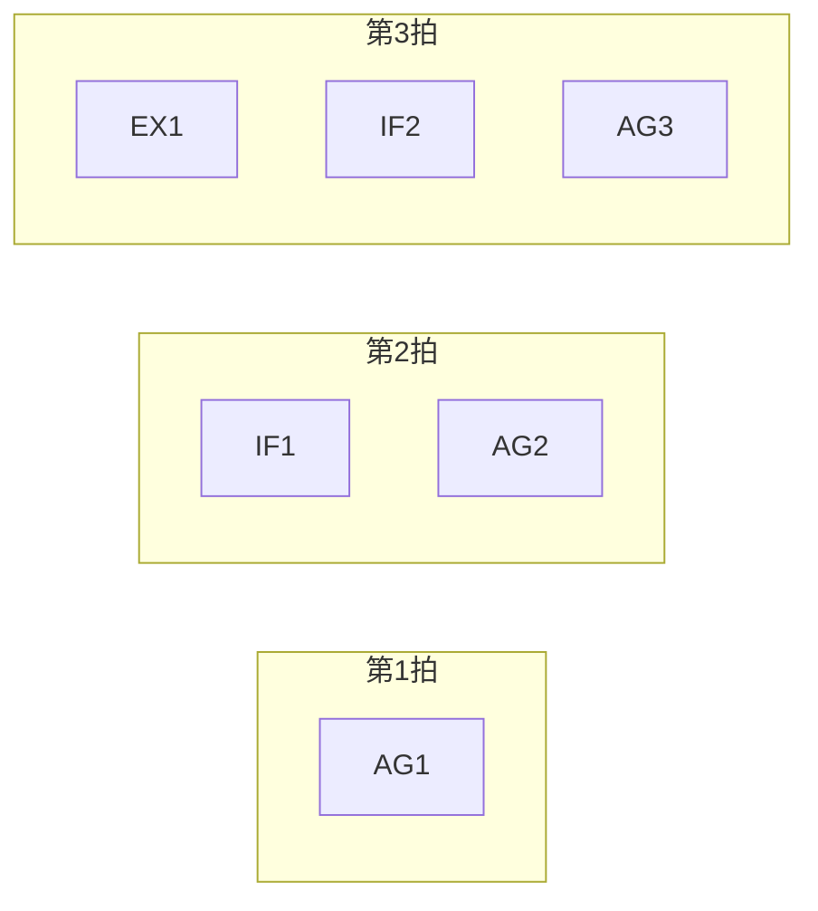

# 第 15 章：流水线的奥秘

- **难度**：★★★ | **学时**：0.7 小时 | **前置**：第 14 章

## 学习目标
- 能画出四级流水线，并说明为什么两条指令只要 5 拍而不是 8 拍
- 能列出流水线级数增加的好处与代价
- 能用 Pentium 4 的例子说明"主频不等于性能"

## 一句话核心
流水线是把一条指令切成几段，让不同段同时处理不同指令。切得越细主频越高，但段间的开销也越大。

## 零基础讲解
### 四段怎么切
以 CHN-1 为例，一条指令分四段：算地址（AG，地址计数器加一）、取指令（IF，从存储器取到指令寄存器）、执行（EX，运算器生成点阵）、显示（DC，输出到屏幕）。顺序固定：AG → IF → EX → DC。相邻两段之间用寄存器存上一步的结果。

不做流水时，一条指令占四个节拍，两条要八拍。每一刻只有一段在干活，另外三段闲着。

### 叠加起来
第一条在执行 IF 时，第二条的 AG 完全可以同时开始——用的是不同硬件，不冲突。于是两条指令从 8 拍缩到 5 拍。这就是流水线：宏观上多条指令同时在跑，微观上每一刻各段都在忙。

CHN-4 用 4 分频时钟驱动四个段，是四级流水线，最多四条指令并行。级数可以继续加，每级干的活更少，龙芯 3A4000 做到了 12 级。历史上 ILLIAC 2 在 1958 年就用了三级：取指、译码、执行。

流水线原理简单、容易用数字电路实现，从超算到嵌入式、手机 CPU 全都在用，所以教材都拿它当开篇第一课。

### 级数不是越多越好
好处有两个：并行度提高，单位时间完成的指令更多（吞吐率上升）；每级活少，时钟节拍可以更短，主频可以更高。

代价也有两个：段间寄存器变多，面积、功耗、成本都涨；数据在寄存器间多走几趟，单条指令的延迟反而变长。再叠加转移猜测、指令相关这些机制，收益可能被吃光。

### 一场主频大战的教训
1999 年 AMD 的 Athlon 率先跑到 1GHz，压过 Pentium 3。Intel 2000 年推 NetBurst 架构的 Pentium 4，靠加深流水线冲主频：P3 是 11 级，P4 一开始 20 级，后来到 31 级，主频冲到 1.4GHz 以上。结果实测计算速度还不如 P3 和 Athlon。消费者这才发现，为"主频"多掏的钱没换来性能。

这段历史说明：主频只是性能公式里的一个因子，流水线深度是拿延迟换频率，换过头就亏。

## 图示

看图说明：斜着看是同一时刻并行工作的不同段，横着看是一条指令走完全程。流水线的效率来自这张"斜表"被填满，一旦遇到跳转或数据依赖，表里就会出现空档。

## 类比与实例
- 类比：流水线像洗车房。冲水、打泡沫、擦干、上蜡四道工序，四辆车可以同时在不同工位。单辆车通过仍要四道工序的时间，但整体吞吐翻了几倍。失效边界：车与车之间不会互相等数据，指令之间会——后一条要用前一条的结果，就得停下来等。
- 实例：把一条指令切成 12 级，主频也许能从 2GHz 提到 3GHz，但一次跳转猜错要清空十几级流水，惩罚比以前更重。所以深流水必须配更好的分支预测，否则白搭。

## 常见误解
- 别以为流水线让单条指令变快。它优化的是吞吐，不是延迟，单条反而可能更慢。
- 别以为级数越多越先进。P4 的 31 级就是反面教材。
- 别以为流水线只在大芯片里有。手机、嵌入式 CPU 一样用。

## 自测题
1. 四级流水线执行两条指令需要几拍？｜5 拍｜8 拍｜4 拍｜答案：A｜解析：第一拍填满，之后每拍出一条，共 4+2-1=5。
2. 加深流水线的主要好处是？｜提高吞吐率与主频｜降低面积｜减少寄存器｜答案：A｜解析：每级活少、时钟可更短，同时并行度更高。
3. Pentium 4 的教训说明？｜主频高不等于性能高｜流水线没有用｜AMD 没有竞争力｜答案：A｜解析：31 级流水线主频虽高，实测性能不及 P3。
4. 段间寄存器的作用是？｜保存上一段的结果供下一段使用｜提高电压｜存储程序｜答案：A｜解析：它是流水段之间的数据交接点。

## 抽认卡
- 流水线的定义？｜把指令切成多段，由不同硬件同时处理多条指令
- 四级流水线的四个段？｜算地址 AG、取指 IF、执行 EX、显示 DC
- 为什么两条指令只要 5 拍？｜不同段用不同硬件，可叠加执行
- 加深流水线的两个代价？｜面积功耗上升；单条指令延迟变长
- 龙芯 3A4000 的流水线级数？｜12 级
- 吞吐率与延迟的区别？｜单位时间完成的任务量 vs 单条任务从开始到结束的时间

## 术语
- 流水线：把指令执行切分为多段并叠加处理的结构
- 吞吐率：单位时间内完成的指令数量
- 流水级：流水线中的一段，由独立电路模块承担
- 段间寄存器：保存上一段结果、供下一段读取的寄存器
- 主频：时钟每秒跳动的次数

## 复习锚点
- 流水线换的是吞吐，不是单条速度
- 级数加深：频率升、开销也升
- 主频只是性能的一个因子
