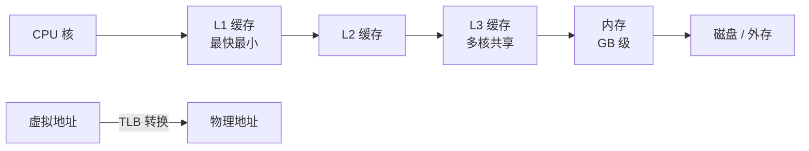

# 第 17 章：内存、缓存与虚拟内存

- **难度**：★★☆ | **学时**：0.7 小时 | **前置**：第 14 章

## 学习目标
- 能说明访存指令（LD/ST）做了什么
- 能解释缓存为什么有效：数据局部性
- 能说清多级缓存的取舍，以及虚拟内存的分段与分页差别

## 一句话核心
CPU 太快，内存太慢，缓存是中间那张小桌子。虚拟内存是给每个程序发一张"看起来连续"的地图。

## 零基础讲解
### CPU 怎么和内存说话
内存是一组带地址的存储单元，程序和数据都先放进去。CPU 靠访存指令读写：读（LD）把内存单元的值搬进寄存器，写（ST）把寄存器的值写回内存。寄存器是双方交接的中转站。

内存有三类端口：地址端口选单元，读写控制端口定方向，数据端口搬数据。CPU 通过内存控制器调用它们，流水线里这一级叫访存阶段（MEM），排在提交之前。

龙芯的写法是 `LD r1, (r0)offset`：r0 的值加偏移算出地址，取出的值进 r1；ST 反过来。

### 容量单位与"尾端"
1 位是 1 bit，8 位是 1 字节；1024B=1KB，往上到 MB、GB、TB。网页约 100KB，一首 MP3 约 5MB，两小时高清电影约 5GB，拍一年照片能到 1TB。台式机常配 8GB，服务器 256GB 起，最小嵌入式 64KB 就够。

尾端（Endian）说的是多个字节装进一个寄存器时的排列。大尾端：内存低地址的字节放到寄存器高位；小尾端：低地址放低位。没有绝对优劣，x86、ARM、龙芯都用小尾端，有些 Power、MIPS 可配置。

### 缓存：小桌子放大书
矛盾很直接：2GHz 的 64 位桌面 CPU 每秒能执行上百亿条指令，DDR4 内存在 2.4GHz 时峰值约 19200MB/s，供数速度差一个数量级。CPU 只能干等。

缓存用更快的工艺做一小块存储，放内存的"局部备份"。依据是数据局部性：CPU 反复用的数据只占内存很小一部分，也就是热点数据。缓存把这些热点留下，再访问就快几十上百倍。

代价是贵，所以容量做不大：内存以 GB 计，缓存只有几十 MB。于是分级：一级最近最快最小，三级最远最慢最大。访问时先查一级，没有再往下，全没有才去内存。主流最多三级，超算可到四级。2000 年前二三级缓存还常在 CPU 外，现在都集成进芯片，占的面积甚至超过处理器核本身。

龙芯 3A4000：4 个核，每核 64KB 一级、256KB 二级，4 核共享 8MB 三级。

### 虚拟内存：每个程序一张假地图
单任务时代，程序可以随便用整块内存。多任务并发后不行了，得由操作系统分配。

虚拟内存给每个程序一块"看起来连续"的地址空间。程序看到的是虚拟地址，真正装在机器上的是物理内存。两种实现：分段，给每个程序一段连续的物理内存，简单快，但不容易伸缩、浪费多；分页，把物理内存切成页，虚拟地址映射到不一定连续的页上，可以按需分配、随时回收，利用率高。

分页时，访存指令给的是虚拟地址，CPU 里的地址转换模块（TLB）翻成物理地址再访问。高性能 CPU 都有这套模块。

## 图示

看图说明：越往右越慢越大。这张金字塔决定了程序性能的上限——数据在 L1 里和在内存里，差的是几十倍的时间。TLB 那条线说明地址翻译是另一条并行的关键路径。

## 类比与实例
- 类比：缓存是书桌，内存是书柜，硬盘是图书馆。写论文时先把要用的几本书摊在桌上，需要别的再去书柜翻，实在没有才跑去图书馆。失效边界：书桌挪书要人动手，缓存换入换出由硬件自动做，而且换错一次（缓存缺失）的代价可能上百拍。
- 实例：遍历一个 100MB 的数组，按行顺序访问很快，按列跳跃访问明显变慢。数据没变、指令没变，慢在缓存装不下、每次都要去内存取。

## 常见误解
- 别以为缓存越大越好。面积、成本、访问延迟都会涨，还得看命中率是否真的提升。
- 别以为虚拟内存是"硬盘当内存"。换页到磁盘只是它的一种实现手段，核心是地址空间隔离与映射。
- 别以为尾端只是学术细节。跨平台传二进制数据不处理尾端，读出来的数就是错的。

## 自测题
1. 读指令 LD 的功能是？｜把内存单元的值加载到寄存器｜把寄存器值写入内存｜跳转到目标地址｜答案：A｜解析：LD 是 load，方向是内存到寄存器。
2. 缓存有效的依据是？｜数据局部性，热点数据被反复访问｜内存容量大｜CPU 主频低｜答案：A｜解析：少量热点数据留在高速存储里，命中率就高。
3. 分页相对分段的主要优势是？｜按需分配、便于伸缩、利用率高｜实现更简单｜速度更快｜答案：A｜解析：分页是离散映射，可增可减。
4. 大尾端的含义是？｜内存低地址字节装入寄存器高位｜低地址装入低位｜两种都可｜答案：A｜解析：这是大尾端的定义，与小尾端相反。

## 抽认卡
- LD 与 ST 的方向？｜LD 内存到寄存器；ST 寄存器到内存
- 容量单位换算？｜1024B=1KB，1024KB=1MB，1024MB=1GB，1024GB=1TB
- 数据局部性是什么？｜CPU 反复访问的内存只占很小一部分
- 多级缓存的取舍？｜近的快而小，远的慢而大，兼顾成本与速度
- 虚拟内存的两种实现？｜分段与分页
- TLB 的作用？｜把虚拟地址翻译成物理地址

## 术语
- 访存指令：读写内存的指令，如 LD、ST
- 尾端：多字节数据在寄存器中的排列顺序
- 缓存：CPU 与内存之间的小容量高速存储
- 数据局部性：访问集中在少量地址且反复使用的规律
- 虚拟内存：操作系统为程序提供的抽象地址空间
- TLB：地址转换后备缓冲器，缓存虚拟地址到物理地址的映射

## 复习锚点
- CPU 与内存的速度差，靠缓存填
- 缓存靠局部性生效，靠分级平衡成本
- 虚拟内存让每个程序以为自己独占内存
