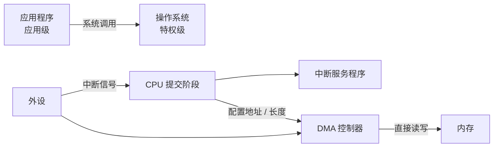

# 第 18 章：CPU 的"外交"——特权级、中断与 I/O

- **难度**：★★☆ | **学时**：0.6 小时 | **前置**：第 17 章

## 学习目标
- 能解释特权级怎样隔开操作系统与应用程序
- 能分清中断与例外的触发源
- 能说明 DMA 为什么比直接 I/O 高效

## 一句话核心
CPU 只管算，外设的事靠三条通道接进来：总线搬数据、中断报消息、DMA 让数据自己走。

## 零基础讲解
### 特权级：两把钥匙
并发系统里，一个程序不能随便动别人的东西。CPU 于是把运行状态分成等级：至少两级，操作系统级和应用级。

资源也分级：有的任何状态都能访问，有的核心资源（关键寄存器、时钟等）只有操作系统能碰。

指令同样分级：应用态指令谁都能执行；特权指令只有操作系统能执行，比如设置运行等级的那条。

开机时 CPU 处于操作系统级，可以"无所不能"。操作系统把程序装进内存，用特权指令把 CPU 降到应用级，程序才开始跑。程序只能执行应用态指令，碰不到别人的资源。

运行中特权级会来回切换：操作系统调程序，高级到低级；程序遇到例外、外设中断或系统调用，低级回高级。

### 中断与例外：一个从外，一个从内
中断是外部事件让 CPU 停下当前指令。键盘按键、网卡收到报文、定时器到点，都属于外部。没有中断机制时，CPU 只能轮询——反复检查设备状态，白费时间。

中断信号走到 CPU 引脚上，CPU 一般在流水线最后一级（提交阶段）检查电平，决定继续还是处理。处理时停止取指，切到操作系统级，跳到中断服务程序（ISR），由它判断是哪个设备、把数据取走，再切回应用级继续跑。

例外是 CPU 内部指令执行触发的，比如除零。两者的机制相似，触发源不同：中断来自外部信号，例外来自指令本身。

### I/O：总线加指令
CPU 芯片上有专门连外设的引脚，合起来叫外设总线，三类信号：地址（找哪个设备）、控制（读还是写）、数据（搬什么）。

I/O 指令负责读写外设。有的 CPU 让 I/O 指令与访存指令共用，只靠地址空间区分——龙芯就是这样，用 `LD` 读一个外设地址。

完整机制是三件套：外设总线提供物理连接，I/O 指令给软件入口，中断提供事件通知。

### DMA：让数据绕开 CPU
直接 I/O 的问题是效率。每条 I/O 指令搬的数据不超过寄存器宽度，32 位 CPU 传 1MB 要 32768 条指令，CPU 时间全耗在搬运上。

DMA 在内存和外设之间加一个控制器，它跟 CPU 独立工作。CPU 只要告诉它：从哪个外设读、读多长、放到内存哪个起始地址，剩下的事控制器自己干。传完发一个中断说"好了"，CPU 直接用内存里的数据。

DMA 控制器就是个典型的协处理器，专干一件事，不用跑指令流水线，单位时间能搬更多数据。这项技术最早在大型机上用，现在台式机、服务器甚至手机都有，控制器一般集成在处理器芯片里。

## 图示

看图说明：上面那条是权限切换，下面那条是数据通道。注意 DMA 绕过了 CPU——CPU 只下命令，不搬箱子，这就是它高效的原因。

## 类比与实例
- 类比：特权级像公司门禁。普通员工（应用）只能进自己楼层，管理员（操作系统）能进机房。中断像前台打内线电话，你得放下手上的事去接。失效边界：门禁是物理的，权限切换是 CPU 状态位，切换本身只要几个周期，代价小得多。
- 实例：拷贝一个 1GB 文件。走直接 I/O，CPU 要执行上千万条搬运指令，风扇狂转；走 DMA，CPU 下完命令就去干别的，硬盘和内存自己传，传完一个中断通知。

## 常见误解
- 别以为中断是"出错"。正常的数据到达也叫中断，它是通知机制，不是故障。
- 别以为特权级只是软件约定。它是硬件强制，应用态执行特权指令会直接触发例外。
- 别以为 DMA 不需要 CPU。配置、启动、收尾都要 CPU，只是不参与逐字节搬运。

## 自测题
1. 特权级机制的作用是？｜隔离应用与操作系统可访问的资源｜提高主频｜扩大内存｜答案：A｜解析：防止一个程序破坏其他程序与系统。
2. 中断与例外的根本区别是？｜中断由外部信号触发，例外由指令执行触发｜中断更严重｜例外不可处理｜答案：A｜解析：触发源不同，处理机制类似。
3. DMA 高效的原因是？｜外设与内存直接传输，CPU 不逐条搬运｜DMA 主频更高｜DMA 能执行指令｜答案：A｜解析：控制器独立工作，省掉大量 I/O 指令。
4. 32 位 CPU 用直接 I/O 传 1MB 数据约需多少条指令？｜约 3 万多条｜约 30 条｜约 300 条｜答案：A｜解析：1MB÷32 位≈32768 条。

## 抽认卡
- 特权级至少分几级？｜两级：操作系统级与应用级
- 特权指令的例子？｜设置 CPU 运行等级的指令
- 中断的常见来源？｜键盘、网卡、定时器等外围设备
- 中断服务程序（ISR）做什么？｜判断中断来源、接收数据、处理后返回
- I/O 三件套？｜外设总线、I/O 指令、中断
- DMA 控制器属于哪类部件？｜协处理器

## 术语
- 特权级：CPU 为隔离资源而设置的运行权限等级
- 特权指令：只允许操作系统执行的指令
- 中断：外部事件触发 CPU 暂停当前流程的机制
- 例外：指令执行异常触发的处理机制
- DMA：直接存储器访问，外设与内存之间不经济 CPU 的数据传输方式

## 复习锚点
- 特权级靠硬件强制，不靠自觉
- 中断从外，例外从内
- DMA 让 CPU 下命令而不是搬数据
