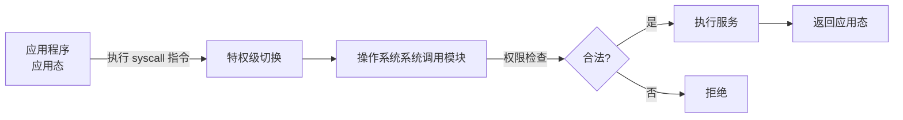

# 第 19 章：系统调用——应用与操作系统之间的桥

- **难度**：★★☆ | **学时**：0.5 小时 | **前置**：第 18 章

## 学习目标
- 能写出"应用程序 = 指令序列 + 库函数 + 系统调用"这个等式并解释每一项
- 能说明系统调用为什么必须切换特权级
- 能区分库函数与系统调用

## 一句话核心
应用只能在自己的院子里活动，想看墙外的信息，得走系统调用这道门，门卫是操作系统。

## 零基础讲解
### 为什么需要这扇门
有些信息应用自己拿不到：系统里有多少进程、网卡和硬盘里的数据、当前时间。这些都是核心资源，操作系统私有，应用无权直接访问。

但应用确实有正常需求。于是操作系统把这些能力封装成接口，应用按需调用。这就是系统调用。

调用的前提是检查。系统调用在 CPU 的高特权级下执行，操作系统会核验调用者权限，只对合法请求提供服务。每种操作系统都有一张系统调用清单，Linux 内核有两百多项。

### 一条指令完成切换
每种 CPU 都定义了系统调用指令。龙芯的是 `syscall`。应用执行到这条指令，CPU 把特权级切到操作系统级，跳到操作系统里的系统调用模块，服务做完再跳回来，继续执行 `syscall` 后面的指令。

### 库函数不是系统调用
把应用拆开看：一大串普通指令，加上库函数，加上系统调用。

库函数是语言层面封装好的功能，编译成模块供重复调用，最典型的是 C 的 `printf()`。但它本质仍是应用态指令序列，在应用权限下执行，碰不到核心资源和外设，也不会引发特权级切换。

区别就在这儿：库函数是"应用自己人帮忙"，系统调用是"进衙门办事"。`printf()` 最终要输出到屏幕，底层还得走系统调用，但那是它内部的事，不改变它自身的性质。

## 图示

看图说明：中间那道"权限检查"是整条链的关键。没有它，系统调用就成了提权后门；有了它，应用只能拿到被允许的那部分能力。

## 类比与实例
- 类比：系统调用像去银行柜台办业务。你不能自己进金库（核心资源），但可以递单子让柜员帮你取（系统调用），柜员会核对身份（权限检查）。失效边界：银行柜员有裁量权，系统调用的检查是代码写死的规则，按清单执行。
- 实例：程序要读文件，调用 `read()`。这个函数最终执行系统调用，操作系统核对文件描述符与权限，从磁盘取数据，再把结果交回应用。全程应用没碰过磁盘控制器。

## 常见误解
- 别以为系统调用很慢所以能不用就不用。它确实有切换开销，但正确性优先，该走还得走。
- 别以为库函数等于系统调用。前者是应用态的代码，后者会进内核。
- 别以为系统调用只是"函数"。它是 CPU 指令 + 操作系统服务 + 权限检查三件套。

## 自测题
1. 系统调用的执行权限是？｜操作系统级（高特权级）｜应用级｜无所谓｜答案：A｜解析：核心资源只能在高特权级下访问。
2. 下列哪项属于库函数而非系统调用？｜printf()｜syscall 指令｜read() 的内核实现｜答案：A｜解析：printf 是应用态的库函数。
3. Linux 内核的系统调用有多少项？｜两百多项｜十几项｜上万项｜答案：A｜解析：书中给出的量级是 200 多项。
4. 系统调用前操作系统会做什么？｜对应用进行权限检查｜重启计算机｜清空内存｜答案：A｜解析：防止恶意应用获取非法信息。

## 抽认卡
- 应用的三个组成部分？｜指令序列、库函数、系统调用
- 龙芯的系统调用指令？｜syscall
- 系统调用与库函数的本质区别？｜是否切换特权级、进入操作系统执行
- 系统调用能提供哪三类典型服务？｜查资源使用、读外设数据、取当前时间
- 为什么系统调用要做权限检查？｜防止应用越权访问核心资源

## 术语
- 系统调用：操作系统提供给应用的高权限功能接口
- 库函数：语言层面封装、在应用态执行的功能模块
- 特权级切换：CPU 从应用级进入操作系统级（或反向）的过程
- 系统调用列表：操作系统规定的可调用服务清单

## 复习锚点
- 应用 = 指令 + 库函数 + 系统调用
- 系统调用 = 一条指令 + 一次提权 + 一次检查
- 库函数在院内，系统调用出墙
