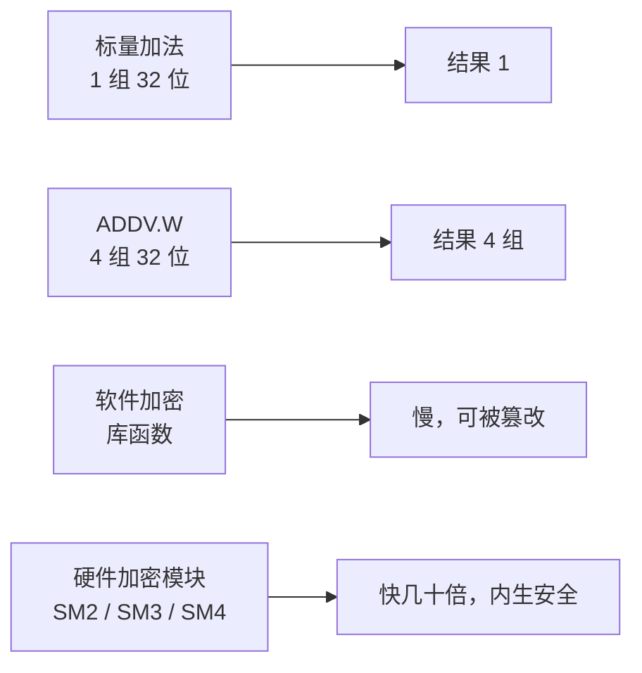

# 第 20 章：专用指令——向量与加密

- **难度**：★★☆ | **学时**：0.5 小时 | **前置**：第 14、15 章

## 学习目标
- 能用 ADDV.W 说明向量指令如何一条算四组
- 能举例说出向量指令的适用场景
- 能说明硬件加密相对软件加密的两点优势

## 一句话核心
一条指令算一组数据叫标量，算多组叫向量。把重复的活打包进一条指令，就是拿面积换时间。

## 零基础讲解
### 向量指令：一条顶四条
一组操作数只有一个数，叫标量；一组操作数由多个数组成，叫向量。

以 128 位向量加法 `ADDV.W w2, w1, w0` 为例：三个都是 128 位向量寄存器，每个装 4 个 32 位数据。一条指令同时算出 4 组 32 位相加的结果，速度等于基本加法指令的 4 倍。

代价是电路面积：要多做向量寄存器，还要多套并行的运算单元。收益是单位时间算更多数据。相比硬冲主频，这条路容易得多，所以向量扩展成了高性能 CPU 的标配。

龙芯 3A4000 支持的向量指令有数百条：定点向量运算与比较、浮点向量运算与比较、向量分支跳转、向量访存与搬运。适用场景是密集数值运算——图像编解码、3D 游戏、语音分析、雷达信号处理。Intel 最早在 1996 年的 Pentium MMX 上加了 57 条多媒体指令，专门处理视频音频图像，多媒体时代的性能就是这么抬起来的。

### 加密：从软件搬进电路
加密是用算法把信息变成密文，解密是逆运算。开机密码、文档口令、邮件加密，背后都是它。常见算法有 DES、3DES、AES、RSA、DSA、SHA-1、MD5；我国在推自主的 SM1、SM2、SM3、SM4，用于关键信息领域。

实现有两条路。软件路线：用程序写算法，编译成库，Windows、Linux、Android 都内置了这种库。硬件路线：用电路实现算法，再提供指令给应用调用。

硬件路线的好处有两个。一是快，比软件快几十倍；二是稳，电路不像软件那样容易被植入恶意代码，能达到更高水平的"内生安全"。龙芯 3A4000 集成了专用安全模块，可以硬件执行 SM2、SM3、SM4，操作系统和应用通过硬件接口取密码服务。

## 图示

看图说明：上面一对说明"打包"的价值，下面一对说明"搬进硬件"的价值。两条路都是同一个思路——把重复劳动固化，换取单位时间的产出。

## 类比与实例
- 类比：标量像一个人搬一块砖，向量像推车一次装四块。推车要造，但搬起来快。失效边界：推车只在砖块规整时好用，数据不规则、要频繁分支时，向量指令的打包效率会掉下来。
- 实例：给一张 4K 图做滤镜，每个像素做同样的浮点运算。标量要循环几百万次，向量一次处理 4 个（甚至更多），循环次数直接除下来。这就是图像处理特别吃向量宽度的原因。

## 常见误解
- 别以为向量指令能替代 GPU。向量单元在 CPU 内，宽度有限；GPU 是成千上万线程的专用阵列。
- 别以为硬件加密绝对安全。算法安全不等于实现安全，侧信道照样能攻击。
- 别以为向量指令只在超算有用。手机拍照、视频解码天天在用。

## 自测题
1. ADDV.W 一条指令能算几组 32 位加法？｜4 组｜2 组｜1 组｜答案：A｜解析：128 位寄存器装 4 个 32 位数据。
2. 向量指令的思想是？｜空间换时间｜时间换空间｜降低主频｜答案：A｜解析：多用电路面积换单位时间更多计算。
3. 硬件加密相对软件加密的优势不包括？｜算法种类更多｜速度快几十倍｜更难被植入恶意代码｜答案：A｜解析：算法种类取决于支持哪些标准，不是硬件天然更多。
4. 我国自主密码算法包括？｜SM2、SM3、SM4｜DES、MD5｜RSA、DSA｜答案：A｜解析：SM 系列是国密算法。

## 抽认卡
- 标量与向量的区别？｜一组操作数是一个数还是多个数
- 128 位向量寄存器装几个 32 位数据？｜4 个
- 向量指令的代价？｜更多寄存器与并行运算单元，占面积
- Intel 最早的向量指令扩展？｜Pentium MMX，57 条多媒体指令
- 硬件加密的两大好处？｜速度快几十倍；抗篡改、内生安全

## 术语
- 标量：一组操作数只含单个数值的运算形式
- 向量指令：一条指令同时计算多组操作数的指令
- 向量寄存器：保存多个数据元素的宽寄存器
- 国密算法：SM1、SM2、SM3、SM4 等自主密码算法
- 内生安全：安全能力内建于硬件、不依赖外挂软件的安全形态

## 复习锚点
- 向量 = 一条指令算多组，靠面积换时间
- 密集数值运算最吃向量
- 加密进硬件：更快，也更难被动手脚
