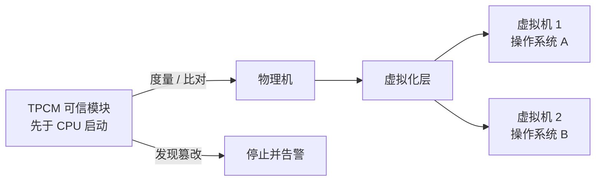

# 第 21 章：虚拟化与可信计算——一台机器当几台用，也只信该信的

- **难度**：★★★ | **学时**：0.7 小时 | **前置**：第 18、19 章

## 学习目标
- 能说明虚拟化把一台机器变成多台逻辑机器的机制与用途
- 能解释硬件虚拟化为什么能让虚拟机跑出接近物理机的性能
- 能对比"老三样"与可信计算的思路差别

## 一句话核心
虚拟化是把资源切成几份分给不同系统，可信计算是给每个部件验明正身。一个管"怎么分"，一个管"信不信"。

## 零基础讲解
### 虚拟化：一台变多台
虚拟化把一台计算机切成多台逻辑计算机，每台叫虚拟机，可以各跑各的操作系统，同时运行。用户在里面装软件、用系统，感觉和真机没差别。

三个典型用途。兼容老系统：设备停售了，新机器上开个虚拟机模拟旧环境，核心资产继续用。开发调试操作系统：一台机器上开几个虚拟机，不用格式化硬盘就能试各种 Linux 版本。云计算的基础：数据中心在物理机上开虚拟机跑应用，某台物理机坏了，上面的虚拟机可以迁移到另一台，服务不中断。

概念最早由 IBM 在 1960 年提出，M44/44X 是鼻祖。1972 年 System/370 第一次引入硬件虚拟化。

### 硬件虚拟化：别用软件模拟
不支持硬件虚拟化时，只能靠软件模拟多个 CPU，慢得明显。硬件虚拟化是 CPU 在设计时就提供机制，让多个操作系统同时跑，每个都能用接近 100% 的 CPU 性能。

2005 年之后的桌面与服务器 CPU 逐步都支持。Intel 叫 VT。龙芯从 3B3000 起自研了全面硬件虚拟化，覆盖执行模式、流水线环境、TLB、中断异常、虚拟机辅助机制、时钟系统，虚拟机效率达 95% 以上。这项工程做了三年多，是龙芯掌握全栈虚拟化技术的标志，也让龙芯服务器有了做云平台的实用能力。

### 可信计算：换个方向做安全
传统"老三样"是杀病毒、防火墙、入侵检测，都是被动防御，挡不住新出现的未知恶意代码，中招后还要花时间找漏洞打补丁。

可信计算反过来，做"主动免疫"。核心是一个可信模块，独立于 CPU 工作，装在主板上，开机时它先启动，而不是 CPU 先启动。出厂前它扫描所有硬件软件，把每个部件的关键特征记在自己内部；出厂后它自身和记录都不可改。运行中它不断比对现状与出厂记录，一旦发现被篡改，立即停止并告警。

这就是白名单思路：只有经过度量、确认可信的资源才允许运行——BIOS 固件、CPU 型号、硬盘序列号、网卡序列号、操作系统、应用程序，都在度量范围内。

这个模块的术语是可信平台控制模块（TPCM），里面一般还集成可信密码模块（TCM），因为度量与校验都要用密码算法。

### 从外挂到内生
可信模块可以做成主板上的独立器件，也可以和 CPU 集成。龙芯 3A4000 把可信模块做进了芯片，独立于处理器核工作。主板不用再额外装，成本降了，安全性反而更高——这就是"内生"的意思：安全长在芯片里，不是贴上去的。

## 图示

看图说明：上半张是"分"，一台物理机被切成多台逻辑机；下半张是"验"，可信模块在系统启动前就盯着所有部件。两者解决的是不同层面的问题，常一起用。

## 类比与实例
- 类比：虚拟化像一套公寓隔成几个单间，各自有门有钥匙；可信计算像小区门禁加监控，进出都要核身份，墙被凿了个洞也能发现。失效边界：隔间之间会抢水电（CPU、内存、IO 资源竞争），虚拟机之间也有性能干扰。
- 实例：云服务器上一台物理机跑十几台虚拟机，某台虚拟机被攻击，正常情况下影响被限制在它自己那间；若虚拟化层有漏洞，攻击者可能"越狱"影响邻居，这也是虚拟化安全研究的热点。

## 常见误解
- 别以为虚拟机等于模拟器。模拟器逐条翻译指令，虚拟机多数指令直接在本机跑。
- 别以为硬件虚拟化只是软件功能。它需要 CPU 在特权级、TLB、中断等层面提供硬件机制。
- 别以为可信计算能防所有攻击。它保证"被改动会被发现"，不保证"不会被攻击"。

## 自测题
1. 虚拟化的本质是？｜把一台计算机虚拟为多台逻辑计算机｜把多台合成一台｜提高主频｜答案：A｜解析：每台逻辑机可跑独立操作系统。
2. 硬件虚拟化的优势是？｜虚拟机性能接近物理机｜不需要操作系统｜不需要内存｜答案：A｜解析：CPU 提供硬件机制，避免软件模拟开销。
3. 可信计算的核心思路是？｜白名单度量，只允许可信资源运行｜查杀已知病毒｜加密所有文件｜答案：A｜解析：主动免疫，先度量后运行。
4. TPCM 与 CPU 的启动顺序是？｜TPCM 先启动｜CPU 先启动｜同时启动｜答案：A｜解析：可信模块要最先启动并度量其他部件。

## 抽认卡
- 虚拟化的三个典型用途？｜兼容老系统、开发调试操作系统、云计算基础
- 硬件虚拟化的首次引入？｜1972 年 IBM System/370
- 龙芯硬件虚拟化的效率？｜虚拟机性能达物理机 95% 以上
- 可信计算的"老三样"指什么？｜杀病毒、防火墙、入侵检测
- TPCM 与 TCM 分别是什么？｜可信平台控制模块与可信密码模块
- 可信计算为什么算"白名单"？｜只有度量通过的资源才允许运行

## 术语
- 虚拟化：把一台物理机抽象为多台逻辑机的技术
- 虚拟机：虚拟化产生的逻辑计算机
- 硬件虚拟化：CPU 提供机制以高效运行多个操作系统的能力
- 可信计算：以度量与校验保证部件未被篡改的安全机制
- TPCM：可信平台控制模块，独立于 CPU 的可信根
- TCM：可信密码模块，提供度量与校验所需的密码功能

## 复习锚点
- 虚拟化管"分"，可信计算管"信"
- 硬件虚拟化让虚拟机跑出接近真机的性能
- 可信计算是白名单 + 主动免疫，不是杀毒
