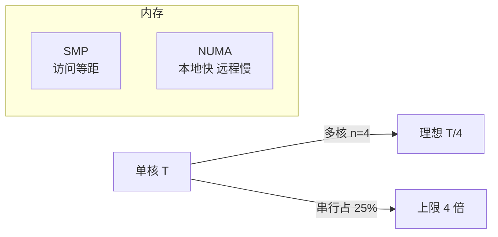

# 第 22 章：并行——多核、多路、多线程与 Amdahl 定律

- **难度**：★★★ | **学时**：0.8 小时 | **前置**：第 15、16 章

## 学习目标
- 能区分多核、多路、硬件多线程三个层次的并行
- 能用 Amdahl 定律算出加速比上限
- 能说清 SMP 与 NUMA 的差别，以及弱一致性为什么被普遍采用

## 一句话核心
横向加计算单元比纵向冲主频容易，但加速比有天花板——串行那一段决定了上限。

## 零基础讲解
### 三个层次
多核：一个芯片里集成多个独立 CPU 单元，每个叫一个核。龙芯 3A1000 到 3A5000 都是 4 核，台式机够用。这是横向扩展：与其把单核主频往上顶，不如多放几个核。

多路：一块主板上插多个独立的 CPU 芯片。服务器常用，公式是"CPU 数量 = 路数 × 每芯片核数"。龙芯 3B4000 四路服务器：4 颗芯片 × 4 核 = 16 核。多路还有个好处：每颗 CPU 有自己的内存通道，带宽能成倍涨；单芯片内一味加核，访存通道不够，会出现"茶壶倒饺子"——核多但喂不饱。

硬件多线程（SMT，也叫超线程）：一个核在硬件上支持多套线程执行环境，每套有独立寄存器与执行上下文。只要运行的线程数不超过支持的套数，就不需要分时复用，是真正的并行。Intel 的文献说，支持 2 套线程环境的 CPU，用不到 10% 的晶体管换来平均 60% 的性能提升。SMT 是 1996 年成型的学术成果，2002 年 Pentium 4 HT 把它带进消费市场。龙芯目前还没用。

软件层的多线程是另一回事：操作系统把 CPU 时间切成小片，轮流给各线程，切换快到人感觉不出，本质仍是分时复用。

### Amdahl 定律：天花板在哪
设问题在单核上耗时 T，n 核理论最短是 T/n。但问题不一定能全部并行。

1967 年 Amdahl 给出的公式：

S = 1 / (1 - a + a/n)

a 是可并行部分占比，n 是核数，S 是加速比。取几个边界值就明白了：a=1 时 S=n，线性加速；a=0 时 S=1，多核白搭；n 趋于无穷时 S 趋于 1/(1-a)。也就是说，串行部分占 25%，无论多少核，加速比都超不过 4 倍。

这条定律对程序员的提醒很直接：先想办法把可并行比例做大，而不是一味堆核数。

### 内存怎么连：SMP 与 NUMA
SMP（对称多处理）：所有 CPU 都能访问所有内存，统一地址空间，访问任何单元的时间相同。结构简单，但 CPU 和内存一多，互连网络的开销就成瓶颈。

NUMA（非统一内存访问）：每个 CPU 带本地内存条，也能访问别人的远程内存。访问本地快、远程慢，"非统一"就是这个意思。它更容易支持大容量内存，互连不易成瓶颈，兼顾了共享的方便与扩展的灵活。龙芯 3B4000 四路服务器就是典型 NUMA。

### 缓存怎么同步
每个核都有自己的缓存，同一份数据可能有多份副本。基于目录的一致性协议：互连网络里放一张全局目录表，记录每个存储单元的状态——在哪些核的缓存里有备份。某核写内存时先查表，若别处有备份就发通知，对方更新。

更新通知的时序有两种原则。强一致性：所有通知执行完才允许继续访存，绝对正确但等得久。弱一致性：不等通知完成就继续跑，硬件不强制全局一致，不同核可能读到不同值；需要时程序员插一条内存同步指令强制等待。

实际并行机几乎都用弱一致：把很小的维护成本交给程序员，换来几倍的性能。龙芯的同步指令是 `SYNC`，执行后保证全机缓存行同步完成。

### 原子指令：别让两个核抢着加一
"内存单元 M 加 1"要三条指令：读、加、写回。单核没问题，双核就可能两边都读到旧值，最后只加了 1 而不是 2。

原子指令让一段操作独占执行。硬件上一般在互连网络里放一个全局原子寄存器，所有核访问它互斥，由网络仲裁，只有一个核拿到权限，其他等着。

龙芯用 LL（取独占权限）和 SC（释放独占权限）成对使用，x86、ARM 也有等价机制。学过数据库的人会发现，这很像事务：一段操作独立完成，不受别人干扰。

## 图示

看图说明：上面是加速比的天花板，下面是两种内存组织方式。看完要记住两件事：核数不是万能的；内存连接方式决定了大机器能扩到多大。

## 类比与实例
- 类比：多人搬一堆货，能并行的部分一人一摞同时搬；但开箱、清点、记账只能一个人做，人再多也得等这几步。失效边界：现实里加人能协调，程序里线程间还要加锁，锁竞争反而可能让多核更慢。
- 实例：一个图像处理程序，95% 的像素运算可并行，5% 是串行读写文件。按公式，n 再大加速比也顶到 1/0.05=20 倍。想再快，只能动那 5%。

## 常见误解
- 别以为核数翻倍性能就翻倍。Amdahl 定律与访存带宽会一起卡住你。
- 别以为超线程等于多核。它共享同一套执行单元，争用时收益会掉。
- 别以为弱一致性是"不安全"。它把同步责任交给程序员，用指令保证关键点一致。

## 自测题
1. 龙芯 3B4000 四路服务器的总核数是？｜16｜8｜4｜答案：A｜解析：4 路 × 每芯片 4 核 = 16。
2. Amdahl 定律中串行部分占 25% 时，加速比上限是？｜4 倍｜25 倍｜无限｜答案：A｜解析：S→1/(1-a)=1/0.25=4。
3. NUMA 的特点是？｜访问本地内存快于远程内存｜所有访问等速｜无内存｜答案：A｜解析："非统一"即访问时间随位置而变。
4. 龙芯的缓存同步指令是？｜SYNC｜FENCE｜BARRIER｜答案：A｜解析：书中明确为 SYNC。

## 抽认卡
- 多核、多路、SMT 的区别？｜芯片内多核、主板上多芯片、核内多线程环境
- CPU 总数怎么算？｜路数 × 每芯片核数
- SMT 的性价比数据？｜不到 10% 晶体管换平均 60% 性能提升
- Amdahl 定律公式？｜S = 1/(1-a+a/n)
- SMP 与 NUMA 的核心差别？｜所有访问等速 vs 本地快远程慢
- 原子指令的作用？｜让一段操作独占执行，避免多核竞争出错

## 术语
- 多核：单芯片集成多个独立处理器核
- 多路：主板上安装多个独立 CPU 芯片
- SMT：同时多线程，一个核支持多套硬件线程环境
- Amdahl 定律：并行加速比受串行比例限制的定量规律
- SMP：对称多处理，所有 CPU 等速访问所有内存
- NUMA：非统一内存访问，本地与远程访问速度不同
- 原子指令：保证一段操作不被其他核打断的指令

## 复习锚点
- 横向扩展有三层：核、路、线程
- 加速比天花板 = 1/串行比例
- 弱一致 + 同步指令，是性能与正确的折中
