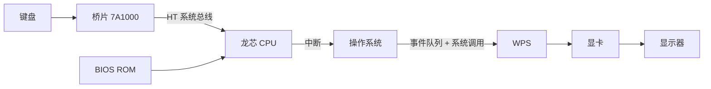

# 第 23 章：从 CPU 到计算机——总线、主板与 BIOS

- **难度**：★★☆ | **学时**：0.7 小时 | **前置**：第 18、19 章

## 学习目标
- 能说清系统总线与外设总线的分工，以及桥片的作用
- 能说出主板的两种 CPU 安装方式与印制电路板的基本构成
- 能按顺序复述"敲一下键"在计算机内部走过的 11 步

## 一句话核心
CPU 只是大脑。总线是神经，桥片是副官，主板是躯干，BIOS 是开机后跑的第一段代码。

## 零基础讲解
### 总线与桥片
总线是模块之间的通信线路，把 CPU、内存、外设连起来。它分两类：CPU 与内存之间要高速，叫系统总线（有的厂商叫前端总线）；连外设的不需要那么快，叫外设总线。

设备多了，CPU 管不过来，于是有桥片——CPU 的"副官"，一端接 CPU，一端接各种外设，把外设管理接过去。龙芯 7A1000 桥片配 3A4000：两者之间走高速 HT 总线，7A1000 到外设走 PCIe 这类低速总线。

也有 CPU 把桥片集成进芯片，直接引出外设接口，集成度高、省主板面积，台式机和笔记本常见。服务器外设种类复杂，多数仍用独立桥片，甚至在桥片下再挂扩展芯片，形成多层外设总线，避免一条线上设备太多堵住。

PCIe 4.0 的理论峰值约 2GB/s，传图片、音乐、电影够用。

### 主板：把所有东西焊在一起
主板是一块印制电路板（PCB），由绝缘底板、导线、焊盘组成，把复杂布线集成起来，可以自动化焊接，出问题也便于整块更换。发明者是奥地利人保罗·艾斯勒，1936 年首次用在收音机里。

CPU 上主板有两种方式。球栅阵列封装（BGA）：芯片下面一排焊球，每个焊球是一个引脚，龙芯 3A4000 是 37.5mm×37.5mm、1211 个引脚，就要在主板上留 1211 个焊点，用机器焊上去，抗震好。栅格阵列封装（LGA）：不用焊，用扣架压住引脚，可以随时换 CPU，台式机和服务器常用。

PCB 可以做多层，绝缘层与导线层交替叠加。多数主板是 4 层或 6 层，龙芯 3A4000 设计时考虑了 4 层布线以省成本。

### BIOS：开机第一段代码
固件是嵌进硬件的软件，存在可擦写存储器里。BIOS 是最重要的固件，装在主板的 ROM 芯片上，出厂前写好，用户一般不改。

它是 CPU 运行的第一个软件。上电后 CPU 从 ROM 读代码执行，做三件事：系统自检（探测 CPU 型号、内存容量、键鼠、硬盘、显示器、网卡，还给内存做读写校验，发现坏单元就报警停机）；初始配置（开机密码、日期时间、启动设备、服务器上的 RAID）；加载操作系统（找到引导程序，装进内存，交班给操作系统）。

整个过程只有几秒，代码装得进 4MB 的 ROM。龙芯 2018 年前用 PMON，之后转用 UEFI。

### 敲一下键，机器里发生了什么
这是龙芯招聘的必考题，十一步：

1. 键盘检测到按键，给桥片 7A1000 发信号。
2. 桥片把事件存进自己的寄存器，通过系统总线拉 CPU 的中断引脚。
3. CPU 把中断状态存进中断状态寄存器。
4. 取指单元把中断状态附在指令后送进 ROB；发射时发现中断，按例外机制撤销未提交指令。
5. CPU 提权到操作系统级，把指令地址强行改到中断处理程序入口。
6. 中断处理程序查桥片寄存器，找到最早的中断源，读出按键编码。
7. 找到在等按键的应用（WPS），把编码放进操作系统核心区里该应用的键盘事件队列。
8. 中断处理结束，返回操作系统。
9. 操作系统降权到应用级，恢复 WPS 运行。
10. WPS 变活跃，通过系统调用取事件队列里的按键编码。
11. WPS 调绘图函数，显卡把图像送显示器，屏幕上出现字符。

### 死机：三种常见根源
死机是失去响应。原因大致三类：操作系统 bug（占绝大多数，Linux 社区版本更新快，未必在每个 CPU 上都测过）；主板硬件不稳（劣质电源供不上电流，晶体管翻不动 0/1；内存走线不等长或太近引发串扰）；外设故障（某款显卡在特定命令组合下不返回信号，CPU 干等）。

龙芯硬件工程师有句话：电源是血脉，内存是仓库。这两处是稳定性的两大根源。

## 图示

看图说明：注意箭头方向——数据从键盘进、从显示器出，中间每一段都换了"经办人"。这张图也是排障地图：哪一环断了，现象就卡在哪。

## 类比与实例
- 类比：桥片像公司前台，所有访客先到前台登记，前台再通知老板（CPU）；老板不会站在门口盯着每个人。失效边界：前台会筛人，桥片只做转发和暂存，不做业务判断。
- 实例：BIOS 内存自检时写入一串数据再读回比对，不一致就停机报警。很多"开机黑屏滴滴响"就是这一步没过，问题往往在内存条接触或颗粒坏。

## 常见误解
- 别以为 CPU 直接连所有外设。中间有桥片和总线分层。
- 别以为 BIOS 是操作系统的一部分。它在操作系统之前运行，装完系统就交班。
- 别以为死机都是软件问题。电源与内存引起的硬件不稳很常见，而且更难查。

## 自测题
1. 桥片的作用是？｜接管外设管理，连接 CPU 与外设｜提高主频｜扩大缓存｜答案：A｜解析：桥片是 CPU 的"副官"。
2. 龙芯 3A4000 的 BGA 封装引脚数？｜1211｜121｜12110｜答案：A｜解析：书中给出 1211 个引脚。
3. BIOS 的三大功能不包括？｜编译应用程序｜系统自检｜加载操作系统｜答案：A｜解析：BIOS 负责自检、配置与引导。
4. 龙芯 2018 年后采用的固件项目是？｜UEFI｜PMON｜BIOS 老版本｜答案：A｜解析：2018 年前用 PMON，之后转 UEFI。

## 抽认卡
- 系统总线与外设总线的区别？｜前者连 CPU 与内存求高速，后者连外设
- BGA 与 LGA 的差别？｜焊球焊接 vs 扣架压接可更换
- PCB 的发明者与年份？｜保罗·艾斯勒，1936 年
- BIOS 存在哪里？｜主板上的 ROM 芯片
- 按键事件的第 4 步做了什么？｜中断状态随指令进入 ROB，触发撤销未提交指令
- 死机的三大根源？｜操作系统 bug、主板硬件不稳、外设故障

## 术语
- 总线：计算机模块之间的通信线路
- 桥片：连接 CPU 与外设、承担外设管理的外围芯片
- PCB：印制电路板，承载并连接电子元器件的基板
- BGA：球栅阵列封装，以焊球作为引脚
- LGA：栅格阵列封装，以触点与扣架连接
- BIOS：基本输入输出系统，开机最先运行的固件
- 固件：嵌入硬件中的软件程序

## 复习锚点
- 总线分层，桥片分劳
- 主板是躯干，封装决定能不能换 CPU
- BIOS 自检、配置、交班，三步走完就退场
