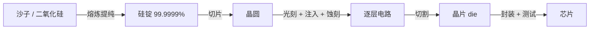

# 第 25 章：从沙子到晶圆

- **难度**：★★☆ | **学时**：0.7 小时 | **前置**：第 24 章

## 学习目标
- 能说明硅为什么成为芯片首选材料
- 能按顺序复述晶圆制造的主要步骤
- 能用"生长、挖掉、掺杂"三种手法概括所有工序

## 一句话核心
芯片的原料是沙子。把它提纯、切片、一层层刻蚀掺杂，三个月后它变成一颗会算数的东西。

## 零基础讲解
### 为什么是硅
地壳里氧占 48.60%，硅占 26.30%，储量充足，不会像石油稀土那样卡脖子。

硅是合适的半导体：常温下导电性介于导体与绝缘体之间。纯硅接近绝缘体，掺进某些杂质就能导电，还能靠杂质浓度调节导电强弱。于是一块硅上可以做出绝缘区和导电区，这就是"半导体芯片"的底子。

沙子的主要成分是二氧化硅，岩石风化后成沙——所以这条路被叫作"从沙子变成芯片之旅"。

### 主要工序
熔炼：二氧化硅脱氧、多步净化，得到电子级硅（EGS），平均每一百万个硅原子最多一个杂质原子。熔炼出的圆柱形大晶体叫硅锭，约 100kg，纯度 99.9999%。

切片：硅锭横向切成圆片，每片叫晶圆。

光刻：晶圆上涂光刻胶，盖一层玻璃掩膜版——有电路的地方透光，没有的不透。紫外光透过掩膜照到胶上，被照到的胶性质改变；再用特殊溶液清洗，电路部分对应的胶被溶掉。

离子注入：对着晶圆打高速金属离子束，离子打进没有被胶保护的区域，掺够了这块硅就能导电。完成后去掉多余的胶。

蚀刻：用同样的光刻思路，把不需要去除的位置用胶盖住，再用酸液洗，露出的硅被溶出凹槽，槽里好铺金属。

多层布线：一层加工完，铺绝缘材料，再加工下一层。复杂芯片有很多层。

切割：把晶圆切成一个个小片，每片含一颗 CPU 的完整电路，这一片叫 die（内核）。

封装：die 放到衬底上，下面是连主板的焊点，上面盖金属散热片，衬底加散热片保护 die，合成最终芯片。

测试：检验、淘汰次品、合格品装箱发货。

### 三种手法概括一切
生长：往上堆材料，由少变多，比如绝缘层和金属线。
挖掉：去掉材料，由多变少，比如蚀刻凹槽。
掺杂：渗进材料改变性质，比如离子注入。

每一种手法都靠光刻和掩膜版遮住不该加工的部分。所以工序是反复循环：涂胶、盖掩膜、曝光、溶胶、加工、洗胶。

层数越多，生产越久。高性能 CPU 有 40 层电路，按每层平均 1.6 天算，光造晶圆就要 64 天；加上前期准备和后段封装测试，整颗芯片通常要 3 个月以上。

## 图示

看图说明：从左到右是一条"纯度越来越高、结构越来越细"的路。注意中间是循环——不是一次光刻就完事，而是几十层反复做，这才是三个月工期的主因。

## 类比与实例
- 类比：像做多层套色版画。每印一层颜色要先刻一块版（掩膜），用纸挡住不该印的地方，再上色（注入或蚀刻），一层层叠出完整图案。失效边界：版画错了可以重印，晶圆错一层，整批报废。
- 实例：电子级硅要求每一百万个原子最多一个杂质。这个纯度比日常所说的"99.9%"高出好几个数量级，提纯本身就是巨大的能耗与工艺挑战。

## 常见误解
- 别以为芯片是"刻出来的"。它是靠光刻定义图形，再靠注入和蚀刻改变材料，本质是加法与减法混用。
- 别以为封装只是"装个壳"。它决定引脚数、散热、可靠性和成本，高端封装能比晶片本身还贵。
- 别以为晶圆越大越省。大晶圆能切更多 die，但对工艺均匀性要求更高。

## 自测题
1. 硅在地壳中的含量约为？｜26.3%｜2.6%｜63%｜答案：A｜解析：仅次于氧的 48.60%。
2. 光刻中起"模板"作用的是？｜带电路图形的掩膜版｜光刻胶｜酸液｜答案：A｜解析：掩膜版决定哪些区域被光照到。
3. 下列哪项属于"掺杂"？｜离子注入｜蚀刻凹槽｜铺设绝缘层｜答案：A｜解析：掺杂是改变材料性质，注入金属离子正是此类。
4. 40 层电路、每层 1.6 天，仅晶圆生产约需？｜64 天｜40 天｜16 天｜答案：A｜解析：40×1.6=64 天。

## 抽认卡
- 电子级硅的纯度？｜99.9999%，百万原子最多一个杂质
- 硅锭的典型质量？｜约 100kg
- 光刻的四步？｜涂胶、盖掩膜、曝光、溶胶
- 芯片制造的三种基本手法？｜生长、挖掉、掺杂
- die 是什么？｜切割后含一颗芯片完整电路的小片
- 一颗芯片的生产周期？｜通常 3 个月以上

## 术语
- 电子级硅（EGS）：可用于半导体制造的高纯度硅
- 硅锭：熔炼拉制成的圆柱形硅晶体
- 晶圆：由硅锭切出的圆形硅片
- 光刻胶：受光照后性质改变、用于定义图形的涂层
- 掩膜版：带电路图形的透光模板
- 离子注入：把杂质离子打入硅中以改变导电性
- 蚀刻：用化学方式去除指定区域材料的工艺
- die：晶圆切割后含完整电路的单颗晶片

## 复习锚点
- 沙子→硅锭→晶圆→die→芯片
- 一切工序归为生长、挖掉、掺杂
- 几十层循环，三个月起步
