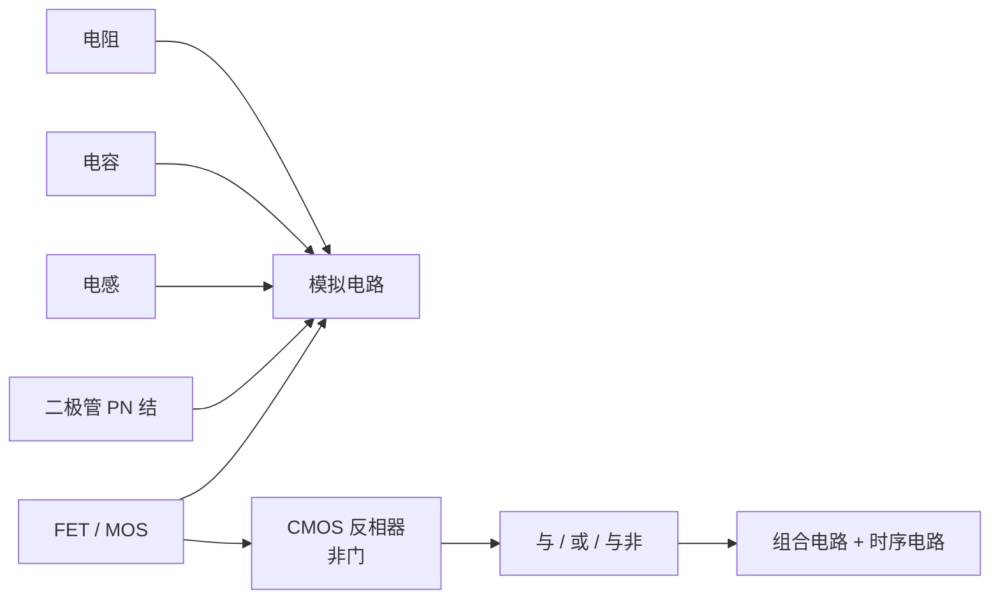

# 第 26 章：模拟与数字元器件——世界只有几种积木

- **难度**：★★☆ | **学时**：0.7 小时 | **前置**：第 13 章

## 学习目标
- 能说出模拟电路六大基础器件与各自的用途
- 能用 PN 结解释二极管的单向导电
- 能说明 CMOS 反相器如何由一对互补晶体管构成
- 能区分组合电路与时序电路

## 一句话核心
无论多复杂的电路，积木只有不到十种。复杂来自组合方式，不来自零件数量。

## 零基础讲解
### 三小弟：电阻、电容、电感
电阻限制电流，单位关系就是欧姆定律：电流 = 电压 ÷ 电阻。芯片里常用多晶硅做电阻，靠控制薄层厚度调阻值，也可以掺杂来增大单位厚度上的电阻。

电容存电荷，两块导体夹一层绝缘介质就是电容，能"通交流、阻直流"，可用来滤噪声。芯片里用金属做，上下两片金属层相对，调面积和间距改容值，还能叠多层省面积。

电感把电能变成磁能存起来，一组线圈就是电感，"通直流、阻交流"，可限制某类频率通过。芯片里把金属走成螺旋形，调长度和圈数改感值。

电容电感是非线性元件，电压电流关系要用指数方程甚至微分方程描述，这是大学"电路分析"课的核心内容。三者合起来叫 RLC 电路，能做出振荡器、滤波器等。

### 单向开关：二极管
二极管只许电流一个方向走。阳极电压高于阴极就导通，反之截止。

芯片里用 PN 结实现。纯硅是四价，原子间共用电子，整体电中性。掺三价元素（铝、镓、硼、铟）成 P 型，共价键缺一个电子，形成空穴；掺五价元素（磷、砷、锑）成 N 型，多出一个自由电子。

正向加压，电子从 N 区往 P 区跑，形成电流；反向加压，电子被拉到 N 区边缘，P 区没有自由电子，电流为零。这就是"单向开关"。

### 水龙头：场效应管
FET 是三端器件：源极、漏极负责传电流，栅极用电场控制通断。

MOS 结构是最常见的一种：源、漏各接一块 N 型半导体，两块都嵌在 P 型里，栅极隔着极薄的二氧化硅绝缘层压在两块 N 型之间的沟道上。

栅极无电压：两块 N 型之间夹着 P 型，相当于两个背靠背的 PN 结，一定挡住电流。
栅极正电压：电场把 P 区少量自由电子吸到沟道，电子浓度升高、电阻下降；电压够大就形成 N 型薄层通路，导通。
栅极负电压：电子被排斥，原位形成空穴，绝缘性增强，电流为零。

FET 靠电压控制，三极管靠电流控制；FET 响应更快、功耗更低，所以芯片里几乎都用 FET。

模拟电路的基本器件就这六种：电阻、电容、电感、二极管、三极管、FET。搭上多层金属连线，能处理任何用微分方程描述的连续信号。

### 数字那边：CMOS 反相器
数字信号是离散的，由模拟信号采样、量化、编码而来。数字电路的器件仍建立在模拟器件上：MOS 管栅极电压高低，天然对应 0 和 1。

CMOS 比 MOS 多一个"C"，互补：一对沟道相反的 MOS 管并联。N 管和 P 管共享栅极作输入，漏极相连作输出。

输入高电平：N 管导通、P 管截止，输出低。
输入低电平：N 管截止、P 管导通，输出高。

这就是非门，也是几乎所有数字集成电路的核心单元。用 P 管 N 管的不同组合，能做出与门、或门、与非门。布尔代数保证：这些门能搭出任何二进制运算。

### 两种数字电路
组合电路：输出只由输入决定，不带记忆。运算器、译码器属于这类。
时序电路：带记忆，输出还取决于内部状态。寄存器、发射队列、Cache、TLB 属于这类。

### 积木为什么这么少
模拟六种、数字四五种，却能撑起整个信息社会。这跟自然界很像：已发现的化学元素 118 种，牛顿用三条定律解释星球运行，欧氏几何从五条公设推演出庞大体系。

"复杂世界由少量积木搭成"这个哲学猜想，被科学一次次印证。学 CPU 的人手里的积木，就是 CMOS 晶体管。

## 图示

看图说明：上面一支是模拟世界，下面一支从同一个 MOS 管长成数字世界。两支的交点就是那颗晶体管——它是整个分叉的起点。

## 类比与实例
- 类比：积木像乐高。基础砖只有几种形状，搭出来的城堡可以无限复杂。失效边界：乐高可以拆了重搭，芯片的"搭"是在硅片上长出来的，改一次要重新流片。
- 实例：PN 结正向导通压降约 0.7V（硅管），这个数值在电源设计里到处出现。它不是理想开关，是有代价的开关。

## 常见误解
- 别以为数字电路和模拟电路是两套东西。数字电路建在模拟器件之上，只是把连续量当离散用。
- 别以为二极管只是"单向阀"。它还有压降、反向击穿等特性，实际电路要算。
- 别以为门电路种类越多越好。基础门少，组合方式多，才是可扩展的关键。

## 自测题
1. 电容在电路中的典型作用是？｜存储电荷、通交流阻直流｜限制电流｜把电能变磁能｜答案：A｜解析：电容隔直通交，可滤波。
2. P 型半导体的形成方式是？｜纯硅掺三价元素，形成空穴｜掺五价元素，多出电子｜纯硅不加杂质｜答案：A｜解析：三价元素缺电子，形成空穴。
3. CMOS 反相器中输入高电平时？｜N 管导通、P 管截止，输出低｜两管都导通｜两管都截止｜答案：A｜解析：互补结构保证输出与输入相反。
4. 下列属于时序电路的是？｜寄存器｜译码器｜加法器｜答案：A｜解析：寄存器带记忆，输出与内部状态有关。

## 抽认卡
- 模拟电路六大基础器件？｜电阻、电容、电感、二极管、三极管、FET
- 电阻的材料与调值方式？｜多晶硅薄层，靠厚度与掺杂调节
- PN 结正向导通的条件？｜P 区电压高于 N 区（阳极高于阴极）
- FET 与三极管的控制方式？｜FET 靠电压，三极管靠电流
- CMOS 的"C"是什么意思？｜互补，一对沟道相反的 MOS 管
- 组合电路与时序电路的区别？｜输出是否依赖内部存储状态

## 术语
- 电阻：限制电流的元件
- 电容：存储电荷的元件，通交流阻直流
- 电感：把电能转为磁能存储的元件
- PN 结：P 型与 N 型半导体交界形成的单向导电结构
- FET：场效应管，以电场控制通断的三端器件
- CMOS：互补金属氧化物半导体，由互补 MOS 管构成的工艺
- 反相器：输出与输入相反的电路，数字电路基本单元
- 时序电路：带记忆、输出依赖内部状态的数字电路

## 复习锚点
- 电阻限流、电容存电荷、电感存磁能
- PN 结给单向，MOS 管给开关
- 一对互补管 = 非门 = 所有数字电路起点
