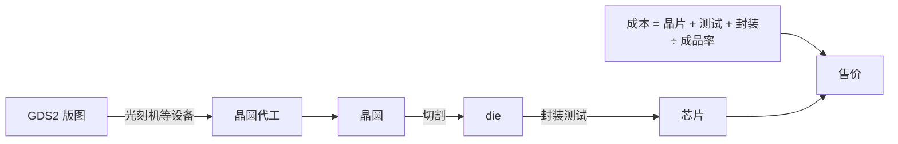

# 第 27 章：版图、制造设备与成本

- **难度**：★★☆ | **学时**：0.6 小时 | **前置**：第 24、25 章

## 学习目标
- 能说明版图里有什么、单元库有什么用
- 能说出光刻机与晶圆代工的产业格局
- 能拆开 CPU 成本的三项构成，并解释成品率与销量的影响

## 一句话核心
版图是设计的终点、制造的起点。它由色块叠成，靠光刻机印出来，最后由成本公式定价。

## 零基础讲解
### 版图：看见平面，想到立体
版图包含芯片中所有 CMOS 管的布局与布线，是物理设计的成果，也是交付流片厂的材料。

在 EDA 里做版图是"所见即所得"：不同材料用不同颜色，N 型、P 型、栅极多晶硅、接触孔、金属层各一块色块，上下层叠，从顶视图看是多种颜色的矩形叠在一起。所以版图设计者要有的基本功是"看到平面图，想到三维结构"。

设计好的器件可以进单元库，下次直接调用，不必重复设计。单元库来源有三种：EDA 自带、流片厂提供、第三方商业库。

EDA 还能按设计规则自动检查：门电路位置关系、布线时序、多层连通性。这套自动检查能消掉不少人为错误。

版图也是作品。龙芯 1 号推出时正逢夏培肃院士从教 50 周年，设计者在每一层金属上都留了"夏 50"的标记，把纪念刻进了硅里。

### 设备与代工格局
芯片设备十几种：硅单晶炉、气相外延炉、氧化炉、磁控溅射台、化学机械抛光机、光刻机、离子注入机、引线键合机、晶圆划片机、晶圆减薄机等。

光刻机最难，被叫作"工业皇冠上的明珠"。荷兰 ASML 的 TWINSCAN 系列占全球约 80% 份额，Intel、台积电、三星都得向它买；最先进的每台超过 10 亿美元，一年只卖几百台。尼康靠低价抢市场（同类不到 ASML 一半），佳能基本退出高端。中国上海微电子（SMEE）做出了 90nm 光刻机，还在往上攻。低端光刻机在电商上约 500 万元一台，硅单晶炉不到 100 万元。

代工端：台积电超过 50% 份额，三星约 20%，格罗方德约 10%（2009 年从 AMD 剥离）。其余小于 10% 的有联电、中芯国际、高塔、华虹等。华虹旗下上海华力能做 12 英寸、22nm。

封测端：日月光、安靠、长电科技、矽品、力成、华天科技、通富微电等。长电、华天、通富被称为"中国大陆封测三强"。

产业链三段，难度从高到低是制造、设计、封测。代工厂和封测厂只做 To B，不直接面对消费者，在上游"闷声发大财"。

### 成本怎么算
制造侧三块：晶片成本、测试成本、封装成本。

晶片成本与面积成正比——面积越小，一片晶圆能切出越多 die。
测试成本与占用测试平台的时间成正比——测试向量要少而覆盖率高，既省时间又不漏检。
封装成本与引脚数、材料有关，功耗越高越贵；高端芯片的封装成本甚至超过晶片本身。

总成本与成品率成反比。成品率是去除次品后良品的比例。杂质超标、设备老化、引脚畸变，都会拉低成品率。

售价还受销量影响：卖得越多，设计费、人力这些一次性成本摊得越薄，所以新片上市贵、越卖越便宜。

还有一层商业逻辑：用低端保护高端。Intel 的赛扬、奔腾卖三四百元，利润极薄甚至不赚钱，目的是把市场门槛压死——后来者想在高端超过它极难，想靠杀低价又很难比赛扬更便宜。两头都有护城河，高端至强、酷睿才能卖高价。

## 图示

看图说明：上半段是物理流程，下半段是商业公式。注意成本那格底下是"除以成品率"——成品率每掉一成，单位成本就往上跳一截。

## 类比与实例
- 类比：版图像印刷厂的制版，光刻机像印刷机，代工厂像印厂，封测像装订。印得越细，机器越贵；印坏一张，整批纸都废。失效边界：印刷可以补印，晶圆不能单片补做，只能整批重来。
- 实例：同一片 12 英寸晶圆，die 面积减半，能切出的颗数大致翻倍，单颗晶片成本接近减半。这就是为什么厂商拼命把面积做小——不只是省材料，是乘法级的成本差。

## 常见误解
- 别以为版图只是"图"。它包含每一层的几何与连接关系，是工厂照着做的唯一依据。
- 别以为设备只影响产量。工艺精度直接决定能不能做出更小的栅极。
- 别以为便宜芯片不赚钱就没意义。它常常是市场门槛的一部分。

## 自测题
1. 版图设计者的基本功是？｜看到平面图能想到三维结构｜会写 Verilog｜会焊板子｜答案：A｜解析：多层色块叠放，必须脑内还原立体。
2. 全球光刻机市场份额最高的是？｜ASML｜尼康｜佳能｜答案：A｜解析：约 80% 份额。
3. 晶片成本与什么成正比？｜晶片面积｜引脚数量｜测试时间｜答案：A｜解析：面积越小，一片晶圆切出的 die 越多。
4. CPU 总成本与成品率的关系是？｜成反比｜成正比｜无关｜答案：A｜解析：成品率越低，摊到良品上的成本越高。

## 抽认卡
- 版图交付的文件格式？｜GDS2
- 单元库的三种来源？｜EDA 自带、流片厂提供、第三方商业库
- 光刻机的产业地位？｜工业皇冠上的明珠，ASML 占约 80%
- 代工三强份额？｜台积电 >50%、三星约 20%、格方约 10%
- 制造成本三构成？｜晶片、测试、封装
- "低端保护高端"指什么？｜用极低价低端产品封死后来者的价格空间

## 术语
- 版图：含各层材料图形与连接关系的物理设计成果
- 单元库：可复用的标准电路模块集合
- 光刻机：把掩膜图形投影到晶圆上的核心设备
- 代工厂：为设计公司提供晶圆制造服务的企业
- 成品率：扣除次品后良品所占比例
- 测试向量：用于检验芯片功能的测试输入集合

## 复习锚点
- 版图是设计的终点、制造的起点
- 设备决定精度，代工决定产能
- 成本 = （晶片+测试+封装）/ 成品率
