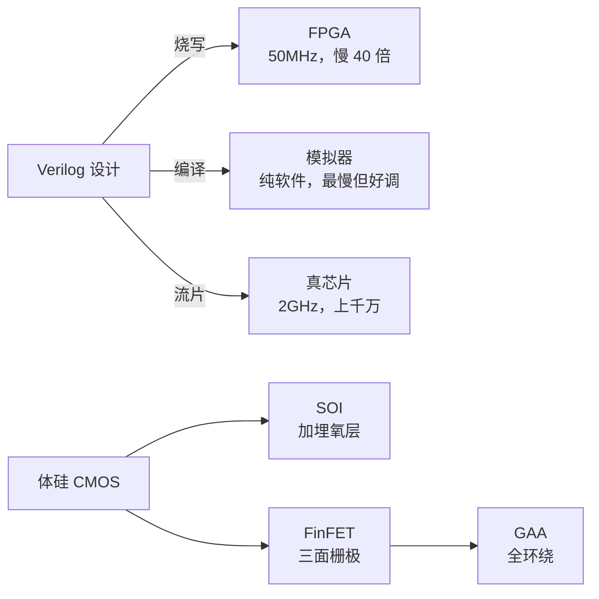

# 第 28 章：不流片也能做 CPU——FPGA 与模拟器

- **难度**：★★☆ | **学时**：0.5 小时 | **前置**：第 24 章

## 学习目标
- 能说明 FPGA 为什么能"烧写"成 CPU
- 能比较 FPGA、模拟器、流片三种验证方式的速度与成本
- 能说出 SOI 与 FinFET 各解决了什么问题

## 一句话核心
想验证 CPU，不一定要花上千万流片。FPGA 是租来的硬件，模拟器是免费的软件，代价都是慢。

## 零基础讲解
### FPGA：一次购买，反复烧写
28nm 一次流片要上千万，只有商业公司扛得住。学 CPU 的人需要一条便宜路。

FPGA（现场可编程逻辑门阵列）是一种可以定制功能的电路。把 Verilog 设计通过配套工具转成网表，从电脑传进 FPGA，电路功能就和设计一致了。买一次板子，可以反复烧写。

所以 FPGA 是流片前不可缺少的实验平台，专业公司会大量采购。"在 FPGA 上把 CPU 跑通"是前端设计的重要里程碑，很多 CPU 教材也拿它做演示平台。

缺点只有一个：慢。龙芯 3A4000 真芯片能跑 2.0GHz，在 FPGA 上最高只能到 50MHz，同一套测试集运行时间长约 40 倍，所以只能跑小规模测试。

### 模拟器：纯软件，几乎零成本
模拟器用软件模拟硬件功能，可以直接用 Java、C/C++、Python 写。相比 Verilog，这些语言描述能力更强，同样篇幅能表达更丰富的行为，实现更快，出问题也更好调试。

有的模拟器只模拟 CPU，有的连主板外设一起模拟，相当于模拟一整台计算机，后者也叫虚拟机。

开源项目里，龙芯团队早期用 GXemul（支持龙芯 2E，发过论文，后来没再维护），2010 年后主要用 qemu——它不只支持龙芯 2 号、3 号，还能模拟 x86、ARM 等十多种指令集，龙芯团队至今在维护并向上游提交代码。

三者的定位很清楚：流片是真硬件、最贵最真；FPGA 是软硬结合、要买板子、慢 40 倍；模拟器是纯软件、近乎免费、更慢但好调试。

### 明天的工艺：SOI 与 FinFET
CMOS 沟道宽度低于 22nm 时性能严重劣化：栅极下的氧化层太薄，源漏之间漏电，静态功耗上升，甚至无法正确区分 0 和 1，成品率和可靠性都掉。

两种改法。SOI（绝缘体上硅）：在衬底上加一层超薄埋氧层，沟道用很薄的硅膜做，埋氧层挡住电子从源流向漏，大幅减少漏电流。传统 CMOS 因此被称为体硅。SOI 2000 年发布，2010 年后商用成熟，主要代工厂陆续从体硅转向 SOI。

FinFET（鳍式场效应晶体管）：把栅极做成 3D，从上、左、右三面包住沟道，像鱼鳍。三面控制让开关更利落，漏电更少，沟道还能更短。

这两项让"CMOS 极限是 10nm"的预测落空，发明人都是胡正明（曾任台积电 CTO、伯克利教授）。

到 5nm，SOI 和 FinFET 也逼近物理极限。三星推出全环绕栅极（GAA）晶体管，宣称可取代 FinFET；Intel 表示 5nm 放弃 FinFET 转 GAA。

## 图示

看图说明：上面三条是"验证手段"的三档选择，成本越高越接近真实；下面一条是"工艺演进"的路径，每一步都在解决漏电。两组东西解决的是不同问题，别混着看。

## 类比与实例
- 类比：流片像开模注塑，模具贵但产品真；FPGA 像可反复擦写的白板，便宜但写得慢；模拟器像在纸上推演，最便宜也最慢。失效边界：白板擦不掉的物理时序问题，只有真芯片才暴露。
- 实例：龙芯 3A4000 在 FPGA 上 50MHz 跑测试集，时间是真芯片的 40 倍。所以 FPGA 上只跑功能验证的小测试集，性能评估还得靠真片或模拟器统计。

## 常见误解
- 别以为 FPGA 只是"开发板"。它是流片前的必经验证环节。
- 别以为模拟器不靠谱。功能验证阶段，模拟器能跑完整启动流程，还能看到每条指令。
- 别以为工艺到 5nm 就到头了。GAA 已经在接棒，只是难度和成本都在飙升。

## 自测题
1. FPGA 相对流片的最大优势是？｜一次购买、反复烧写，成本低｜速度更快｜不需要设计｜答案：A｜解析：省掉上千万流片费。
2. 龙芯 3A4000 在 FPGA 上的最高主频约为？｜50MHz｜2GHz｜500MHz｜答案：A｜解析：真片 2.0GHz，FPGA 上只有 50MHz。
3. SOI 解决的核心问题是？｜漏电流｜主频太低｜引脚太少｜答案：A｜解析：埋氧层阻挡源漏间漏电。
4. FinFET 的栅极结构是？｜三面包围沟道的 3D 结构｜平面结构｜四面环绕｜答案：A｜解析：像鱼鳍，三面控制。

## 抽认卡
- FPGA 的全称？｜现场可编程逻辑门阵列
- 在 FPGA 上跑通 CPU 意味着什么？｜前端设计达到重要里程碑
- 龙芯团队现在主用的模拟器？｜qemu
- SOI 的关键结构？｜衬底上的超薄埋氧层
- FinFET 与 GAA 的发明人？｜胡正明
- GAA 的含义？｜全环绕栅极晶体管

## 术语
- FPGA：可反复编程配置的电路器件
- 模拟器：用软件模拟硬件行为的程序
- 流片：把版图交付工厂投产
- SOI：绝缘体上硅，以埋氧层抑制漏电的工艺
- FinFET：栅极三面包围沟道的 3D 晶体管
- GAA：全环绕栅极晶体管，FinFET 的后继结构

## 复习锚点
- 验证三档：流片最真、FPGA 居中、模拟器最省
- 省钱的代价都是速度
- 工艺演进的主线是"把漏电关住"
