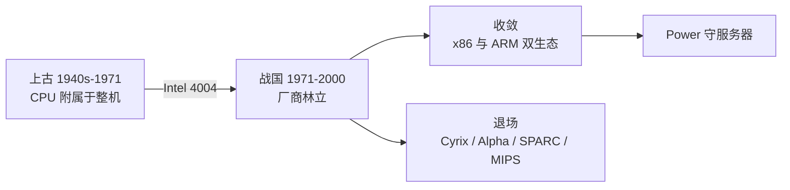

# 第 29 章：从上古到战国——CPU 家族简史

- **难度**：★★☆ | **学时**：0.6 小时 | **前置**：第 4 章

## 学习目标
- 能定义 CPU 的"上古时代"与"战国时代"
- 能举出四款 20 世纪 70 年代的经典 8 位处理器
- 能说出几个曾经辉煌、如今退场的 CPU 品牌及其原因

## 一句话核心
1971 年之前，CPU 只是整机的一部分；1971 年之后，CPU 成了有型号、有品牌的独立商品。这条分界线是 Intel 4004。

## 零基础讲解
### 上古：有实无名
1971 年 Intel 4004 发布之前，CPU 由计算机厂商自己设计自己用，不作为商品销售，也没有专属品牌。所有 CPU 厂商同时都是计算机制造商。

那时一台大型机的 CPU 可能占一个机柜，甚至一个机房。举几个标本：

1951 年 Ferranti Mark 1，4050 个电子管，CPU 主频 100kHz，20 位字长，主存 512B，约 50 条指令，占两个 5m×2.7m 的机柜，功率 25kW。

1959 年 DEC 的 PDP-1，提出"交互式计算机"，把人机交互部分收进一张桌子（显示器、键盘、光笔、打印机），这部分叫终端；主机仍占 2m² 机柜。CPU 主频 5MHz，18 位字长，内存 9KB，加减法 10ms，乘法 20ms。

1961 年 SAGE，史上最大最重最贵的计算机，6 万个电子管，占地 2000m²，CPU 机柜就有 15m×45m，每秒 75000 条指令，造价 120 亿美元，用于防空监测，一直跑到 1983 年。

1964 年 CDC 6600，第一台商用超算，被认为最早采用 RISC 思路（术语还没出现），内存约 65kB，60 位字长。Pascal 语言就是在它上面开发的。设计者西摩·克雷后来做了 Cray-1（1976 年，64 位，80MHz，支持向量指令，1MB 内存）。

1970 年 PDP-11，商业上极成功，16 位小型机，售价 2 万美元，销量超 60 万台，第一个跑 UNIX 的机器，直到 1990 年还在卖。

### 战国：百花齐放
1971 年后，Intel 开创了独立 CPU 厂商的商业模式：专注做 CPU，出系列型号，持续提性能，整机厂买现成的就行。从此人们说"某计算机采用某公司某型号芯片"，CPU 有了身份。

70 年代的"老四强"：Intel 8080、MOS 6502、Motorola MC6800、Zilog Z80。

6502 堪称传奇：Apple I、II、III 都用它（传说第一台苹果机的 6502 是乔布斯亲自开车买回的），史上销量最高的个人计算机 Commodore 64 用它，任天堂 FC、小霸王学习机也用它。

Z80 兼容 8080 并扩展 80 多条指令，能把 CPU、内存、主要 I/O 做在一块板上，是 80 年代工业单板机的主力。

Motorola 的 MC6800 开启 680x 系列，1979 年的 MC68000（16 位）用在早期 Macintosh、Amiga、Atari、Commodore 上，后来"龙珠"系列进入 Palm 等 PDA，最终大部分被 ARM 取代。

80 到 90 年代更热闹：Cyrix 靠低价高能，90 年代与 Intel、AMD 三足鼎立，一度销量超过 Intel，1999 年被威盛收购，衍生出 C3/C5/C7、Nano；DEC 的 Alpha 是 RISC 阵营性能最高的，21164、21264 用不高的工艺跑到很高主频，SMT 最早在这里实现，1998 年被康柏收购后终止；Sun 与 TI 的 SPARC（1987，32 位，16MHz）到 UltraSPARC 占据高端服务器，Java 最早就是在 SPARC 服务器上开发的；MIPS 覆盖服务器、工作站、游戏机、嵌入式，长期是国外计算机教学的示范平台。

大浪淘沙之后，还在活跃的主要是 ARM 与 Power。ARM 在嵌入式、移动计算崛起，建成了唯一能与 x86 平起平坐的第二套生态；IBM 的 Power 守在大型机、服务器，PowerPC 衍生到桌面与嵌入式。

## 图示

看图说明：这不是一棵不断分叉的树，而是一次爆发后的大收敛。看这张图要抓的是"为什么收敛"——不是技术最强者胜出，而是生态最稳者胜出。

## 类比与实例
- 类比：上古像家家自己打家具，战国像家具城开张，品牌林立，最后剩下几个大卖场。失效边界：家具城靠渠道，CPU 靠软件生态，后者的黏性强得多。
- 实例：一台 1970 年代的 PDP-11 售价 2 万美元、内存 56KB，销量却超过 60 万台。它的成功不在算力，在"便宜 + 能跑 UNIX + 够用"。

## 常见误解
- 别以为上古 CPU 很弱所以没意义。现代计算机的很多结构（终端、交互、指令系统）都在那时定型。
- 别以为退场的品牌都是技术差。Alpha 技术极强，死于公司并购；Cyrix 便宜好用，死于技术迭代跟不上。
- 别以为历史只是故事。今天的选择（兼容、开放、生态）都能在这些兴衰里找到依据。

## 自测题
1. CPU"上古时代"结束的标志是？｜1971 年 Intel 4004 发布｜1951 年 Ferranti Mark 1｜1964 年 CDC 6600｜答案：A｜解析：4004 让 CPU 成为独立商品。
2. 下列哪款不是 70 年代"老四强"？｜Alpha 21264｜Intel 8080｜Zilog Z80｜答案：A｜解析：Alpha 是 90 年代 DEC 的产品。
3. 苹果早期个人计算机使用过哪些 CPU？｜6502、68000、PowerPC、x86｜只有 x86｜只有 ARM｜答案：A｜解析：四代更替，2003 年才转向 Intel。
4. PDP-11 的历史意义之一是？｜第一个运行 UNIX 的计算机｜第一台超算｜第一台 PC｜答案：A｜解析：它也是 PC 时代前销量最大的计算机。

## 抽认卡
- 上古与战国的分界？｜1971 年 Intel 4004
- 70 年代四款经典 8 位处理器？｜Intel 8080、MOS 6502、Motorola MC6800、Zilog Z80
- 史上销量最高的个人计算机？｜Commodore 64，用 6502
- Alpha 处理器的结局？｜1998 年 DEC 被康柏收购后终止研发
- Cyrix 的归宿？｜1999 年被威盛收购
- 现存的两大生态？｜x86 与 ARM

## 术语
- 上古时代：CPU 由整机厂自研自用、未独立销售的时期
- 战国时代：1971 年后多家 CPU 厂商并存的时期
- 终端：与人交互的输入输出设备部分
- 单板机：把 CPU、内存、I/O 集成在一块板上的微型计算机
- 第二套生态：相对 x86 而言、以 ARM 为核心的软硬件体系

## 复习锚点
- 1971 年是 CPU 独立纪年的起点
- 战国百家，最后收敛为 x86 与 ARM
- 退场原因多是生态与公司命运，不是单纯技术

