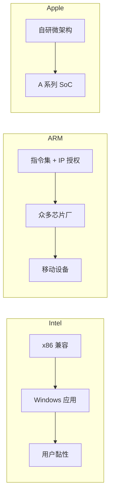

# 第 30 章：巨头寻踪——Intel、AMD、ARM、苹果、IBM

- **难度**：★★☆ | **学时**：0.7 小时 | **前置**：第 29 章

## 学习目标
- 能说明 Intel 成功的真正原因不在性能领先
- 能说出 AMD 与 Intel 竞争的两大法宝与两次逆转
- 能解释 ARM 的授权模式为何能建成第二套生态

## 一句话核心
Intel 赢在生态，不在性能。ARM 赢在开放，不在算力。AMD 赢在敢跟，苹果赢在敢自己来。

## 零基础讲解
### Intel：大一统靠三处兼容
x86 系列包括 8080、8086、80286、80386、80486，以及奔腾、赛扬、至强、酷睿、凌动，型号加起来几千种。它们指令集兼容，都能跑 DOS、Windows、Linux。

值得注意的是：Intel 的性能长期不是同时代最强的，史上被当作性能标杆的 CPU 很少出自 Intel。它赢在三处向下兼容与标准化：x86 只加指令不改不删；IBM 定义了开放的 PC 整机标准，谁都能造；Windows 的 Win32 API 多年不变，应用向下兼容。

"开放"加"兼容"是它的两个法宝。用户选 x86，就有越来越多的应用可用，而应用才是生态里最值钱的东西。三十年前的 Windows 程序，今天还能在 x86 上跑。

违背这条规律，连 Intel 自己也会碰壁。IA64 不兼容 x86，跑不了 Windows 应用，被用户抵制。

### AMD：技术领跑与质优价廉
AMD 1969 年由仙童的八位员工创办，长期仿制 Intel 的 8080 到 80486，1995 年 K5 起开始独立设计，但仍留在 x86 生态内。

它的两件武器：一是技术领跑，1999 年 Athlon 先破 1GHz，2003 年 Athlon 64 先推 64 位，2005 年 Athlon 64 X2 是真双核，比 Intel 用两个 die 封装的 Pentium D 更省电；二是价格，一般是同级 Intel 的三分之二，配套桥片和主板也更便宜，整机厂利润空间更大。

2005 年 AMD 份额到 50%，几乎平分秋色。之后 Intel 靠 Tick-Tock 反攻，酷睿 2 横扫高端，AMD 份额 2017 年跌到 20% 以下。再后来 Intel 从 14nm 到 10nm 屡屡受挫，AMD 借自家代工厂 GF 的 7nm 优势，2019 年推 Zen2，2020 年一季度份额回到 40%。

Intel 是伟大公司，AMD 更像可敬的斗士。AMD 市值只有 Intel 的十分之一，但它的存在让 Intel 跑得更快。

### ARM：把芯片生意做成授权生意
ARM 源自 1978 年成立的英国 Acorn。当年 Acorn 嫌 Motorola 68000 又贵又慢，找 Intel 授权 80286 被拒，工程师只能自己干，做出了 32 位 RISC 的 ARM。

定位一开始就是低功耗、精简架构的嵌入式与移动。2000 年后 PDA、智能机、平板把它推上巅峰。

它建生态靠两条。一是比 Intel 更开放：早早退出制造，只做指令集与 IP 核授权，门槛低，芯片遍地开花。Intel 的对手不是 ARM 一家，是所有造 ARM 兼容芯片的公司。二是抓转折点：别人都在台式机和服务器上拼大而复杂，它避开正面战场，等老牌厂商反应过来，船大难调头。

如今 ARM 也在往桌面和服务器攻，服务器 CPU 性能已不低于 Intel 至强。

### 苹果：自己动手做核
苹果从 1976 年起一直用别人家的 CPU：6502 → 68000 → PowerPC → x86。

A 系列最初只用于手机平板，2010 年 iPhone 4 首搭 A4。三个阶段很清晰：用第三方芯片（iPhone 4 前用高通、三星）；基于 ARM 公版 IP 少量定制（A4、A5）；自研核（2016 年 A6 抛弃公版，用自家 Swift 微架构）。

苹果的 CPU 团队不是从零搭的，是把 DEC、Intel、ARM、AMD、MIPS 的名将收拢起来，加上重金投入。2020 年 A14 是业界首款 5nm，118 亿晶体管，6 核 CPU、4 核 GPU、16 核神经网络引擎，性能不输桌面 CPU。同年 11 月，苹果开始卖搭载 ARM 的台式机与笔记本，17 年后再次换芯。

### IBM：巨人的四条产品线
IBM 1911 年成立，1964 年 System/360 宣告系统时代来临。

z 系列：大型机最高端，金融与关键业务的主力。2020 年 z15 有 12 核、GF 14nm、核心面积 696mm²、122 亿晶体管、5.2GHz、四级缓存共 960MB。

Power：RISC，源自 1970 年代的 IBM 801，1990 年随 RS/6000 发布第一代。Power9 对 Intel 至强可达两倍性能，Power10 在性能与 I/O 带宽上又有跃升，龙芯团队靠研读它的资料判断前沿走向。

PowerPC：1991 年 IBM、Apple、Motorola 联合开发，用于 90 年代 Mac；2003 年苹果转向 Intel 后，它退到工控与嵌入式。

Cell：2001 年 IBM、索尼、东芝联合研发，"1+N"结构——1 个 Power4 主核加 8 个协处理器，128 位×128 个寄存器，靠超高速总线互连。IBM 用它造出走鹃，登顶过世界最快。2009 年终止，但设计要素被 Power 继承。

Power 走"高端高价"，性能、I/O、可靠性让 Intel 望尘莫及，金融核心系统仍是它的地盘。

## 图示

看图说明：三条路径的差别在"谁掌握增量"。Intel 掌握指令集，ARM 掌握授权，苹果掌握核设计。谁掌握的那一层越靠近软件生态，黏性越强。

## 类比与实例
- 类比：Intel 像收租的房东，房子（x86）谁都能住，但产权在它手上；ARM 像卖图纸的设计院，图纸授权给谁都能盖，收的是授权费；苹果像自己设计自己盖的开发商。失效边界：房东会被更好的房子冲击，设计院会被免费图纸冲击，开发商要独自扛全部风险。
- 实例：AMD 用 7nm 反超时，Intel 还在 14nm。这不是设计能力突然逆转，是制造路线的一次判断差异被放大成了市场份额的翻转。

## 常见误解
- 别以为 Intel 一直最强。它多数时候是"最稳"，不是"最快"。
- 别以为 ARM 不造芯片所以弱。不造芯片恰恰是它能铺开的原因。
- 别以为苹果换芯只是商业决策。它背后是十几年自研核的积累与人才收编。

## 自测题
1. Intel 成功的核心原因是？｜在指令集、整机标准、操作系统三处保持兼容与开放｜单核性能长期第一｜价格最低｜答案：A｜解析：生态黏性来自兼容。
2. AMD 的两大竞争法宝是？｜技术领跑与质优价廉｜广告与渠道｜规模与垄断｜答案：A｜解析：多次率先突破，同时价格约为同级的三分之二。
3. ARM 生态成功的关键是？｜低门槛的指令集与 IP 授权模式｜自己制造芯片｜只做高端｜答案：A｜解析：不造芯片，让所有下游厂商成为它的盟友。
4. 苹果 A6 的转折意义是？｜抛弃 ARM 公版，改用自研微架构｜首次使用 x86｜首次用 5nm｜答案：A｜解析：从定制走向自研核。

## 抽认卡
- Intel 生态的三处兼容？｜x86 指令集、开放的 PC 整机标准、Windows 向下兼容
- AMD 两次关键领先？｜先破 1GHz、先推 64 位（另有真双核）
- ARM 的前身？｜1978 年成立的英国 Acorn
- 苹果 A14 的关键参数？｜5nm、118 亿晶体管、6 核 CPU
- IBM 的四条 CPU 产品线？｜z 系列、Power、PowerPC、Cell
- Cell 的结构？｜1 个 Power4 主核 + 8 个协处理器

## 术语
- Wintel 联盟：x86 与 Windows 组成的产业组合
- Win32 API：Windows 提供给应用的编程接口
- IP 授权：把指令集或核设计许可给他人生产芯片的模式
- 真双核：两个完整核集成于一个 die，区别于双 die 封装
- SoC：片上系统，集成 CPU 与多种功能模块

## 复习锚点
- Intel 赢兼容，ARM 赢授权，苹果赢自研
- AMD 用领先与低价换生存空间
- 生态的黏性来自应用，不来自跑分
