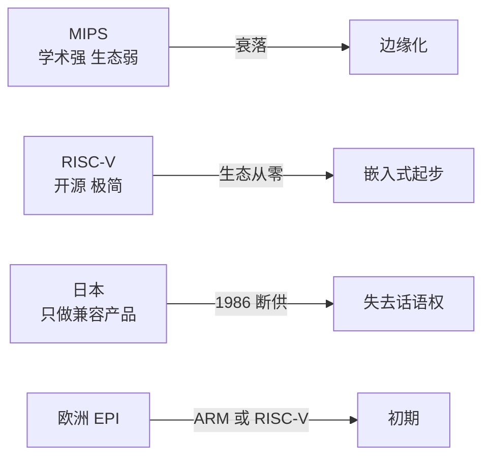

# 第 31 章：小而坚强与世界边缘——MIPS、RISC-V 与各国 CPU 之路

- **难度**：★★☆ | **学时**：0.6 小时 | **前置**：第 30 章

## 学习目标
- 能说出 MIPS 的两大贡献与衰落原因
- 能解释 RISC-V 的开放理念和它面对的碎片化难题
- 能用日本的教训说明"制造不等于掌握生态"

## 一句话核心
MIPS 输给了生态，RISC-V 想用开放换生态。日本输给了授权，因为它只做产品、不做标准。

## 零基础讲解
### MIPS：教科书里的殿堂
MIPS 由斯坦福前校长约翰·亨利斯团队 1984 年创立，是 RISC 先锋，曾建起能与 x86、ARM 比肩的生态。

它学术气息很重：三本计算机经典教材里有两本出自亨利斯，国外教学长期以 MIPS 为范例，资料最开放、最丰富。技术上也不含糊——1991 年的 R4000 就实现了 64 位，而 Intel、ARM 的 64 位要晚十年以上。

90 年代它一度是最广泛使用的 RISC，产品线覆盖服务器、工作站、PC、游戏机、交换机、嵌入式。2000 年前后转折：服务器和桌面被 x86 挤压，嵌入式没打过 ARM，移动计算没抓住，架构升级慢，公司几经转卖，逐渐边缘化。

它留下的遗产是人才与教材。很多从业者第一款上手的处理器就是 MIPS，龙芯研发人员桌上的参考书也多是 MIPS 示范。

### RISC-V：极简与开放
RISC-V 与 MIPS 师出同门——领导者之一大卫·帕特森与亨利斯合写过那两本经典教材。

2010 年，伯克利团队要做一款灵活的 CPU，但 Intel、ARM 授权卡得严、限制多，于是从零设计一套全新指令集。

它的风格是极简：没有历史包袱，不需要向下兼容，基础指令仅 40 多条，加模块化扩展总共几十条；核心文档 238 页，而 x86、ARM 的文档上千页。

生态理念是自由开放：任何人可以设计、制造、销售 RISC-V 芯片与软件，不交授权费。基金会成员持续增长，目标是建一个不被某家商业公司控制的"全民生态"。

但书里也点得清楚：RISC-V 在基础原理上创新不多。重设计指令集本身很简单，第一版只花几个月；现代 CPU 核心原理 2000 年就成熟了，它主要是用已有技术做芯片。

最大的难题是立足之地。x86、ARM、Power 已分割世界，各有绝技与多年壁垒。RISC-V 的软件生态要从零做，目前主要在低端嵌入式、物联网分一杯羹，桌面、服务器、移动还没迈过"零的突破"。

### 边缘地带的三条路
日本：70 年代美企向 NEC、夏普、日立、理光、富士通、东芝、三菱大量授权，日本造的兼容 CPU 与内存物美价廉，反而成了美国市场主力。但它只做产品、不做生态主导权。1986 年 80386 上市前，Intel 断供 32 位授权，日本公司从此只能买成品。NEC 的 PC98 只好"换芯"：8086 → 自研 V30 → 又被逼回 80286。1984 年日本启动 TRON 项目想另立体系，被"不公平贸易""盗取知识产权"打压，又被极低授权条件诱导，最终放弃 PC 正面竞争，只允许在嵌入式领域用。日本对 CPU 家族的贡献更多在制造，SuperH、TMPM 这类自研架构只是支脉。

欧洲：产业分散，没有硅谷量级的聚集区。意法半导体做 STM8（自研）、STM32（ARM 兼容）；西门子剥离出英飞凌，主攻汽车电子，有 ARM 兼容与自研 TriCore；飞利浦分出恩智浦，做 ARM、Power 兼容微控制器。2018 年欧盟提出 EPI（欧洲处理器计划），集结 10 国 27 家机构，目标低功耗处理器与超算 CPU，指令集选 ARM 或 RISC-V，目前仍在初期。

韩国：三星 CPU 历史不短，S3C2410 是最早在中国流行的 ARM 嵌入式芯片，iPhone 一代二代都用三星的 ARM。2011 年推出 Exynos（猎户座），至今仍有国际影响力。但韩国也主要走兼容制造路线，多用 ARM 公版 IP 配自家先进工艺，性能功耗上缺乏鲜明优势，面对苹果 A 系列、高通、海思竞争力偏弱。

一句话总结：制造能力可以买设备建厂堆出来，生态主导权只能靠指令集、专利与开发者一点点养出来。

## 图示

看图说明：四条路都在同一个问题上打转——生态从哪来。MIPS 有技术没守住，RISC-V 想用免费换规模，日本被授权掐住，欧洲还在选路线。

## 类比与实例
- 类比：MIPS 像一所名校，教材写得最好，但毕业生留不住产业；RISC-V 像开源社区，门槛为零，但要把散落的贡献者拧成一股绳；日本像代工厂，活干得漂亮，图纸不是自己的。失效边界：开源社区能聚人，但商业闭环仍是难题，免费不等于可持续。
- 实例：RISC-V 文档 238 页、基础指令 40 多条，对照 x86 上千页文档、上千条指令。这个对比最能说明"历史包袱"的重量。

## 常见误解
- 别以为开源就一定能赢。生态需要商业闭环，光有免费不够。
- 别以为日本技术不行。它造得出好东西，输在没有标准话语权。
- 别以为 RISC-V 只能做低端。它在高端有潜力，但目前确实还没跨过零的突破。

## 自测题
1. MIPS 在技术上的领先事例是？｜1991 年 R4000 率先实现 64 位｜率先做出 5nm｜率先做多核｜答案：A｜解析：比 Intel、ARM 早十年以上。
2. RISC-V 的核心文档约多少页？｜238 页｜1000 页以上｜40 页｜答案：A｜解析：基础指令 40 多条，文档 238 页。
3. 日本失去 CPU 话语权的直接事件是？｜1986 年 Intel 中止 32 位授权｜TRON 项目成功｜EPI 计划启动｜答案：A｜解析：断供使日本只能购买成品。
4. 欧洲 EPI 计划准备采用哪些指令集？｜ARM 或 RISC-V｜只 x86｜只 Power｜答案：A｜解析：两条路线并行评估。

## 抽认卡
- MIPS 的创始人？｜约翰·亨利斯团队，1984 年
- MIPS 衰落的主要原因？｜桌面与服务器被 x86 挤压、嵌入式输给 ARM、错过移动
- RISC-V 的两位关键人物？｜大卫·帕特森与约翰·亨利斯（合作教材）
- RISC-V 的生态理念？｜自由开放，免授权费
- 日本 TRON 项目的结局？｜被迫放弃 PC 正面竞争，限用于嵌入式
- 三星移动处理器系列名？｜Exynos（猎户座）

## 术语
- MIPS：源于斯坦福的 RISC 架构与公司
- RISC-V：伯克利发起的开放指令集架构
- 碎片化：同一架构因扩展不一导致软件难以通用的问题
- TRON：日本 1984 年启动的自主信息产业体系项目
- EPI：欧洲处理器计划

## 复习锚点
- 技术领先不等于生态领先
- 开源能降低门槛，不能自动带来闭环
- 只做兼容产品，迟早被授权掐住
