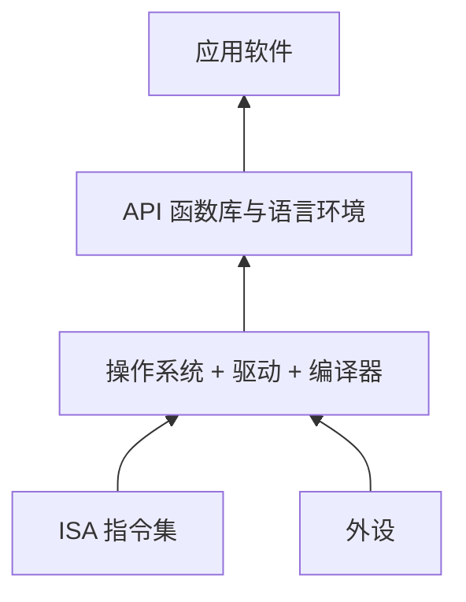

# 第 32 章：生态之重——CPU 的价值不在 CPU

- **难度**：★★☆ | **学时**：0.6 小时 | **前置**：第 4、19 章

## 学习目标
- 能定义 CPU 生态与软件生态，并说明二者的关系
- 能说出 CPU 与应用之间的三种接口
- 能用 Inside / Outside 模型解释 CPU 企业的两个使命

## 一句话核心
CPU 是土，软件生态是森林。土本身不能吃，能长出什么才值钱。

## 零基础讲解
### 生态是什么
CPU 生态是围绕某一种 CPU 的全部资源：配套软硬件、应用软件、社区、知识库、书籍、开发者、合作厂商、用户，整条上下游。

软件生态是某一种 CPU 能运行的所有软件的集合，是 CPU 生态里最重要的一块，日常也直接叫"生态"。

关键判断：CPU 本身没有使用价值。一个元器件对用户没用，只有 CPU 加应用软件才提供服务。软件越多，CPU 能干的事越多，价值越大。

所以做生态的门槛远高于做 CPU。做 CPU 是技术活，原理 2000 年前后就成熟了，投人投时间就能出产品；做生态是群体行为，要成千上万家厂商多年合作，大型软件的复杂度不亚于 CPU，CPU 厂不可能全自己做。核心是让应用厂商有利可图，把"统一战线"建起来。

最难的是起步阶段那个怪圈：应用少 → 用户少 → 厂商不愿支持 → 更没人用。很多 CPU 公司没跳出怪圈就撑不住了。全球能做 CPU 的不止百千家，敢做生态的屈指可数。

### Inside 与 Outside
龙芯 2012 年提出的模型：Inside 是芯片之内的 CPU 核，是看家本事；Outside 是芯片之外的软件生态，决定可用性、放大价值；芯片是两者的衔接载体。

成功的 CPU 公司都会在芯片团队之外再建一支软件生态团队。龙芯 2013 年成立系统软件团队，进入"左手 CPU，右手软件生态"的阶段。2020 年完成性能补课，生态初具规模，但要追到 x86、ARM 的水平还需要更长时间。

### 三种接口
最简的分法：下面操作系统，上面应用软件。两者之间有两个接口——指令集（ISA）规定二进制编码格式，系统调用（System Call）规定操作系统给应用的服务。

但真实的生态是多层的：操作系统在最底层，管硬件、提供驱动，还带编译器（最常用 C/C++）；往上是 API 层，提供编程语言环境与函数库；最上面是应用软件。旁边还有外设（Devices），通过硬件接口连进来。

于是接口变成三种：应用软件接口 = {ISA, System Call, API}。三者缺一不可，都是生态建设的内容。

龙芯桌面与服务器生态以 Linux 为主，系统调用就是 Linux 内核 API；嵌入式和实时系统若用 VxWorks，系统调用就换成 VxWorks API。

## 图示

看图说明：箭头是"支撑"方向，下层托着上层。三种接口分别落在 ISA、System Call、API 三处，任何一层断了，应用都跑不起来。

## 类比与实例
- 类比：CPU 是地基，操作系统是市政管网，API 是水电接口，应用是楼里的商铺。地基再结实，没有管网和商铺，也没人来。失效边界：地基不能换，生态可以迁移（通过二进制翻译、虚拟机），只是要付代价。
- 实例：一台性能够用的龙芯机器，如果常用软件装不上，用户就不会买。性能补课完成之后，真正卡住销量的是"软件够不够"。

## 常见误解
- 别以为 CPU 做强了生态自然来。生态是独立战场，要单独的团队和投入。
- 别以为生态只是"软件数量"。接口规范、开发者、社区、书籍都算。
- 别以为怪圈可以靠降价破。用户要的是能用的软件，不是便宜的空机器。

## 自测题
1. CPU 的价值由什么决定？｜其上承载的软件生态的价值｜主频高低｜晶体管数量｜答案：A｜解析：CPU 单独没有使用价值。
2. Inside 与 Outside 分别指？｜芯片内的 CPU 核与芯片外的软件生态｜封装内外｜主板内外｜答案：A｜解析：龙芯 2012 年提出的模型。
3. 应用软件接口包括哪三项？｜ISA、System Call、API｜ISA、PCB、BIOS｜API、GPU、DMA｜答案：A｜解析：三者共同构成应用运行条件。
4. 生态起步最难的问题是？｜应用少、用户少、厂商不愿支持的双向怪圈｜缺资金｜缺人才｜答案：A｜解析：正反馈难以启动。

## 抽认卡
- CPU 生态的定义？｜围绕某 CPU 的全部资源与上下游集合
- 软件生态的定义？｜某 CPU 能运行的所有软件的集合
- 为什么 CPU 本身没有使用价值？｜它只是元器件，需软件才提供服务
- 三种接口公式？｜应用软件接口 = {ISA, System Call, API}
- 龙芯系统软件团队成立时间？｜2013 年
- 生态架构的层次？｜操作系统 → API → 应用软件，旁挂外设

## 术语
- CPU 生态：围绕某 CPU 的全部资源与产业集合
- 软件生态：某 CPU 可运行的全部软件集合
- Inside/Outside：芯片内核心与芯片外生态的二分模型
- 系统调用：操作系统向应用提供的服务接口
- API：应用编程接口，语言与函数库层面的调用规范

## 复习锚点
- 土与森林：CPU 的价值在生态
- 三接口：ISA、System Call、API
- 做芯片是技术，做生态是群体工程
