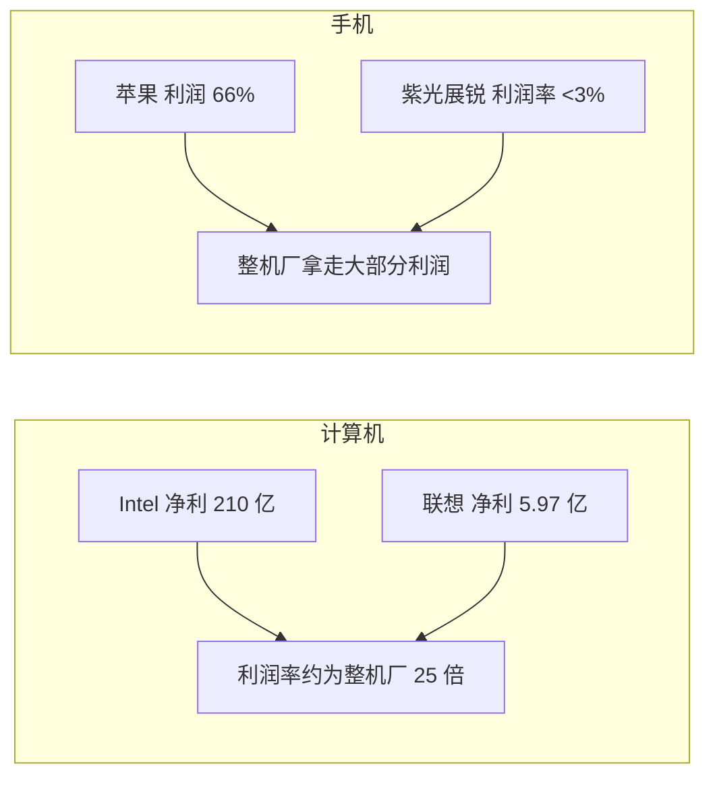

# 第 33 章：开发者的号角与解决方案为王

- **难度**：★★☆ | **学时**：0.7 小时 | **前置**：第 32 章

## 学习目标
- 能区分系统软件开发者与应用软件开发者，说出中国开发者结构的特点
- 能说明 Linux 发行版是怎么"做"出来的
- 能用虚拟机的机制解释"脱离指令集的生态"
- 能用利润率数字说明"解决方案为王"

## 一句话核心
写代码的人决定生态有没有内容，做解决方案的人决定钱怎么分。

## 零基础讲解
### 两类开发者
开发者是软件生态的主要贡献者。狭义指写代码的程序员，广义包括一切参与应用制造的人员与厂商。

分两类：系统软件开发者，做操作系统与 API，目标是让操作系统在 CPU 上稳定跑，并向应用提供丰富高效的 API；应用软件开发者，做应用程序，目标是功能满足需求、交互好用。

中国的情况是应用强、系统弱。Java 程序员几百万人，互联网应用全球最发达；系统软件开发者加起来约万人规模，多数还是在开源代码上改定制，属操作系统里的低端工作；API 开发者极稀有，做 C/C++ 编译器、Java 编译器的人不到千人。

龙芯的软件工程师主要做系统软件，围绕自己的指令集研发 Linux 发行版，再细分出内核、C/C++ 编译器、Java 虚拟机、浏览器、图形库、媒体解码、虚拟化与云平台等小组。2015 年做了 3D 地球演示，证明 3A2000 平台上软件优化后 3D 应用是流畅的；2017 年启动"龙芯应用公社"，把类似应用商店的东西集成进系统。

### 发行版是怎么来的
操作系统分商业与社区两类。商业的如 Windows、macOS，不公开源码；社区的如 Linux，全球程序员基于互联网合作开发，源码公开。

Linux 以发行版形式提供成品：把网上分散的源码汇总，在某个 CPU 平台上编译，按统一格式打包，做成一张安装光盘。

做发行版技术含量很低，主要是重新编译的体力活，很少自己写源码。谁都能做。商业公司做发行版，靠技术咨询、支持、维护收费。常见的有 Fedora、Redhat、Ubuntu、Debian。国内的深度（Deepin）自己写了图形界面，接近 macOS 的美观，被称"最美 Linux"。龙芯维护的是 Loongnix——把社区发行版源码在龙芯上重新编译、适配优化，建了开源社区提供镜像与全部源码，也能在源码层面二次定制。

### 虚拟机：没有 CPU 实体的生态
应用要在某 CPU 上跑，得先变成该 CPU 的机器指令。按转换方式分两类语言。

本地编译型：源码编译成二进制可执行文件，运行时不再需要源码。C/C++、Fortran、Pascal 属于这类，都是 80 年代以前的老语言。

虚拟机型：源码不预编译，直接在虚拟机上跑；虚拟机动态加载源码，转成当前 CPU 的机器指令。Java、.Net、JavaScript、Python、PHP、Shell 属于这类。Go 是混合型。

虚拟机屏蔽了指令集差异。本地编译型要为每个 CPU 出不同二进制版本，虚拟机型只发一份源码就能到处跑——"一次编译，多处运行"。

于是开发者可以脱离 CPU 建生态：这个生态属于虚拟机，不属于某颗 CPU。服务器侧最成功的是 Java（占 90% 以上），桌面侧是浏览器里的 JavaScript，移动侧是 Android 虚拟机。

### 解决方案为王
解决方案是针对一种应用需求的整体软硬件平台：CPU 加主板、操作系统、外设、应用软件。做好一套，同类场景可复用。

IT 产业本质是"解决方案为王"。解决方案的研发难度高于 CPU 本身，它含对需求的理解，要同时满足功能、成本、性能、定制，只能在实际应用中反复磨合。

规律很硬：解决方门槛越高，企业在产业链上的位置越高、利润越高；只会造产品、没有核心方案的，只能站在低端做同质竞争。

看两组数字。计算机领域：2019 年 Intel 收入 720 亿美元、净利 210 亿；联想收入 510 亿、净利 5.97 亿。CPU 厂利润率是整机厂的 25 倍。原因是计算机 CPU 设计难度极高，市场被极少数厂商垄断，Intel 不只做 CPU 还做主板设计，联想拿资料生产即可，同类整机厂还有 HP、Dell、曙光、浪潮一大批。

手机领域反过来了：2019 年苹果一家拿走全球智能手机 66% 的利润、32% 的收入；三星 17%，华为约 10%；而做手机芯片的紫光展锐利润率低于 3%。原因是手机 CPU 设计难度低——谁拿到 ARM 公版都能做，全球几百家能做 ARM 芯片；而"做好手机"的厂商不到 10 家，苹果投入最大、方案最优。

所以产业链分钱不看谁干得多，看谁控制解决方案。中国企业的普遍问题是制造发达、方案落后、利润薄。华为干了很多别人的活，利润不如苹果的零头。

结论：在现有 x86、ARM 体系里做 CPU 只能是追随者，地位受威胁时对方会用知识产权、贸易公平等借口压制。根本出路是建自己的体系，走自己的指令集与独立软件生态。

## 图示

看图说明：同样是"做芯片"，两个领域的利润分配完全相反。差别不在技术难度本身，在谁掌握了解决方案。

## 类比与实例
- 类比：解决方案像餐厅，CPU 像厨房设备。设备供应商能赚一笔，但定价权和回头客在餐厅。失效边界：如果厨房设备只有一家能造（如计算机 CPU），设备商反而能掐住餐厅。
- 实例：苹果应用商店按 3:7 与应用开发者分成，2019 年该业务收入高达 500 亿美元，占其 2600 多亿总收入的一大块。这就是"掌握分发入口"的收益。

## 常见误解
- 别以为做芯片一定比做整机赚。要看这个领域里谁掌握方案。
- 别以为发行版是"开发操作系统"。多数发行版工作只是重编译与打包。
- 别以为虚拟机生态与 CPU 无关。它绕开了指令集，但仍要 CPU 与操作系统支撑。

## 自测题
1. 中国开发者结构的特点是？｜应用软件开发者多、系统软件开发者少｜系统软件多、应用少｜两者均衡｜答案：A｜解析：系统软件约万人规模，API 开发者不到千人。
2. Linux 发行版的核心工作是？｜把分散源码在特定平台编译、打包｜从零写内核｜设计指令集｜答案：A｜解析：技术含量低，以重编译为主。
3. 虚拟机生态的关键作用是？｜屏蔽指令集差异，源码到处可跑｜提高主频｜降低功耗｜答案：A｜解析：一次编译，多处运行。
4. 2019 年 Intel 与联想的利润率对比说明？｜掌握解决方案者拿走产业链多数利润｜整机厂更赚钱｜芯片厂不赚钱｜答案：A｜解析：计算机领域 CPU 厂利润率为整机厂 25 倍。

## 抽认卡
- 两类开发者？｜系统软件开发者与应用软件开发者
- 中国 API 开发者规模？｜从事编译器等工作的人不到千人
- Linux 发行版的产出形式？｜一张安装光盘/镜像
- 虚拟机型语言举例？｜Java、.Net、JavaScript、Python
- 本地编译型语言举例？｜汇编、C/C++、Fortran、Pascal
- "解决方案为王"的含义？｜对方案的控制力决定利润分配

## 术语
- 系统软件开发者：开发操作系统与 API 的人员
- 发行版：把大量源码编译打包成的 Linux 成品
- 本地编译型语言：编译成可执行文件后运行的语言
- 虚拟机型语言：由虚拟机动态翻译执行的语言
- 解决方案：面向某类需求的整体软硬件平台

## 复习锚点
- 应用强、系统弱，是中国开发生态的现状
- 发行版多是重编译，不是从零造系统
- 虚拟机让开发者脱离指令集
- 谁控制解决方案，谁分走利润
