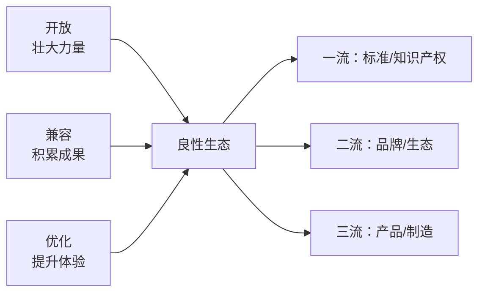

# 第 34 章：生态的优点与方向——开放、兼容、优化

- **难度**：★★☆ | **学时**：0.7 小时 | **前置**：第 33 章

## 学习目标
- 能说出优秀生态的三个原则及各自作用
- 能用 Linux 的碎片化说明"开放而不兼容"的代价
- 能用"标准—品牌—产品"三档解释 CPU 企业的营利模式

## 一句话核心
开放把力量聚起来，兼容把成果留住，优化把体验拉高。三条缺一条，生态就会散。

## 零基础讲解
### 三个原则
开放：生态链企业多，能公开平等合作，有意愿有实力就能进来贡献并获得利益。作用是壮大力量、保持创新、防止少数企业垄断。

兼容：企业间遵守共同规则，产品能互相配合。作用是把所有企业拧成合力，减少冲突与合作成本。兼容靠标准规范约束。

优化：企业联合打磨整体方案，各自根据别人的产品特点提升品质。作用是在同样的成本下挖出更多潜力，提高体验与效率。

三个范例很清楚。Windows-Intel 是兼容至上：x86 几十年向下兼容，今天的机器还能跑 40 年前的软件；Windows 系统调用从 90 年代就走兼容路线；IBM 与 Intel 联合定 PC 硬件规范，所有 x86 主板遵守同一套规则，一张 Windows 光盘能在所有 x86 机器上装，Windows XP 在今天最新的整机上还能装。

Android-ARM 是开放：ARM 向全球授权，Android 源码免费开放，任何手机厂都能用这套组合造手机，全球智能机市场里 Android-ARM 占 87%，远高于封闭的苹果。

苹果是优化：软硬联合优化，"对每一个应用、每一个功能、每一个像素进行优化"，用中等性能的 CPU 做出体验一流的设备，还能要求供应商提供定制元器件。

### 松散型的反面教材：Linux
Linux 是松散型生态的代表：开放做得最好，兼容与优化乏力。

开放性有数据：2019 年 Linux 内核社区提交超过 74000 次代码，来自全球 4189 名程序员，累计增加 300 万行，规模与微软 Windows 内核团队相当。

兼容性有硬伤：内核升级频繁，系统调用常变且不坚持向下兼容，新版本经常不支持老接口或擅自改功能参数；API 层同样混乱，编译器升级随意改语法、函数库里删函数；发行版之间更不兼容，几百种发行版各用各的内核版本、各定各的打包格式，社区从未统一规范。结果是在一个发行版上写的代码，换个发行版可能跑不起来，甚至同一发行版升级后自己原来的程序也跑不了。

优化也乏力：缺少像苹果那样死磕体验的团队，桌面与界面设计滞后。Linux 发展 30 年，台式机份额只有 1.29%。Android 能成功，是因为 Google 把图形界面推倒重写了一遍。

书里判断很直接：碎片化已积重难返，因为生态培育初期没建立好"基因"。中国操作系统大多基于 Linux 发行版，会受这套碎片化影响，需要在生态建设上超越开源社区。

### 生态的外沿
解决方案是核心，但优秀生态还会做五件事增值：

标准规范——定义产品间接口，是"生态的律法书"，从 U 盘尺寸到文档格式都算。
软件社区——集中操作系统、API、应用，也是协作与传播平台。
适配认证——发认证证书做推荐依据，如"Windows 兼容"标记。
人才培养——ARM 2000 年进中国时与高校合建嵌入式实验室、免费送硬件平台，有力拉动了开发者转移。
书籍出版——知识的权威载体，深阅读是培养专业人才的必由之路。

外沿伸到信息化社会每个角落，这个"泛生态"是技术、商业、营销、管理的交叉体，所以需要懂技术也懂经营的复合型人才。

### 三档营利模式
一流做标准（对应知识产权），二流做品牌（对应生态），三流做产品（对应芯片制造）。

高通是知识产权营利的典型：3G/4G 霸主，净利润 53% 来自专利费，专利超 13000 项，约 3900 项是 CDMA 专利。中国手机出货越多，它越"躺着挣钱"。

ARM 也是：自己不造一颗芯片，只授权指令集与公版 IP。收费分两笔——买使用权交一次，每卖一块芯片再交一次。1991 到 2020 年 ARM 芯片累计出货 1600 亿颗。

二流如 Intel：x86 在桌面与服务器份额超 90%，短期内不必担心生存，但这两个市场多年萎缩，它最大的问题是如何拓展新市场。

三流是只会造芯片卖芯片的：没有独门技术，进入门槛低，竞争者环伺，最好也就是把成本做平。追随 x86、ARM 的大多数厂商在这一档。

中国 CPU 企业正从第二档往第一档走：龙芯坚持指令集授权、架构授权、造芯片、建生态齐头并进。

### 应用商店：生态阵地
应用商店极大提高了发行效率。之前靠磁盘、光盘、分散站点下载，找和装都要时间与技术；商店提供图形界面，检索、一键安装、一键升级，还带点赞评论的社交属性。

上架应用数量体现生态繁荣度，优秀应用可以当"杀手锏"。它也改变了选购逻辑——很多人买手机先看商店里有没有自己要的应用。

拥有者可以对开发者抽"生态税"。苹果商店付费应用按 3:7 分成，2019 年应用商店收入高达 500 亿美元。

国内也在做：深度操作系统自研商店，2016 年在龙芯上完成移植，首批 400 款；2020 年龙芯应用商店应用近万款。

### 结尾的判断
中国 IT 生态的水平类似 90 年代的硅谷：已有多个 CPU、操作系统企业，路线各异，性能与创新力持续提升，进入快车道。

应用层面已大部分自主：电子政务、企业信息化、电商、移动支付都能自己开发，WPS 就是例子。下一步要攻的是底层——CPU 与操作系统也自己开发、自己使用。

"没必要自建生态""中国人做不成生态"的说法长期存在。书里的回答是：生态是持久战略，要一代人努力，不可能速胜，也不能走回头路。

## 图示

看图说明：三个原则是入口，三档营利是出口。原则越扎实，越能往上走一档——标准收租，生态设卡，制造只能拼成本。

## 类比与实例
- 类比：开放是开城门，兼容是统一轨距，优化是打磨车厢。只开城门不定轨距，火车进不来。失效边界：生态没有强制执法者，靠利益与标准自愿遵守，松散型生态正是缺了这一环。
- 实例：Windows 10 官方称 4.1 万款受测软件中仅 49 款存在兼容问题，兼容率 99.9%。这是几十年兼容策略攒下的信用。

## 常见误解
- 别以为开源就等于好生态。Linux 开放极佳，桌面份额仍只有 1.29%。
- 别以为做标准是"虚的"。高通的利润一半以上来自专利费。
- 别以为应用商店只是下载工具。它是分发入口，也是抽税通道。

## 自测题
1. 优秀生态的三个原则是？｜开放、兼容、优化｜便宜、快速、稳定｜开源、免费、众包｜答案：A｜解析：分别对应壮大力量、积累成果、提升体验。
2. Linux 桌面份额低的主要原因是？｜兼容与优化不足、碎片化严重｜不开源｜收费太高｜答案：A｜解析：发行版与接口各行其是。
3. 高通的主要营利方式是？｜知识产权与专利授权｜芯片制造｜整机制造｜答案：A｜解析：净利 53% 来自专利费。
4. 应用商店按 3:7 分成的含义是？｜苹果与开发者三比七分配付费收入｜厂商与运营商｜硬件与软件｜答案：A｜解析：这是"生态税"的具体形式。

## 抽认卡
- 兼容靠什么约束？｜标准规范
- Linux 内核社区 2019 年的提交规模？｜74000 余次，4189 名程序员
- ARM 的授权收费方式？｜购买使用权一次，每片芯片再收一次
- "一流企业做什么"？｜做标准（知识产权）
- ARM 芯片累计出货量（1991—2020）？｜1600 亿颗
- 深度系统在龙芯上首批上架应用数？｜400 款

## 术语
- 标准规范：定义产品间接口、约束兼容的规则集合
- 碎片化：同一生态内版本、接口、格式各行其是
- 生态税：平台从开发者收益中抽取分成
- 泛生态：解决方案之外的标准、社区、认证、人才、出版等支撑体系

## 复习锚点
- 开放、兼容、优化，三条缺一不可
- 碎片化是生态初期种下的病，后期难治
- 标准收租，生态设卡，制造拼成本
