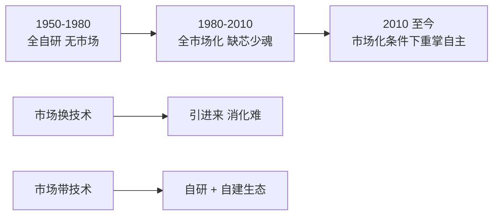

# 第 35 章：中国 CPU 旧事——为什么必须自己做

- **难度**：★★☆ | **学时**：0.6 小时 | **前置**：第 30、31 章

## 学习目标
- 能说出中国做 CPU 的三条理由与市场规模数据
- 能比较"市场换技术"与"市场带技术"两条路线
- 能概括中国计算机事业的三个阶段

## 一句话核心
CPU 是所有信息设备的底座。底座买别人的，利润、安全、话语权就都在别人手里。

## 零基础讲解
### 为什么必须做
CPU 是计算机的大脑和心脏，在新基建里是基础元器件。大到台式机、服务器、云计算、工控、高铁、飞机、卫星，小到智能家居、门锁、水表、电饭锅，都要用它。

中国是最大需求市场：台式机约占全球 20%，服务器约占 30%。2019 年全球台式机出货 2.6 亿台，按均价 215 美元算，桌面 CPU 市场约 545 亿美元；服务器 1200 万台，平均每台 2.5 颗 CPU，按 1500 美元算，约 450 亿美元。

自主率却很低：2019 年前 7 个月进口 CPU 470 亿元，其中直接来自美国的（Intel、AMD、高通等）超过 320 亿元。中国信息化生态主要建在 x86、ARM 上，大部分高额利润被国外厂商赚走。

风险有三层：供应链被卡、后门漏洞难杜绝、核心技术受制于人。所以做自己的 CPU，既是产业升级的需要，也是信息安全的需要。

### 两条路线
"市场换技术"：通过合资把市场让出去，走引进—消化—吸收。现实是"引进"容易，"消化吸收"极漫长——知识产权仍在对方手里，有的企业只是拿到 x86、ARM 授权资料直接造芯片，离"掌握设计能力"很远。

"市场带技术"：自研技术、自建生态，用市场引导带动技术进步。航天是成功先例——水平世界领先，形成了中国特有的产业体系，还能走出去参与全球竞争。

龙芯选的是后者：从每一行源代码开始设计自己的芯片，在应用中不断演进。起点低，但能像爬楼一样持续抬升，最终成为市场接受的产品。

### 三个阶段
第一个 30 年（1950—1980）：完全自主研发。1956 年成立中科院计算所，当时的传统是从"沙子"造计算机——单晶硅、晶体管、CPU、主板、操作系统都能自己造。但没有市场化，只服务特定项目。

第二个 30 年（1980—2010）：完全市场化。联想、曙光、浪潮出货量居世界前列，但两大核心技术 CPU 与操作系统主要建在 x86、ARM 上。

第三个阶段（2010 至今）：在市场化条件下重新掌握自主能力，在开放市场中打破垄断。

代表成果是 1967 年的 109 丙"功勋计算机"：中国第一台具有分时、中断系统的计算机，32 位字长，每秒 10 万次，中国第一个自行设计的管理程序（操作系统的前身）就在它上面建立，服役 16 年。

### 缺芯少魂
中国 PC 从一开始就走兼容路线。最早的自研 8 位微型机是 1977 年 DJS-050，清华、安徽无线电厂、电子部联合设计，兼容 Intel 8080。80 年代主要仿制 Intel、Motorola、6502、Z80 的兼容机，90 年代全面转向 IBM PC 与 DOS/Windows。

大型机同样"与国际接轨"：1993 年的曙光一号达到当时国际先进水平，用 Motorola M88100 与 AT&T UNIX，定点运算每秒 6.4 亿次，主存最大 768MB——但团队曾在美国硅谷"洋插队"11 个月，因为国内处理器、操作系统、高密度生产技术都薄弱。

结果很直接：80、90 年代国家对自主研发 CPU 的支持力度明显下降，主要科研计划都未列入，CPU 设计能力在高校与研究所基本丧失。

操作系统的命运类似：70 年代前只服务硬件；80 年代重点转向汉字显示、中文输入法，离核心技术渐远；90 年代被 Windows、UNIX 垄断，自主的 COSIX 放弃研发，"红旗"等厂商只做 Linux 发行版定制，走到产业链末端，没形成有影响力的产业。

## 图示

看图说明：三个阶段是"能力—市场"的钟摆：先有能力没市场，后有市场没能力，现在要两样都要。下面两条路线是同一个问题的两种解法，区别在于技术主权归谁。

## 类比与实例
- 类比：市场换技术像租别人的厨房做菜，菜能卖，配方学不到；市场带技术像自己打灶台，开始火候差，但配方和灶都是自己的。失效边界：自建体系在起步期产品确实不如人，要靠特定市场养着。
- 实例：2019 年前 7 个月进口 CPU 470 亿元，美国直接来源超 320 亿元。这个数字就是"底座依赖"的价格标签。

## 常见误解
- 别以为"自己做 CPU"是全新想法。1950—1980 年中国人就从沙子造到操作系统，只是没有市场。
- 别以为拿到授权就等于掌握技术。设计资料能造芯片，改不了架构。
- 别以为兼容路线一定错。它在市场化阶段救了产业，但也留下了"缺芯少魂"的账。

## 自测题
1. 2019 年全球服务器 CPU 市场销售额约为？｜450 亿美元｜545 亿美元｜120 亿美元｜答案：A｜解析：1200 万台 × 2.5 颗 × 1500 美元。
2. "市场带技术"的典型成功先例是？｜航天产业｜家电产业｜纺织业｜答案：A｜解析：水平领先且形成了自主产业体系。
3. 中国计算机事业第一个 30 年的特点是？｜完全自主研发但无市场化｜完全市场化｜依赖进口｜答案：A｜解析：从沙子到操作系统都能自造，只服务特定项目。
4. 109 丙"功勋计算机"的意义是？｜中国第一台具分时中断系统的计算机｜第一台 PC｜第一台超算｜答案：A｜解析：32 位、每秒 10 万次，服役 16 年。

## 抽认卡
- 中国台式机与服务器占全球市场比例？｜约 20% 与 30%
- 2019 年前 7 个月 CPU 进口额？｜470 亿元，其中美国来源超 320 亿元
- 两条技术路线？｜市场换技术与市场带技术
- 中国计算机三个阶段？｜全自研、全市场化、市场化下重掌自主
- DJS-050 兼容哪款芯片？｜Intel 8080
- 曙光一号用的是什么处理器？｜Motorola M88100

## 术语
- 市场换技术：以市场开放换取国外技术引进的路线
- 市场带技术：以自研与市场牵引共同推动技术进步的路线
- 缺芯少魂：核心芯片与操作系统均依赖国外的状态
- 109 丙：中国早期自主研制的大型晶体管计算机

## 复习锚点
- 需求最大，自主率最低，这是中国 CPU 的起点
- 引进容易，消化极难，架构主权买不来
- 三个阶段：有能力没市场 → 有市场没能力 → 两者都要
