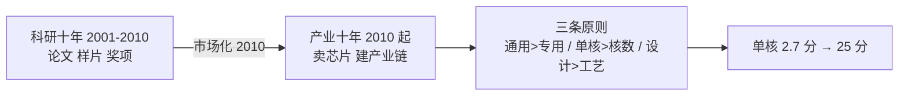

# 第 36 章：龙的声音——龙芯的两个十年与三条原则

- **难度**：★★☆ | **学时**：0.7 小时 | **前置**：第 35 章

## 学习目标
- 能说清龙芯两个十年各自的任务
- 能说出龙芯 1/2/3 号系列的定位差别
- 能复述从学院派转向做产品后的三条设计原则

## 一句话核心
龙芯的第一个十年证明"能做"，第二个十年证明"能用"。转折点是从追单项指标，转向追用户感受。

## 零基础讲解
### 两个十年
做龙芯的初心很朴素："中国这么大一个国家，怎么能没有 CPU？"当时市场主流已是奔三奔四，团队的判断是"哪怕做个 Intel 8086 也得自己试试"。

第一个十年（2001—2010）是科研史。起源于中科院计算所 2001 年成立的微处理器团队，得到 863、973、自然科学基金、核高基支持，完成技术积累，初步掌握高性能 CPU 核心技术。成果形式是论文、著作、原型样片、科研奖项。

第二个十年（2010 起）是产业史。2010 年开始市场化运作，走企业报国路线，把芯片卖给客户。龙芯中科把课题组的研究成果转换成产品，第一款产品芯片是龙芯 2F。

2015 年进入高速发展期：应用案例遍布政企信息化、教育、工控、网络安全，性能逼近国际主流，形成近千家企业的产业链。

龙芯坚持全面自研：每一行电路源代码、整颗芯片的版图都自己设计。

2002 年 8 月 10 日清晨 6 点 08 分，用龙芯 1 号作 CPU 的计算机屏幕上出现"login:"，中国结束了只能用国外 CPU 造计算机的历史。

### 三个系列
1 号：嵌入式、物联网，性能简、功耗低。3 号：台式机、服务器、笔记本，性能强、核数多。2 号：工控、网络设备，性能适中、接口丰富。

3A4000/3B4000 于 2019 年 12 月发布。3A4000 用 GS464v 核，主频 1.8—2.0GHz，单芯片 4 核，内置功耗控制核心，可按负载动态调频调压。3B4000 面向服务器，支持双路四路，一台机器最多 16 核。

2021 年 3A5000 相比 3A4000：SPEC CPU 2006 提升 50% 以上，STREAM 提升 40% 以上，Unixbench 提升 100% 以上。

配套桥片是 7A 系列，集成自研 GPU。

### "世界先进水平"的误会
《麻省理工科技评论》2008、2010、2012 年连发三篇文章，标题大意是"中国 CPU 正在逼近 Intel""很快可以竞争"。

当时龙芯确实在学术会议上发表了成果，但那些"先进"只是**一个指标**——计算性能。2010 年的四核 3A1000 靠多核并行，浮点性能确实接近主流。

但产品要看的是多元指标：单核性能、I/O 能力、软件生态。当时的龙芯只能算科研原型。

书里的自我批评很直白：单一指标做到离国际主流很近，是典型的学院派思维。2010 年因此成为龙芯转向做产品、做市场的新起点。

### 三条设计原则
从学院派转向企业运作后，龙芯确定了做产品的三条顺序：

先通用后专用。通用处理能力是日常高频业务的性能，不只取决于计算，而是计算、访存、I/O 都要好。打开 Office 文档、浏览网页、看视频，CPU 执行只占一小部分。浮点计算只是科学计算的"专用处理"能力，不该拿来当招牌。

先单核后核数。很多任务只能在单核上跑，时间取决于单核性能，核多没用。"人多力量大"不完全适用于 CPU。台式机 4 核基本够用；服务器单核弱，堆再多核也无济于事。

先设计能力后先进工艺。设计能力是用同样多的晶体管在更短时间内完成计算，是硬功夫。2010 年 3A1000 用 65nm 做到 1GHz，而 Intel 用 130nm 就能做到 4GHz；即使把 Intel 的芯片降到 1GHz，龙芯性能也只有它的 1/5。所以"性能补课"主要补设计能力。

### 性能补课的结果
三代产品迭代，单核性能提升 10 倍以上。2012 年被称为"即将和 Intel 竞争"的 3A1000，单核分值其实只有 2.7 分；2019 年 3A4000 到 21.1 分；2021 年 3A5000 超过 25 分。

体验的改善很具体：3A1000 上打开 20MB 的 Office 文档要 33 秒，3A4000 上不到 1 秒。

设计能力的进步也具体：3A4000 与 3A3000 工艺相同，性能翻倍——这是二十年优化经验的成果。

下一步是提工艺、提主频、加核数：3A5000、3C5000 主频超 2.5GHz，单核接近 30 分，单芯片最多 16 核，支持四至十六路服务器。

## 图示

看图说明：从左边到右边，评价标准换了。左侧的"分数"是学术指标，右侧的"分数"是产品指标。中间那三条原则，就是换标准的操作手册。

## 类比与实例
- 类比：学院派像比赛单项的运动员，跳得高就是好；做产品像参加十项全能，还要看耐力、稳定性、配速。失效边界：单项确实能证明潜力，只是不能当交付标准。
- 实例：同样是 65nm，龙芯 1GHz 对 Intel 4GHz。这个对比说明"工艺"能放大设计差距，也能掩盖设计差距，所以书里把设计能力排在工艺之前。

## 常见误解
- 别以为龙芯一开始就想做产品。头十年是科研任务，指标导向。
- 别以为浮点性能高就等于好用。日常办公更多受单核、访存、I/O 影响。
- 别以为工艺先进就能补一切。同工艺下性能翻倍，才是设计能力的体现。

## 自测题
1. 龙芯第一个十年的成果形式主要是？｜论文、著作、原型样片、奖项｜量产芯片销售｜整机品牌｜答案：A｜解析：科研阶段，未市场化。
2. 龙芯 1 号系列的定位是？｜嵌入式、物联网，低功耗｜服务器多核｜台式机高性能｜答案：A｜解析：三系列中最小的一档。
3. 龙芯三条原则的第一条是？｜先提高通用处理能力，再提高专用处理能力｜先多核再单核｜先工艺再设计｜答案：A｜解析：日常体验由通用能力决定。
4. 3A1000 与 3A4000 的单核分值大致是？｜2.7 分与 21.1 分｜10 分与 20 分｜2.7 分与 10 分｜答案：A｜解析：十年提升 10 倍以上。

## 抽认卡
- 龙芯起源年份与单位？｜2001 年，中科院计算所微处理器团队
- 龙芯第一款产品芯片？｜龙芯 2F
- 三个系列的定位？｜1 号嵌入式、2 号工控、3 号桌面服务器
- 3A4000 的主频与核数？｜1.8—2.0GHz，4 核
- 3A5000 的 SPEC 提升幅度？｜50% 以上
- "性能补课"主要补什么？｜设计能力

## 术语
- GS464v：龙芯 3A4000 采用的新一代处理器核代号
- 桥片：配合 CPU 提供 I/O 与图形等功能的配套芯片
- 性能补课：把单核与通用处理能力补到国际主流水平
- 学院派思维：以单一学术指标衡量产品的思路

## 复习锚点
- 前十年证明能做，后十年证明能用
- 三原则：通用优先、单核优先、设计优先
- 单核 2.7 → 25 分，是补课的成绩单
