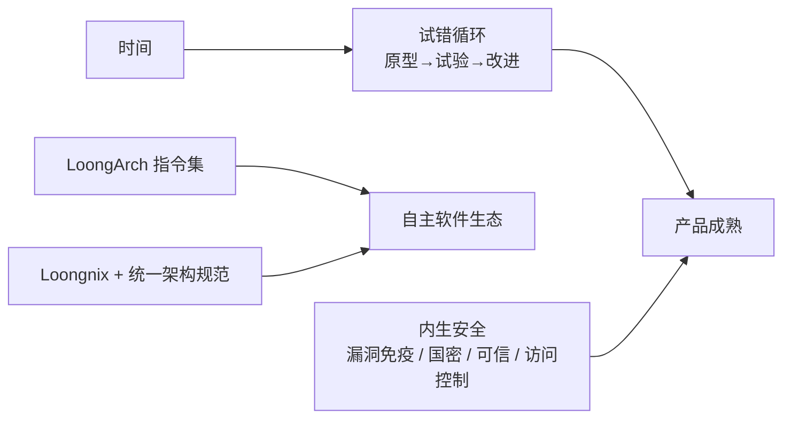

# 第 37 章：龙之生态——试错、LoongArch 与内生安全

- **难度**：★★★ | **学时**：0.7 小时 | **前置**：第 32、36 章

## 学习目标
- 能用高复杂系统的两个难点解释"试错不可绕过"
- 能说明 LoongArch 为什么是自主生态的根基
- 能列出龙芯内生安全的四类机制

## 一句话核心
核心技术难在细节不在原理，所以只能靠时间试错。指令集是生态的户口本，没有它就只能当租客。

## 零基础讲解
### 试错：时间是第四个变量
核心技术有个共同点：都是高复杂系统。我国的清单上有高端发动机、精密仪器、脑科学，还有 CPU。

难点一：影响品质的因素太多，没法用"分而治之"切开，子系统之间牵一发动全身。一个函数若有一万个变量，描述它的公式就极其庞大；人脑即便看清每个神经元，也说不清它们的组织方式。

难点二：必须靠大量实验来完善。产品质量不是设计出来的，是"做原型—试验—找不足—改进—再试验"循环出来的。发动机原理初中就讲过，造一台能用一年的很容易，造 100 万台跑一年都不出问题，就难了。

所以核心技术的难点不在科学原理，在功能细节。创新函数以前看三个变量：资金、人才、体制机制；现在要加第四个——时间。三流产品有钱就能做，二流要有钱有人才，一流还要有体制加长期积累。

### LoongArch：从必然王国到自由王国
指令集是软硬件界面，规定 CPU 执行指令的二进制编码。一种指令集承载一个生态：x86+Windows 是 Wintel，ARM+Android 是 AA。国外厂商把指令集当控制生态的手段，要授权才能做兼容 CPU。

书里那个比喻很到位：中国人可以用英文写小说，但不可能基于英文形成中华民族文化。用授权指令系统能做出产品，做不出自主产业生态。

2021 年 4 月 15 日，LoongArch 对外发布。从顶层规划到各指令部分的功能定义，再到每条指令每个寄存器的编码、名称、含义，全部自行设计。

结构上包括基础部分（Loongson Base）、虚拟化（LVZ），以及二进制翻译（LBT）、向量（LSX）、高级向量（LASX）三个扩展。它的设计思路是：丢掉传统指令集里不适应发展的陈旧内容，吸纳近年指令系统设计的先进成果；硬件上更易做高性能低功耗，软件上更易编译优化、开发操作系统与虚拟机。

兼容怎么解决？靠团队十余年的二进制翻译积累：能把现有龙芯应用无损自动翻译到 LoongArch，也支持对 x86、ARM 等多种主流指令集的高效二进制翻译。

2020 年起新研 CPU 均支持 LoongArch，3A5000 是首款。

### Loongnix 与统一架构
成功的 CPU 企业都同时做操作系统。龙芯维护社区版 Loongnix：把大量开源软件在龙芯上移植优化，做成安装光盘，可装在全部龙芯台式机、服务器、笔记本、网络设备、云平台上；代码与镜像在社区公开下载，整机厂也可拿全部源码裁剪定制。

更关键的是统一架构。龙芯联合固件、主板、操作系统厂商制定《龙芯 CPU 统一系统架构规范》，规定主板与操作系统之间所有接口的设计标准。所有整机厂都要遵守并通过龙芯认证，操作系统就可以装在所有认证过的机器上，将来换 CPU 也不影响系统。

软件优化也做到了实处：内核、编译器、API、图形库、媒体库针对龙芯特点优化，性能常比社区原始代码提升 10 倍以上；与应用厂商联合优化后，WPS 在龙芯上比在 x86 上更快。

### 内生安全
只有自己做的芯片才能保证没有后门漏洞。传统做法是在 CPU 外面加安全模块，龙芯 3A4000/3B4000 直接把安全控制机制设计在处理器核内，这叫"内生安全"。

四类机制：漏洞防范——对 Meltdown、Spectre 这类影响 x86、ARM 的漏洞，从机理上分析并设计规避，3A4000 及后续型号已免疫；硬件加解密——支持 SM2、SM3、SM4 国密算法，以前靠软件执行的运算改为电路执行，性能提升几十倍且不怕被篡改；可信计算——芯片内专用安全可信模块，监督每个核的计算任务；访问控制——内核栈溢出防护，对系统调用、进程、I/O 做监督。

有个真实案例：2018 年 4 月某市政务热线中心 15 台 Windows 机器中勒索病毒全部崩溃，同处一室的 3 台龙芯机器不受影响，撑住了系统运转。

### 趋于成熟的四个标志
功能丰富：办公所需功能齐备，WPS、浏览器、Java 虚拟机、中间件、数据库、云平台、大数据、AI 方案都有，打印机、扫描仪、身份证读卡器等外设已适配。

架构稳定：统一架构规范让操作系统对不同主板、升级后的 CPU 都保持二进制兼容，像 Windows XP 能用十几年那样，升级不用换系统。

性能优化：3A4000 打开复杂文档、业务网站、高清视频、3D 应用已无延迟，与软件厂商联合优化后整体性能甚至优于 x86。

问题收敛：用户遇到的问题越来越少，且多是使用习惯或应用软件本身的问题，不再需要 CPU 与操作系统背锅。

书里有一句结论：龙芯计算机已能在日常办公中替代"Intel+Windows"，本书就是基于龙芯 3A5000 写的。

## 图示

看图说明：上半条讲"怎么变强"，下半条讲"凭什么独立"。试错解决能力问题，指令集解决主权问题，两者都不是一次性能解决的。

## 类比与实例
- 类比：指令集像语言的字母表。借别人的字母能写出文章，但字典、教材、考试标准都在别人手上；自建字母表，一开始书少，但标准归自己。失效边界：字母表免费也没用，得有足够多的人愿意用它写字。
- 实例：3A4000 与 3A3000 同工艺，性能翻倍。这就是"设计能力"这条原则的实证。

## 常见误解
- 别以为试错就是"多试几次"。它是有方向的迭代，靠反馈收敛，不是乱撞。
- 别以为二进制翻译是临时方案。它同时承担兼容老应用和兼容 x86、ARM 应用两类任务。
- 别以为内生安全是营销词。漏洞免疫、国密硬件、可信模块、访问控制都能对应到具体机制。

## 自测题
1. 高复杂系统的第一个难点是？｜因素太多、子系统牵一发动全身，无法简单分治｜原理太难｜缺少资金｜答案：A｜解析：这是复杂系统区别于普通工程的标志。
2. LoongArch 发布的年份是？｜2021 年｜2019 年｜2010 年｜答案：A｜解析：2021 年 4 月 15 日对外发布。
3. LoongArch 的向量扩展包括？｜LSX 与 LASX｜LVZ 与 LBT｜Base 与 API｜答案：A｜解析：LVZ 是虚拟化，LBT 是二进制翻译。
4. 龙芯对 Meltdown、Spectre 的处理是？｜从机理上设计规避，实现免疫｜靠打补丁｜不管｜答案：A｜解析：自研芯片可从根本上消除。

## 抽认卡
- 创新函数的第四个变量？｜时间
- LoongArch 的五个组成部分？｜Base、LVZ、LBT、LSX、LASX
- Loongnix 是什么？｜龙芯维护的社区版 Linux 发行版
- 统一架构规范约束什么？｜主板与操作系统之间的所有接口
- 内生安全四类机制？｜漏洞防范、国密硬件、可信计算、访问控制
- 勒索病毒案例的结果？｜15 台 Windows 崩溃，3 台龙芯正常

## 术语
- 高复杂系统：因素众多、子系统强耦合、难以分治的系统
- LoongArch：龙芯自主设计的指令集架构
- LVZ / LBT / LSX / LASX：虚拟化、二进制翻译、向量、高级向量扩展
- Loongnix：龙芯社区版操作系统发行版
- 内生安全：把安全机制做进处理器核内部
- 二进制翻译：把一种指令集的程序转成另一种指令集执行

## 复习锚点
- 难在细节不在原理，时间是第四个变量
- 指令集是生态户口本，借不来主权
- 安全做进核里，才叫内生
