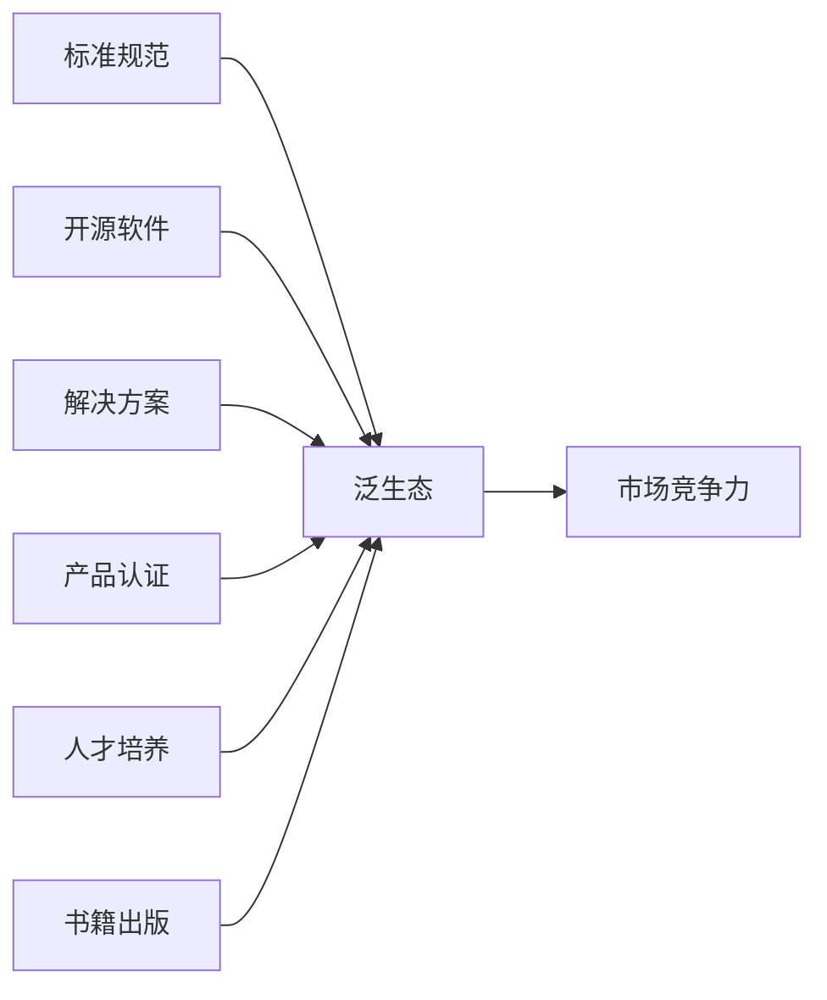

# 第 38 章：未来已来——泛生态六支柱与多条路线

- **难度**：★★☆ | **学时**：0.5 小时 | **前置**：第 34、37 章

## 学习目标
- 能列出龙芯泛生态的六个支柱
- 能说出"从零开始造计算机"的教育思路
- 能比较中国 CPU 企业的两条路线与代表产品

## 一句话核心
把技术链打通只是第一步，真正的门槛是把生态链打通——标准、软件、方案、认证、人才、书籍，六根柱子缺一根都会漏风。

## 零基础讲解
### 六根支柱
到 2020 年，龙芯生态形成了六方面支撑。

标准规范：两个结合部各一套——硬件与操作系统之间是《龙芯 CPU 统一系统架构规范》；操作系统与应用软件之间正在联合厂商制定《龙芯 API 兼容规范》，目标是让龙芯上各种操作系统提供统一 API，消掉 Linux 碎片化的影响。

开源软件：在 Linux 内核、gcc 编译器、Java 虚拟机、浏览器上都是社区维护者，每项提交数万行代码。Java 虚拟机的代码提交量居世界第四，仅次于 Oracle、Red Hat、SAP。

解决方案：打造"从端到云"的全链条，各地建适配中心，提供机器给应用厂适配。2019 年建"云中心"做远程适配，2020 年建全国一体化的"生态适配服务产业联盟"，规范兼容性测试认证，带动上下游协同攻关。

产品认证：发布《龙芯平台兼容适配认证流程规范》，通过测试的发证，证书由龙芯与厂商共同盖章，作为向用户推荐的依据。

人才培养：建立生态培训、学校教育、考核认证体系。2019 年组专职讲师团队，面向开发者推"应用迁移"培训理念，面向用户讲使用方法。2020 年提"龙芯万里行"，全国巡回培训。

书籍出版：2018 年与人民邮电出版社推出"中国自主产权芯片技术与应用丛书"，已出 CPU 原理、操作系统、应用开发、使用教程等。面向用户的教程讲到每个菜单、对话框、界面，帮人从 Windows 习惯迁移过来。

书里的判断：龙芯正从"打通技术链"跃升到"打通生态链"。

### 从零开始造计算机
中国信息技术教育长期缺 CPU 核心原理教学。学生学的主要是 x86、ARM 架构，只能掌握基本概念、看不到内部实现，多数计算机专业毕业生说不清 CPU 怎么跑。

龙芯与学校共建自主创新教育联盟推动课程改革，推出"龙芯 CPU 高校开源计划"，把 GS132 和 GS232 两款 CPU 核向高校与学术界开源，学生对照源码学原理，从学"用"计算机转为学"造"计算机。已有超过百所高校开课。

中小学层面，很多学校建了龙芯电子教室，学龙芯操作而非做"微软培训班"，甚至有小学生用它学开发游戏。

### 其他中国 CPU 企业
申威：自研微架构，2003 年起研制。2015 年申威 26010 面向科学计算，1.5GHz，浮点峰值 3.168×10¹² 次/秒，用于"神威·太湖之光"，2016 年登顶世界最快超算。

更多企业走引进授权路线：海思做 ARM 兼容的"麒麟"手机芯片与"鲲鹏"桌面/服务器芯片；飞腾做 ARM 兼容处理器；AMD 等授权国内企业做 x86 兼容；IBM 授权做 Power。

趋势判断：自研微结构、走"市场带技术"的龙芯快速发展，性能与生态逐渐超越引进授权的 x86、ARM 路线。

### 没有弯道超车
书里的结论很硬：这件事没有捷径，也不要幻想"弯道超车"——有些表面上的直道其实是更弯的弯道，只能直道追赶。不断试错是复杂系统的必要过程，好的体制机制和更多经费可以加速迭代，但不能取代迭代。

有个"30 年为周期"的规律：运十 1986 年终止，C919 首飞已是 2017 年。

下一步三件事：坚持正确生态路线（市场带技术，用专用市场养技术，再参与商业竞争）；进入性能新阶段（3A5000/3C5000 满足开放市场要求，胜任云平台、大数据、高并发网站）；做好"应用迁移"长期攻坚（30 年积累的应用系统要迁到龙芯，工作量巨大，应用厂商开始成为建生态的最重要角色）。

## 图示

看图说明：六根柱子各自独立，靠"接口标准"串起来。缺标准则散，缺人才则空，缺书籍则知识传不下去——这也是为什么它被单列一支。

## 类比与实例
- 类比：技术链像造好一条生产线，生态链像把原料、销路、质检、工人、说明书全都配齐。只有生产线，产品出不了厂。失效边界：生产线可以买，生态的每一环都得自己攒时间。
- 实例：Java 虚拟机代码提交量全球第四，仅次于 Oracle、Red Hat、SAP。这个排名是"参与国际社区"最硬的凭证。

## 常见误解
- 别以为生态就是"软件多"。标准、认证、人才、书籍同样算支柱。
- 别以为开源就是免费拿。要成为维护者，得持续提交代码。
- 别以为引进授权和自研只是路线偏好。前者拿不到架构主权，后者要背时间成本。

## 自测题
1. 龙芯 API 兼容规范要解决什么问题？｜Linux 生态碎片化导致接口不统一｜硬件散热｜封装成本｜答案：A｜解析：让各操作系统提供统一 API。
2. 神威·太湖之光用的是哪款处理器？｜申威 26010｜龙芯 3A5000｜鲲鹏｜答案：A｜解析：2016 年登顶世界最快超算。
3. 龙芯高校开源计划开放的两款核是？｜GS132 与 GS232｜GS464v 与 3A4000｜A72 与 A53｜答案：A｜解析：面向高校与学术界开源。
4. 关于"弯道超车"，书中的观点是？｜没有捷径，只能直道追赶｜可以靠工艺超车｜可以靠授权超车｜答案：A｜解析：表面的直道常是更弯的弯道。

## 抽认卡
- 泛生态六支柱？｜标准规范、开源软件、解决方案、产品认证、人才培养、书籍出版
- 龙芯 Java 虚拟机提交量排名？｜世界第四
- 申威 26010 的浮点峰值？｜3.168×10¹² 次/秒
- 海思的两条产品线？｜麒麟（手机）与鲲鹏（桌面/服务器）
- 运十终止与 C919 首飞的年份？｜1986 与 2017
- 龙芯下一步三件事？｜坚持路线、进入性能新阶段、应用迁移攻坚

## 术语
- 泛生态：技术之外的标准、社区、认证、人才、出版等支撑体系
- 应用迁移：把既有应用系统适配到新平台的工作
- GS132 / GS232：向高校开源的龙芯 CPU 核
- 生态适配服务产业联盟：统一兼容性测试与认证的产业组织

## 复习锚点
- 六支柱：标准、开源、方案、认证、人才、书籍
- 从学"用"计算机到学"造"计算机
- 没有弯道超车，只有直道追赶与时间积累
