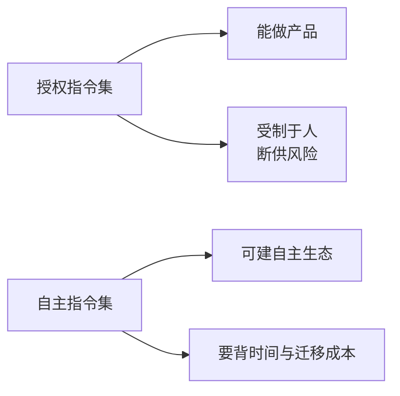

# 自主指令集

- **难度**：进阶 | **涉及章节**：第 4、37、38 章

## 一句话定义
自主指令集是自己定义编码与语义、不依赖他人授权的指令集，典型例子是龙芯的 LoongArch。

## 为什么重要
用别人的指令集可以做产品，但做不出自主产业生态。授权一旦收紧，产品线就断——日本 1986 年被断供 32 位授权，就是最直接的教训。

## 图示

看图说明：两条路的差别不在"能不能造出芯片"，而在"能不能长期定标准"。看这张图要同时看收益和代价。

## 详解
自主指令集要解决三件事：自己定义（编码、寄存器、语义）、自己能实现（微结构配套）、别人愿意用（生态从零起步）。

LoongArch 的做法有代表性：2021 年发布，含基础部分、虚拟化扩展、二进制翻译扩展、向量与高级向量扩展；设计上丢掉陈旧内容、吸纳先进成果；兼容靠十余年的二进制翻译积累，能把旧应用无损迁到新架构，也能翻译 x86、ARM。

代价也很实：30 年积累的应用系统要迁移，工作量和时间都是巨大的。这不是"换个指令集"那么简单，是整条产业链重做一遍。

## 常见误解
- 别以为自主等于闭门造车。LoongArch 兼容国际主流功能，也参与国际开源社区。
- 别以为自主指令集能速成。指令集本身几个月能写出来，生态要十年计。

## 在书中出现的脉络
| 章节 | 语境 | 关键结论 |
|---|---|---|
| 第 4 章 | ISA 是生态边界 | 兼容机只在同一 ISA 内成立 |
| 第 37 章 | LoongArch、Loongnix、内生安全 | 从必然王国到自由王国 |
| 第 38 章 | 六支柱、应用迁移 | 生态链比技术链更难打通 |

## 相关概念
- 前置：[指令集](isa.md)、[软件生态](ecology.md)
