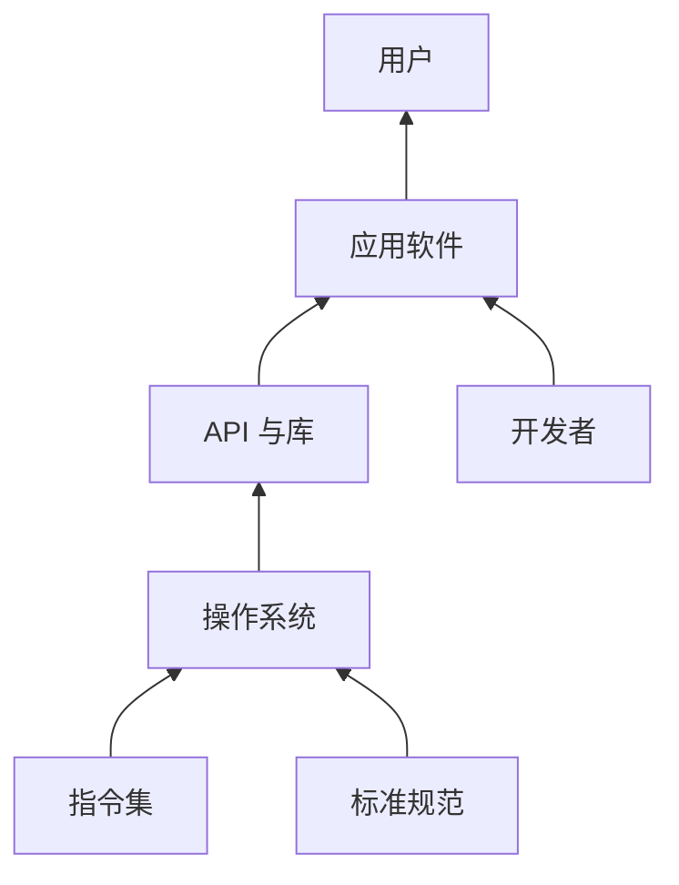

# 软件生态

- **难度**：进阶 | **涉及章节**：第 32—34 章

## 一句话定义
软件生态是某一颗 CPU 能运行的全部软件的集合，以及围绕这些软件形成的开发者、厂商、社区与标准。

## 为什么重要
书里最硬的一句判断是：CPU 本身没有使用价值，它的价值由其上承载的生态决定。做 CPU 是技术活，做生态是群体工程，后者门槛更高、周期更长。

## 图示

看图说明：生态是自底向上长出来的，不是拼出来的。开发者与标准是两条横向的支撑线，缺一条结构就歪。

## 详解
生态有三条原则：开放（企业多、可平等参与，壮大力量）、兼容（产品能互相配合，积累成果）、优化（联合打磨体验）。

对照三个范例：Windows-Intel 是兼容至上，40 年前的软件还能跑；Android-ARM 是开放，占全球智能机 87%；苹果是优化，对每个像素死磕。

反面是 Linux：开放做得最好，兼容与优化乏力，发行版几百种、打包格式各行其是、内核升级常不向下兼容，结果桌面份额长期只有百分之一左右。

生态的商业模式分三档：一流做标准（知识产权，如高通专利费占净利一半以上）、二流做品牌（生态，如 Intel 的 x86 份额）、三流做产品（制造，拼成本）。

## 常见误解
- 别以为生态等于软件数量。标准、认证、人才、书籍同样是支柱。
- 别以为开源自动带来生态。缺兼容与优化，开源也会碎片化。

## 在书中出现的脉络
| 章节 | 语境 | 关键结论 |
|---|---|---|
| 第 32 章 | Inside/Outside、三种接口 | CPU 是土壤，生态是森林 |
| 第 33 章 | 开发者、发行版、虚拟机、解决方案 | 谁控制方案谁分利润 |
| 第 34 章 | 开放兼容优化、Linux 反面、三档营利 | 碎片化难治 |

## 相关概念
- 前置：[系统调用](system-call.md)
- 后续：[自主指令集](autonomous-isa.md)
