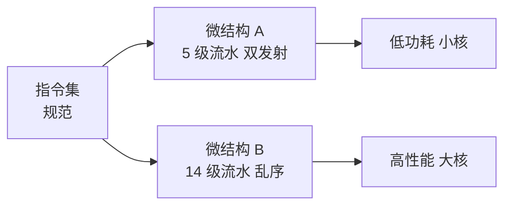

# 微结构

- **难度**：进阶 | **涉及章节**：第 6、15、16 章

## 一句话定义
微结构是一颗 CPU 的电路设计方案，也就是某套指令集在硅片上的具体实现。

## 为什么重要
同一个指令集可以有很多种微结构：有的快而费电，有的慢而省电。**性能差异主要来自微结构，不来自指令集**。理解这一层，才能看懂"同工艺性能翻倍"这类事实。

## 图示

看图说明：左边一份规范，右边两种实现。看这张图要抓住"一对多"——规范唯一，方案可以很多。

## 详解
微结构要决定：流水线分几级、每拍发射几条指令、是否乱序、缓存几级多大、分支预测多复杂、有几个执行单元。

这些选择彼此牵制。级数多能提主频，但分支预测失败的代价变大；发射宽能提并行度，但取指、译码、寄存器端口都要跟上，否则只是加面积不提性能。

同一套微结构还能衍生出多个型号：改缓存与频率、裁掉模块、多核组合、换工艺分档。这就是产品线的做法。

## 常见误解
- 别以为买了 IP 核就等于会做 CPU。集成与自研是两件事，核心设计不在自己手里。
- 别以为微结构越复杂越好。复杂度要能被软件用上，否则只是功耗和面积。

## 在书中出现的脉络
| 章节 | 语境 | 关键结论 |
|---|---|---|
| 第 6 章 | 微结构衍生四法、IP 核 | 设计能力体现在微结构 |
| 第 15 章 | 流水线级数与主频 | 级数有代价，Pentium 4 是教训 |
| 第 16 章 | 乱序、多发射、ROB | 用窗口换并行度 |

## 相关概念
- 前置：[指令集](isa.md)
- 后续：[流水线](pipeline.md)
