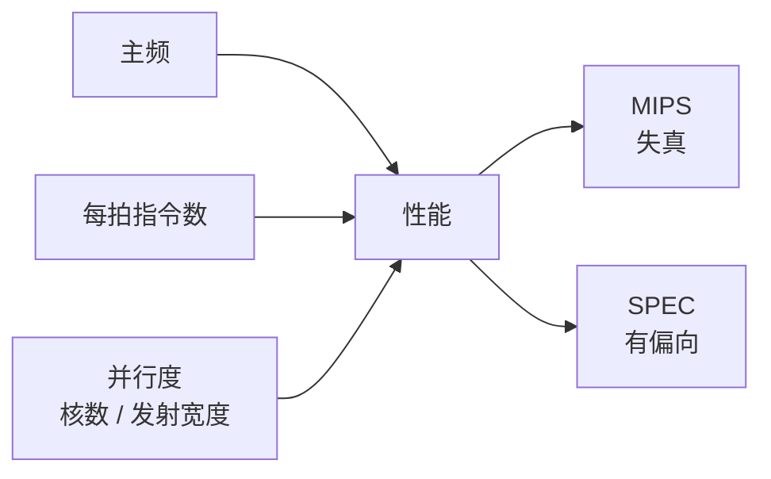

# 性能度量

- **难度**：基础 | **涉及章节**：第 2、36 章

## 一句话定义
性能是"多快干完活"，但怎么量取决于你量的是什么活，没有单一数字能概括。

## 为什么重要
选 CPU、评 CPU、卖 CPU 都绕不开它。而每个指标都有它测不到的地方，误用一个指标就会得出错误结论——书里拿 MIPS、SPEC、单核分值反复举过例子。

## 图示

看图说明：性能由三块相乘，任何一块单独拉高都可能被另一块拖住。下面两个是常用指标，各自都有盲区。

## 详解
常用关系：性能 ≈ 主频 × 每拍执行指令数 × 并行度。主频靠工艺与流水线，每拍指令数靠微结构，并行度靠多核与多发射。

MIPS（每秒百万条指令）看着直观，但不同指令集的指令"含金量"不同，一条复杂指令可能等于别人几条，所以跨架构比 MIPS 没有意义；同架构内也可能被指令组合刷高。

SPEC 用一组真实程序跑分，比 MIPS 靠谱，但仍有偏向：不同编译器、不同内存配置、不同优化选项都会影响结果。厂商选对自己有利的子项报分，是常规操作。

单核性能与多核性能也不是一回事。很多任务只能在单核跑，核数再多也帮不上；这就是"先单核后核数"的由来。

## 常见误解
- 别以为主频就是性能。同主频下 IPC 可以差几倍。
- 别以为跑分高就一定好用。日常办公受单核、访存、I/O 共同影响。

## 在书中出现的脉络
| 章节 | 语境 | 关键结论 |
|---|---|---|
| 第 2 章 | 主频 × 每拍 × 并行度、MIPS 失效、SPEC 软肋 | 指标都有盲区 |
| 第 36 章 | 单核 2.7 → 25 分 | 补课补的是单核与设计能力 |

## 相关概念
- 前置：[流水线](pipeline.md)
- 后续：[自主指令集](autonomous-isa.md)
