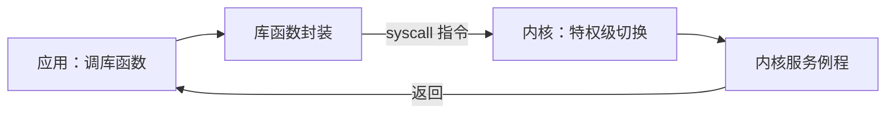

# 系统调用

- **难度**：基础 | **涉及章节**：第 18、19 章

## 一句话定义
系统调用是应用程序请求操作系统帮忙做事的正式入口，也是 CPU 从"用户态"切到"内核态"的那道门。

## 为什么重要
它是应用与操作系统之间的第二条接口（第一条是指令集）。没有它，应用没法读写文件、发网络包、申请内存——这些事都必须由操作系统代做。

## 图示

看图说明：应用看到的常常是库函数，库函数里面才发系统调用。看这张图要区分"库函数"和"系统调用"不是一回事。

## 详解
CPU 有特权级。用户态不能直接碰硬件、不能改页表、不能关中断；要做这些，只能通过系统调用这条受控通道。

过程大致是：应用把调用号放进寄存器，执行一条特殊指令（如 syscall），CPU 切到内核态、跳到固定的入口，内核按号分发到对应服务例程，做完再返回用户态。

系统调用的集合构成操作系统的"API 底座"。Linux 的系统调用是 Linux 内核 API，换了操作系统，这套接口就换一套——所以同一个程序在不同系统上要重新编译或做兼容层。

## 常见误解
- 别以为 printf 就是系统调用。它是库函数，内部可能调用 write。
- 别以为系统调用越少越好。它有一次切换开销，但安全边界必须靠它。

## 在书中出现的脉络
| 章节 | 语境 | 关键结论 |
|---|---|---|
| 第 18 章 | 特权级、中断与例外 | 特权级是系统调用的前提 |
| 第 19 章 | 应用 = 指令 + 库函数 + 系统调用 | 三者分工明确 |
| 第 32 章 | 三种接口 | ISA、System Call、API |

## 相关概念
- 前置：[缓存](cache.md)
- 后续：[软件生态](ecology.md)
